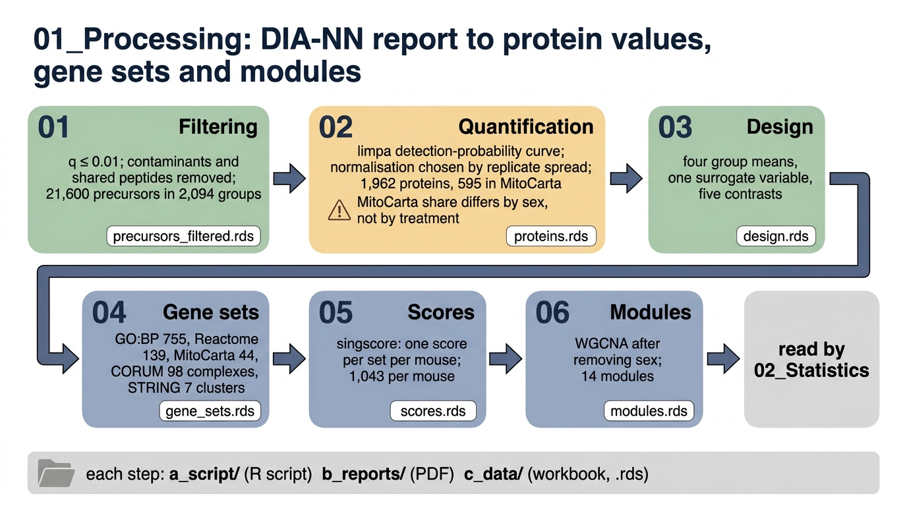

# 01_Processing

Turns the DIA-NN report into protein values per mouse, and builds every protein grouping later steps test. Nothing here compares groups.

| Step | Does | Method |
|---|---|---|
| [`01_Filtering`](01_Filtering/README.md) | keeps trustworthy precursors | limpa `readDIANN`, q ≤ 0.01, contaminant and shared-peptide filters |
| [`02_Quantification`](02_Quantification/README.md) | protein abundance per mouse | limpa `dpcQuant`, MitoCarta, quantile normalisation per universe |
| [`03_Design`](03_Design/README.md) | fixes the model and contrasts | four group means, one sva surrogate variable, five contrasts |
| [`04_Gene_Sets`](04_Gene_Sets/README.md) | the protein groups to test | GO:BP, Reactome, MitoCarta, compartments, CORUM, STRING; membership table |
| [`05_Scores`](05_Scores/README.md) | set activity per mouse | singscore |
| [`06_Modules`](06_Modules/README.md) | co-abundance modules | WGCNA after removing sex |

Steps run in number order. Each holds `a_script/` (one script), `b_reports/` (one preview PDF from package plots, where there is something to draw), `c_data/` (one workbook plus the `.rds` later steps read) and a README naming what it reads and writes.
