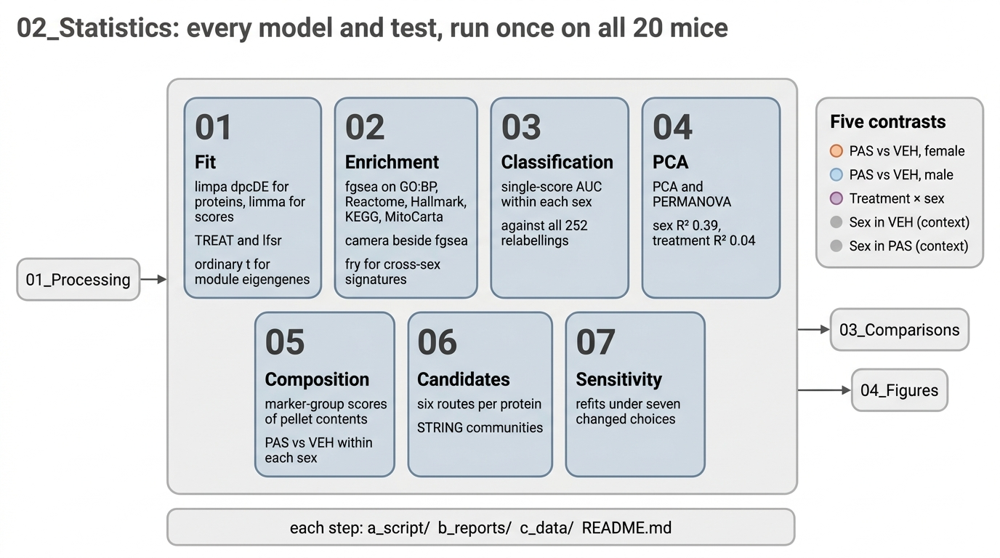

# 02_Statistics

Every model and test, run once on all 20 mice (the sensitivity step refits under other choices on purpose). The three comparisons read these results; nothing here is computed again downstream.

| Step | Asks | Method |
|---|---|---|
| [`01_Fit`](01_Fit/README.md) | contrasts, phenotype effects and phenotype associations | limpa `dpcDE`, limma |
| [`02_Enrichment`](02_Enrichment/README.md) | which pathways shift, per contrast and per phenotype | fgsea (enrichVolcano), redundancy flags, cross-sex signatures, STRING |
| [`03_Classification`](03_Classification/README.md) | does one score separate PAS from vehicle | pROC AUC, exact Wilcoxon, 252-relabelling null |
| [`04_PCA`](04_PCA/README.md) | what shapes the whole proteome and the phenotypes | PCA, PERMANOVA |
| [`05_Composition`](05_Composition/README.md) | what else went into each pellet, and whether PAS changed it | marker scores, haemoglobin share, MitoCarta share; Welch t within sex |
| [`06_Candidates`](06_Candidates/README.md) | which proteins to follow up, by six independent routes | p, every-mouse AUC, both sexes, phenotype, module hub, leading edge; STRING v12 communities |
| [`07_Sensitivity`](07_Sensitivity/README.md) | how much the protein results depend on choices made once | refits under other detection slopes, adjustments, weights, without one run, with pellet share |

Steps run in number order after `01_Processing`. Each holds `a_script/`, `b_reports/`, `c_data/` and a README naming what it reads and writes.
