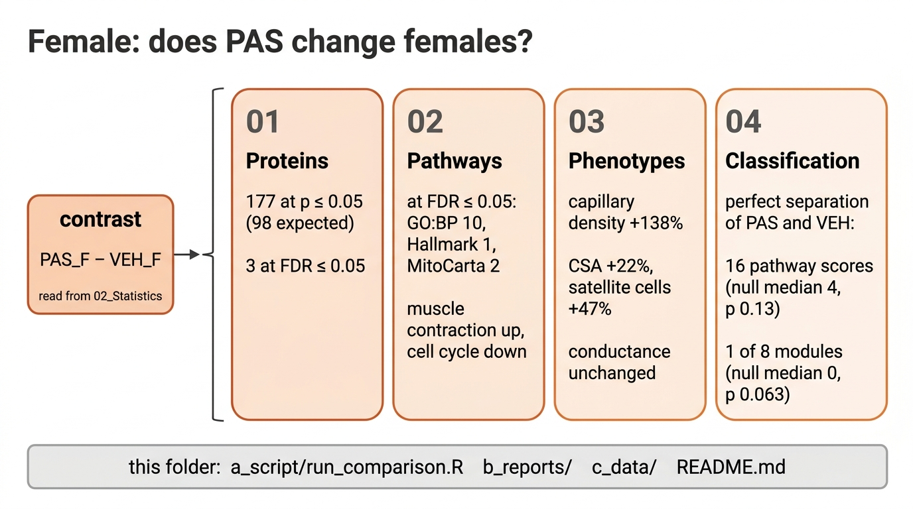

# Female

Contrast: `PAS_vs_VEH_female`, PAS_F − VEH_F. Run with `Rscript 03_Comparisons/Female/a_script/run_comparison.R`.

## Proteins

- Full proteome: 177 at p ≤ 0.05, 107 at Π ≤ 0.05, 3 at FDR ≤ 0.05 (Cops3, Cops8, Dusp3, all down).
- Mitochondrial universe: 42, 17 and 0.
- One of the 107 Π ≤ 0.05 proteins, Ubxn6, was never detected in a PAS female, so its PAS-female value is limpa's estimate; `detected_PAS_F` filters it.
- Both Π lists have more STRING edges than chance: up 26 edges among 44 proteins (2.6 times expected), down 60 among 63 (2.4 times).

## Pathways

- GO:BP 95 sets at p ≤ 0.05 and 10 at FDR ≤ 0.05. Muscle contraction, organismal movement and small-molecule catabolism rise; cell cycle, mitotic cell cycle and proteasome-mediated catabolism fall. Only the three falling sets have singscore p ≤ 0.05.
- Hallmark 2 and 1 (myogenesis up); Reactome 24 and 0; KEGG 6 and 0.
- MitoCarta 11 and 2 (metabolism and carbohydrate metabolism up), neither supported by singscore (p 0.20 and 0.69).

## Phenotypes

- PAS raises capillary density +138% (p 0.005), CSA +22% (p 0.002) and satellite cells per fibre +47% (p 0.009). The three respiratory conductances do not change (p ≥ 0.30).
- Protein associations at p ≤ 0.05, pooled and within treatment: 764 and 779 of 11,772 tests; 5 and 2 at FDR ≤ 0.05.

## Classification

- 47 of 1,005 pathway scores at p ≤ 0.05. 16 separate PAS from vehicle perfectly, against a median of 4 over the 252 relabellings (p 0.13).
- One of 8 modules separates perfectly (null median 0, p 0.063); one of 98 complexes does (p 0.35).
- Nothing reaches FDR ≤ 0.05.
