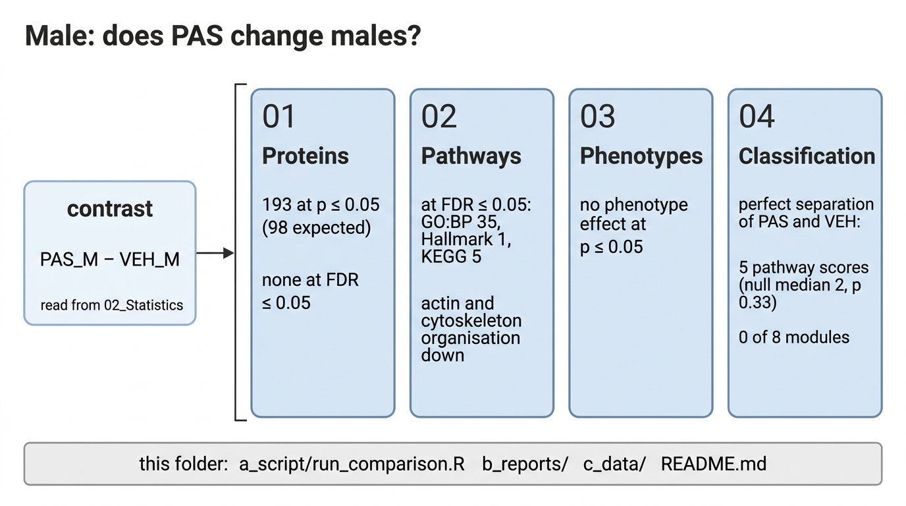

# Male

Does PAS change the proteome and the phenotypes of males? Every number here comes from the `PAS_vs_VEH_male` contrast (PAS_M − VEH_M) of the shared fit. Run with `Rscript 03_Comparisons/Male/a_script/run_comparison.R`; the methods are in [`03_Comparisons`](../README.md).

| Step | Result | Files |
|---|---|---|
| 01 Proteins | Full proteome: 193 proteins at p ≤ 0.05, 106 at Π ≤ 0.05, none at FDR ≤ 0.05. Mitochondrial universe: 37, 9, 0. Both Π lists are more connected in STRING than chance (up: 27 proteins, 5 edges, 5.0 times expected; down: 79 proteins, 203 edges, 3.9 times). | `01_proteins` |
| 02 Pathways | GO:BP 161 at p ≤ 0.05, 35 at FDR ≤ 0.05, 34 of them down: actin filament organisation and its regulation, cytoskeleton and supramolecular fibre organisation, cell and cell-matrix adhesion, plasma membrane organisation. 17 of the 35 have a singscore contrast at p ≤ 0.05, so the mouse-level test supports about half. Reactome 16 and 0; Hallmark 6 and 1 (epithelial-mesenchymal transition down); KEGG 7 and 5, all down (ECM-receptor interaction, cardiac muscle contraction and three cardiomyopathy or myocarditis sets); MitoCarta 6 and 0. | `02_pathways` |
| 03 Phenotypes | Phenotype effects: none at p ≤ 0.05; the closest is satellite cells per fibre, +43% (p 0.086). Phenotype associations at p ≤ 0.05, pooled and within treatment: proteins 756 and 706 of 11,772 tests, 9 and 3 at FDR ≤ 0.05; full-proteome pathway scores 152 and 90 of 5,766; complexes 19 and 16 of 588; modules 2 and 2 of 48; clusters 1 and 0 of 42. With no phenotype effect, these associations follow variation between mice, not a PAS response. | `03_phenotypes` |
| 04 Classification | Pathway scores: 28 of 1,005 at p ≤ 0.05. 5 separate PAS from vehicle perfectly, against a median of 2 over all 252 relabellings (p 0.33). Modules 1 of 8 at p ≤ 0.05, none perfect; complexes 3 of 98, clusters 0 of 7. No level has more perfect separators than the relabelling null at p ≤ 0.05, and none reaches FDR ≤ 0.05. | `04_classification` |

Each step's workbook is `c_data/<step>.xlsx` and its preview `b_reports/<step>.pdf`.
