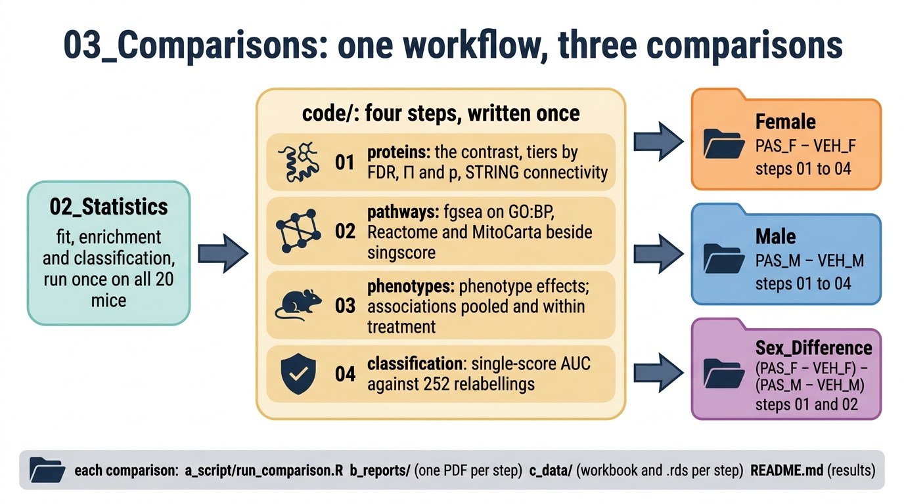

# 03_Comparisons

The three questions, answered from results `02_Statistics` computed once on all 20 mice. Each step is written once in `code/`; each comparison folder holds a runner that calls those steps for its contrast, the reports and the results. No comparison reads another, and nothing here refits a model.



## Comparisons

| Folder | Question | Contrast | Steps run |
|---|---|---|---|
| [`Female`](Female/README.md) | does PAS change females? | PAS_F − VEH_F (`PAS_vs_VEH_female`) | 01 to 04 |
| [`Male`](Male/README.md) | does PAS change males? | PAS_M − VEH_M (`PAS_vs_VEH_male`) | 01 to 04 |
| [`Sex_Difference`](Sex_Difference/README.md) | does the PAS response differ by sex? | (PAS_F − VEH_F) − (PAS_M − VEH_M) (`treatment_by_sex`) | 01 and 02 |

## Steps

| Script in `code/` | Does | Reads | Preview pages |
|---|---|---|---|
| `01_proteins.R` | keeps the contrast from the limpa `dpcDE` fit (BH within universe) and tiers each protein: FDR ≤ 0.05, else Π ≤ 0.05, else p ≤ 0.05; adds the STRING connectivity of the Π lists | `02_Statistics/01_Fit`, `02_Enrichment` | a base volcano per universe, ten smallest p labelled; `stats::heatmap` of the proteins at p ≤ 0.05 |
| `02_pathways.R` | keeps the contrast's fgsea results on GO:BP and Reactome (full proteome) and MitoCarta (mitochondrial universe), BH within collection, each beside the same set's singscore contrast; GO Slim BP families group GO:BP terms for display | `02_Statistics/02_Enrichment`, `01_Processing/04_Gene_Sets` | `fgsea::plotGseaTable` of the five strongest sets each way per collection |
| `03_phenotypes.R` | phenotype effects: % change against the same sex's vehicle, Welch t on log values. Phenotype associations: each feature regressed on one z-scored phenotype within the sex (limma), pooled across PAS and vehicle and within treatment, side by side, r pooled and within each group beside them, a refit with the pellet's mitochondrial share as the check | `02_Statistics/01_Fit`, `02_Enrichment` | phenotype effects with 95% CI; protein associations at p ≤ 0.05 by phenotype and model; the strongest robust protein per phenotype |
| `04_classification.R` | keeps the sex's rows of the single-score ROC: AUC (1 = higher in PAS) with DeLong 95% CI, exact Wilcoxon p, BH within level, and perfect separations against all 252 relabellings | `02_Statistics/03_Classification` | histogram of pathway-score AUCs; `pROC` curves of the four smallest p |

Each step writes `c_data/<step>.xlsx` (every feature, every statistic; `read_me` first), `c_data/<step>.rds` (for later figures) and `b_reports/<step>.pdf`, a short preview drawn with package or base plots, into its comparison's folder. The workbooks hold the full results; the styled figures live in `04_Figures`.

## Reading the results

- Π ranks on p and fold change together and controls no error rate. STRING connectivity is descriptive: subunits of one complex move together.
- fgsea permutes genes, so its FDR runs optimistic. The singscore p beside each fgsea row is tested across mice; where the two disagree, trust the singscore.
- A phenotype association is co-movement, not a PAS effect. The pooled model asks whether a feature moves with the phenotype across one sex's PAS and vehicle mice; the within-treatment model asks whether it does so among mice given the same treatment, so it cannot simply restate the PAS effect. Each association page states the phenotype effect in that sex; where that effect has p > 0.05, the associations follow variation between mice.
- Classification leaves proteins out, because their ROC repeats the protein contrast.

## Run

```sh
Rscript 03_Comparisons/Female/a_script/run_comparison.R
```

The same for `Male` and `Sex_Difference`. Each runner needs only `02_Statistics` and `01_Processing/04_Gene_Sets` to have run.
