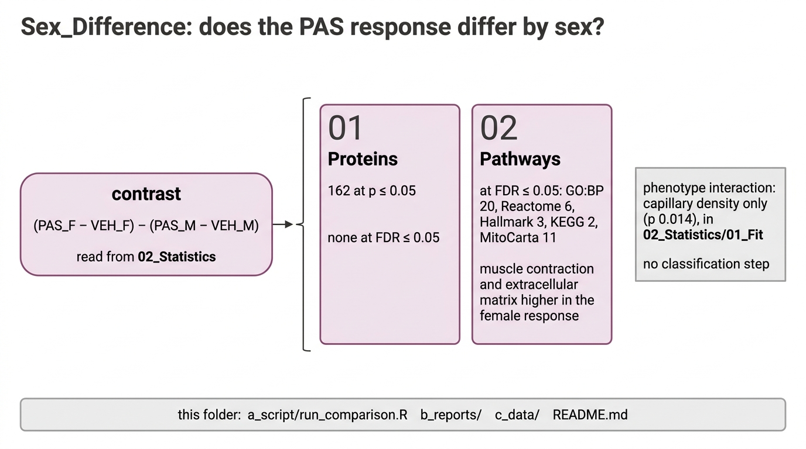

# Sex_Difference

Does the PAS response differ between the sexes? The test is the interaction contrast `treatment_by_sex`, (PAS_F − VEH_F) − (PAS_M − VEH_M); a positive value means PAS raised a protein or set more in females than in males. A feature that changes in one sex and not the other is not, on that basis, a sex difference; only this contrast tests it. Run with `Rscript 03_Comparisons/Sex_Difference/a_script/run_comparison.R`; the methods are in [`03_Comparisons`](../README.md).

| Step | Result | Files |
|---|---|---|
| 01 Proteins | Full proteome: 162 at p ≤ 0.05 (98 expected), 142 at Π ≤ 0.05, none at FDR ≤ 0.05. Mitochondrial universe: 46, 26, 0. The Π lists are connected in STRING (up: 97 proteins, 294 edges, 3.2 times expected; down: 45 proteins, 23 edges, 3.3 times). | `01_proteins` |
| 02 Pathways | GO:BP 93 at p ≤ 0.05, 20 at FDR ≤ 0.05, 19 higher in the female response (muscle contraction, myofibril and sarcomere assembly, actomyosin organisation, detoxification and redox homeostasis) and proteasome-mediated protein catabolism lower; 7 have singscore p ≤ 0.05. Reactome 19 and 6, all higher in the female response: muscle and striated muscle contraction, collagen formation, extracellular matrix organisation and degradation, response to chemical stress; 2 have singscore p ≤ 0.05. MitoCarta 12 and 11: metabolism, ROS and glutathione, detoxification and amino acid, lysine, carbohydrate and lipid metabolism higher, complex I, mitochondrial ribosome and translation lower; 3 have singscore p ≤ 0.05. | `02_pathways` |

There are no phenotype or classification steps. The phenotype interaction (capillary density p 0.014; the other five p ≥ 0.22) is in `02_Statistics/01_Fit` (sheet `phenotype_interaction`) and in Figure 1 panel e. Classification needs a label each mouse carries, and the interaction is a difference of differences between groups.

Each step's workbook is `c_data/<step>.xlsx` and its preview `b_reports/<step>.pdf`.
