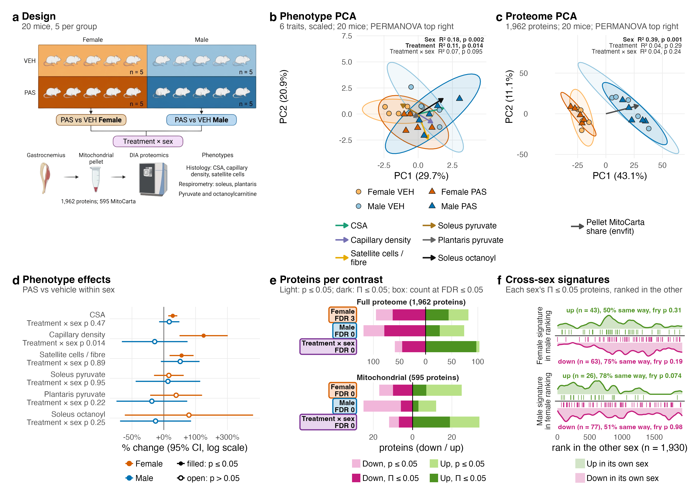

# F01_Global

Figure 1: the design and the structure of the phenotypes and the proteome on top; the phenotype effects, protein counts and cross-sex signatures below.

| | |
|---|---|
| Reads | `assets/design.png`, `02_Statistics/01_Fit/c_data/fit.rds`, `02_Statistics/02_Enrichment/c_data/enrichment.rds`, `02_Statistics/04_PCA/c_data/pca.rds` |
| Writes | `b_reports/panels/<panel>.pdf/.png` (66 or 57 × 64 mm), `b_reports/F01_composite.pdf/.png` (180 × 128 mm), `c_data/F01.xlsx` |
| Run | `Rscript 04_Figures/F01_Global/a_script/F01_composite.R` (each panel script also runs alone) |

Each panel is its own script in `a_script/panels/`. The composite runs them, adds the letters, lays them out as one aligned 2 × 3 grid, and checks the panel e counts against `01_fit.xlsx`, the mouse count against the design and the four barcode lanes. Panels read saved outputs and compute nothing beyond counts and arrow scaling.

## Panels

| Panel | Shows | Source |
|---|---|---|
| a | Design: 2 × 2 sex by treatment, five mice per cell; gastrocnemius mitochondrial pellet, DIA; the phenotypes; the three contrasts in the colours used throughout. | `assets/design.png` |
| b | Phenotype PCA of the six traits, scaled. Fill: group; shape: treatment (circle vehicle, triangle PAS); 95% t-ellipse per group; each trait's loading as a coloured arrow; PERMANOVA (adonis2, Euclidean, 999 permutations, sequential terms) top right, bold at p ≤ 0.05. | `pca.rds` |
| c | Proteome PCA of the 20 mice, drawn the same way; the arrow is the direction in which the pellet's MitoCarta share rises (envfit, R² 0.91), which runs along PC1 with sex. | `pca.rds` |
| d | PAS vs vehicle per phenotype within each sex, % change with 95% CI on a log axis (Welch t on log values); filled at p < 0.05, open ns. The treatment × sex p sits under each trait. | `fit.rds`: `phenotype_effects`, `phenotype_interaction` |
| e | Proteins per contrast, down left and up right, full proteome above the mitochondrial universe. Light bar: p < 0.05; dark bar: Π < 0.05 (always the smaller count); dashed: p < 0.05 expected by chance in each direction. FDR ≤ 0.05 count in each box. | `fit.rds`: `protein_contrasts` |
| f | Each sex's Π < 0.05 up and down proteins placed in the other sex's ranking, as limma's barcode (Wu & Smyth 2012); each lane gives size, the share moving the same way and the fry p (across mice). | `enrichment.rds`: `signatures`, `ranks` |

Π is p^|log2 FC| (Xiao et al. 2014). It ranks a protein on p and fold change together and controls no error rate; Π ≤ 0.05 can include proteins with p > 0.05. Two error-controlled measures sit beside it in `01_fit.xlsx`. TREAT tests for a fold change above 1.2 (McCarthy & Smyth 2009); no protein reaches TREAT FDR ≤ 0.05 in any contrast. ashr's local false sign rate (Stephens 2017) is ≤ 0.05 for five female proteins (Cops3, Dusp3, Ugp2, Appl1, Hook3), one male (Cd36) and no interaction protein.

Panel a is an illustration drawn from `assets/design_spec/`: SPEC.md holds every label, EVIDENCE.md the source of each element and DONOTDRAW.md what the evidence rules out. Every label was checked against EVIDENCE.md.

## Workbook

`c_data/F01.xlsx` holds one sheet per panel (`a_design` to `f_signature_barcode`), each with the numbers that panel draws, plus `read_me`, `input_manifest` and `package_versions`.
