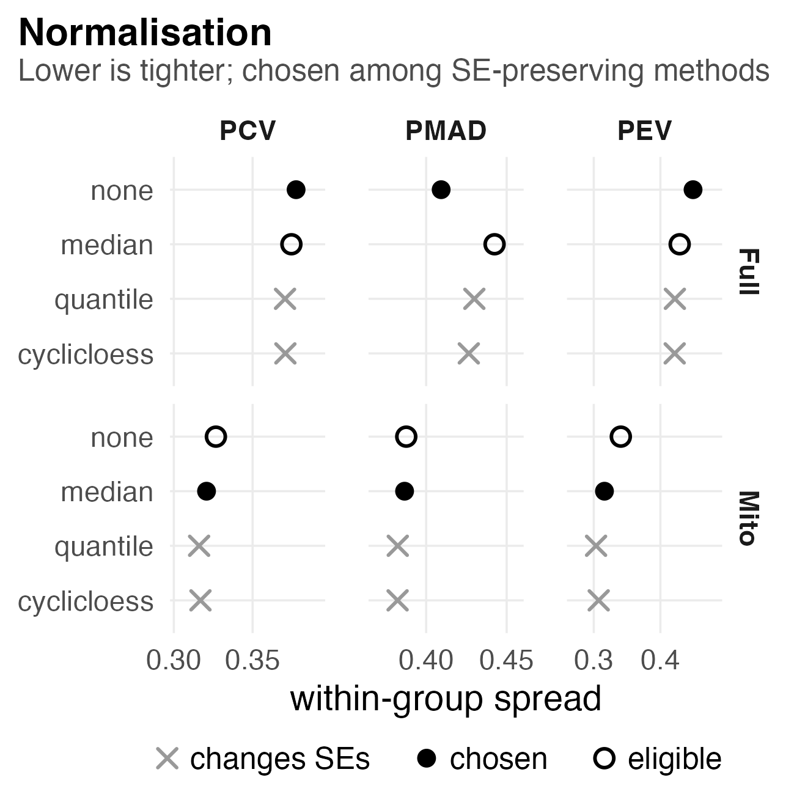
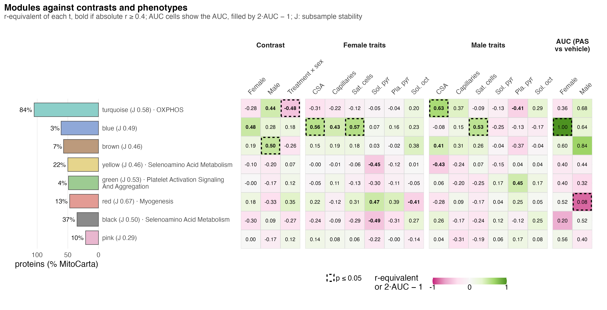

# F01_Global

- Figure 1: what the design is, what PAS did to the phenotypes, and how the phenotypes and the proteome are structured.
- Supplementary Figure 1: what processing kept and chose, and what else is in the pellet.
- Supplementary Figure 2: what the proteome components track, whether perfect separation beats chance, and how the modules relate to PAS and the phenotypes.

## Figure 1

### a. Design

The four groups of five mice, the three contrasts in the colours every figure uses, the sample path to 1,962 proteins (595 in MitoCarta) and the six phenotypes. The panel is an image, `assets/design.png`, not a plot; nothing in it is computed. `assets/design_spec/` holds its spec.

### b. Phenotype PCA

One point per mouse on the first two components of the six scaled phenotypes (29.7% and 20.9% of variance), with 95% ellipses per group and arrows for trait loadings. PERMANOVA: sex R² 0.18 (p 0.002), treatment 0.11 (p 0.014), interaction 0.07 (p 0.095). The arrows are rescaled, so read only their direction and relative length.

### c. Proteome PCA

The same drawing for the 1,962 normalised proteins. PC1 (43.1%) separates the sexes completely; within each sex PAS and vehicle overlap. PERMANOVA: sex R² 0.39 (p 0.001), treatment 0.04 (p 0.29). The grey arrow is the pellet MitoCarta share (envfit R² 0.91), which runs along PC1, so sex and pellet composition cannot be told apart here.

### d. Phenotype effects

% change of PAS against the same sex's vehicle with 95% CI, on a log axis. Females gain capillary density (+138%, p 0.005), CSA (+22%, p 0.002) and satellite cells per fibre (+47%, p 0.009); no male trait reaches p ≤ 0.05. The treatment × sex test under each trait is p ≤ 0.05 only for capillary density (p 0.014). The twelve p-values are uncorrected, and respiration was measured in soleus and plantaris, not gastrocnemius.

### e. Proteins per contrast

Proteins down (left) and up (right) per contrast at p ≤ 0.05 (light bar) and Π ≤ 0.05 (dark bar), with the FDR ≤ 0.05 count in each row's box. Full proteome: females 95 down and 82 up, males 119 and 74, interaction 59 and 103. Only three proteins pass FDR ≤ 0.05, all down in females (Cops3, Cops8, Dusp3).

### f. Cross-sex signatures

Each sex's Π ≤ 0.05 up and down lists placed in the other sex's protein ranking, drawn as limma barcodes. The share moving the same way in the other sex runs from 50% to 78%, but no list reaches p ≤ 0.05 by fry (p 0.074 to 0.98). fry allows for correlation between proteins; the shares alone do not.

## Supplementary Figure 1

### a. Filtering

Precursors and protein groups left after each filter, top to bottom: 26,310 in 2,309 groups enter and 21,600 in 2,094 remain. Removing shared peptides costs the most (3,119 precursors; signal 98.3% to 75.0%), because muscle's abundant isoform families share peptides.

### b. Depth per run

Precursors and protein groups identified per run. Female runs identified 13,190 to 19,409 precursors and male runs 9,422 to 16,514; the six shallowest runs are all male. This technical difference is why the model carries a surrogate variable.

### c. Normalisation

Within-group spread (PCV, PMAD, PEV) for each method, full proteome above MitoCarta. Quantile and cyclic loess are crossed out because they break limpa's standard errors. The lower PMAD picks no normalisation for the full proteome (0.409 against 0.442) and median centring for MitoCarta (0.387 against 0.388, a near tie).

### d. Surrogate variable

sv1 against log2 run depth per mouse: r = 0.85 across mice, 0.86 in females, 0.92 in males. PAS and vehicle mice interleave along it (Welch p 0.46 and 0.71), so sv1 absorbs run depth and not the PAS effect.

### e. Pellet mitochondrial share

Percentage of each pellet's protein signal from MitoCarta proteins. Every female pellet is at or below 51.8% and every male pellet at or above 52.4% (p = 1.9e-08). PAS does not change the share in either sex (−1.8 points in females, p 0.23; +0.6 in males, p 0.74).

### f. Pellet composition

Marker scores per mouse (mean z-scored log2 abundance of each group's markers) and haemoglobin as % of precursor signal. Female PAS pellets carry more sarcoplasmic reticulum (p 0.0015). Male PAS pellets carry less vessel (p 0.00028), nerve (0.0077), red cell (0.021) and myofibril (0.025) material, so male PAS protein results can partly reflect what went into the tube.

## Supplementary Figure 2

### a. What the proteome components track

R² of sex, treatment, their interaction, MitoCarta share and run depth on PC1 to PC4. PC1 (43.1%) tracks sex (0.89), MitoCarta share (0.88) and run depth (0.69), and not treatment (0.00). Treatment reaches 0.21 only on PC4 (6.8%).

### b. Perfect separators against relabelling

For each feature level and sex, the number of features that put all five PAS mice above or below all five vehicle mice, against the same count over all 252 relabellings. No level beats the null at p ≤ 0.05. Female pathway scores come closest (16 against a null median of 4, p 0.13).

### c. Modules against contrasts and phenotypes

One row per module (size, MitoCarta share, stability, top annotated set), with the r-equivalent of each contrast and each trait slope within sex, and each eigengene's AUC for PAS against vehicle. No cell reaches FDR ≤ 0.05; the lowest is 0.063, the blue module's female AUC of 1.00. Brown is higher in male PAS mice (r 0.50, p 0.042) and turquoise (OXPHOS) differs between the sexes' PAS effects (r −0.48, p 0.049).

## Run

`Rscript 04_Figures/F01_Global/a_script/F01.R`, `a_script/supp/S1.R` and `a_script/supp/S2.R`. Each panel script also runs alone.

## Workbook

`c_data/F01.xlsx`, `S1.xlsx` and `S2.xlsx` hold one sheet per panel, named after the panel script, with the table it draws.
