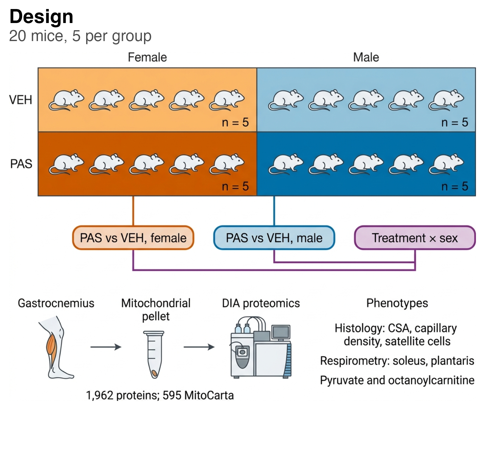
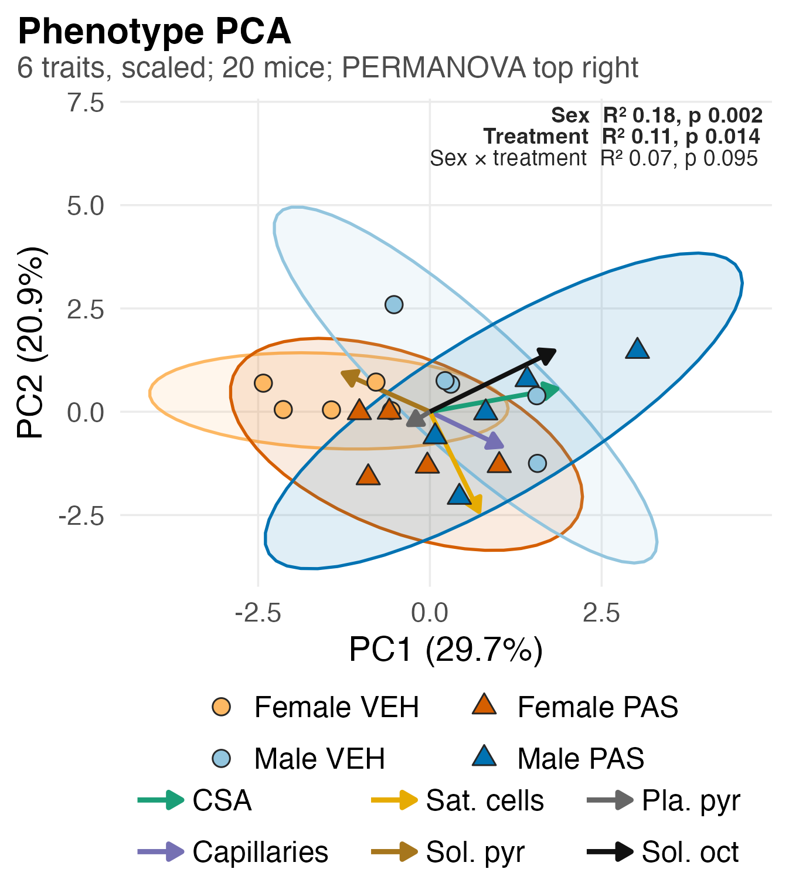
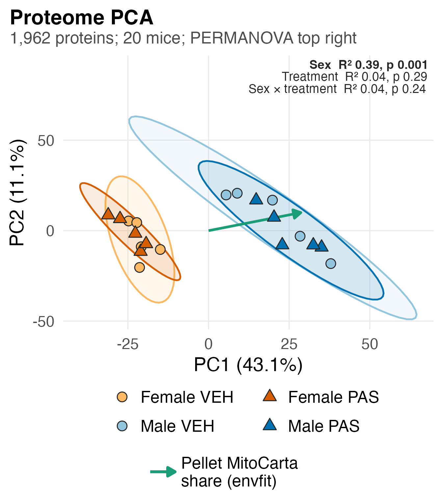
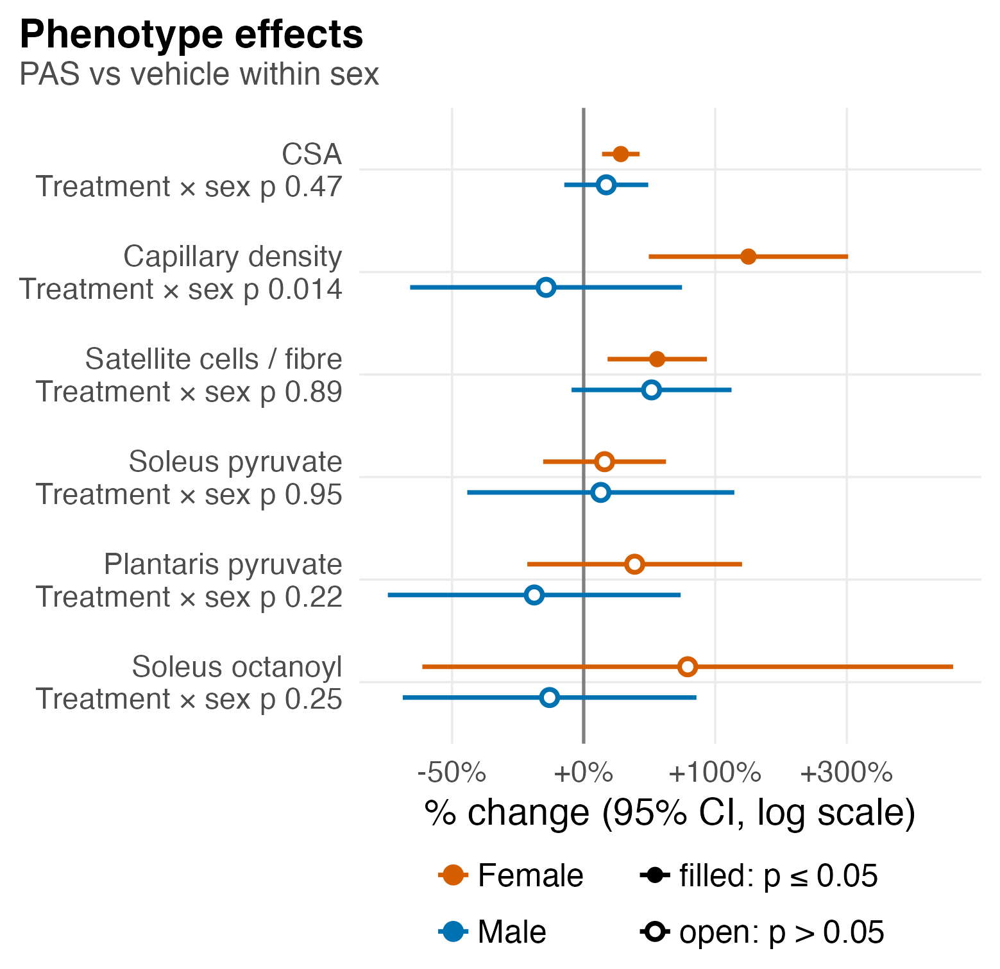
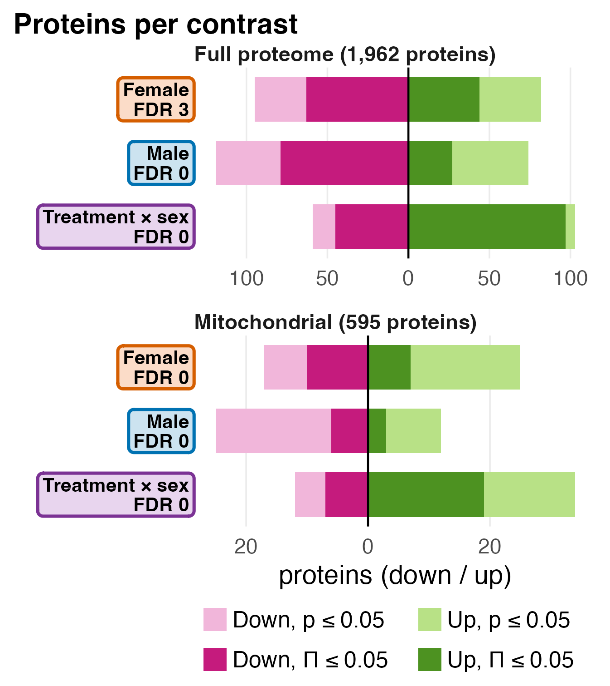
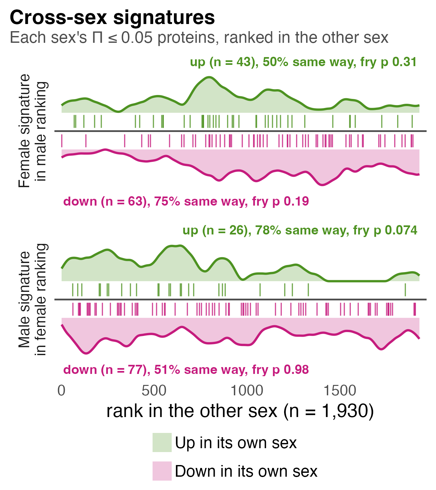

# F01_Global

Figure 1: the design and the structure of the phenotypes and the proteome on top; the phenotype effects, protein counts and cross-sex signatures below.

| | |
|---|---|
| Reads | `assets/design.png`, `02_Statistics/01_Fit/c_data/fit.rds`, `02_Statistics/02_Enrichment/c_data/enrichment.rds`, `02_Statistics/04_PCA/c_data/pca.rds` |
| Writes | `b_reports/panels/<panel>.pdf/.png` (66 or 57 × 64 mm), `b_reports/F01_composite.pdf/.png` (180 × 128 mm), `c_data/F01.xlsx` |
| Run | `Rscript 04_Figures/F01_Global/a_script/F01_composite.R` (each panel script also runs alone) |

Each panel is its own script in `a_script/panels/`. The composite runs them, adds the letters and lays them out as one aligned 2 × 3 grid. Panels read saved outputs and compute nothing beyond counts, ranks, the barcode's moving average and arrow scaling.

## Panels

### a. Design

The 2 × 2 grid holds the four groups, female in orange and male in blue, vehicle in the lighter shade and PAS in the darker, with five mice in each cell. Below it sit the three contrasts in the colours every later figure uses: PAS against vehicle within females, the same within males, and their interaction, which asks whether the female response differs from the male one. The bottom row is the sample path: gastrocnemius, a mitochondrial pellet, DIA proteomics giving 1,962 proteins of which 595 are in MitoCarta. On the right are the phenotypes: fibre cross-sectional area, capillary density and satellite cells from histology, and pyruvate and octanoylcarnitine respiration from soleus and plantaris. The subtitle's count of 20 mice, 5 per group, is computed from the fit; everything inside the image is drawn, not computed.

### b. Phenotype PCA

One point per mouse, placed by its scores on the first two principal components of the six phenotypes, each scaled to unit variance. Fill gives the group and shape the treatment (circle vehicle, triangle PAS); each shaded ellipse is a group's 95% t-ellipse. Each coloured arrow is one trait's loading, rescaled so the longest reaches 80% of the furthest score, so read only its direction and relative length.

PC1 carries 29.7% of the variance and PC2 20.9%. CSA (loading 0.59) and soleus octanoylcarnitine (0.57) drive PC1, and satellite cells mostly PC2 (−0.76). The PERMANOVA in the corner (adonis2, Euclidean, 999 permutations, sequential terms, bold at p ≤ 0.05) gives sex R² 0.18 (p 0.002), treatment 0.11 (p 0.014) and the interaction 0.07 (p 0.095). PAS mice sit to the right of their own sex's vehicle mice on average (group mean PC1 −1.47 to −0.31 in females, 0.62 to 1.15 in males). Group spreads do not clearly differ (betadisper p 0.086), so the treatment term mostly reflects a shift in location, though five mice per group leave the ellipses wide.

### c. Proteome PCA

The same drawing for the proteome: one point per mouse on the first two components of the 1,962 normalised proteins, centred but not scaled.

PC1 carries 43.1% of the variance and PC2 11.1%. The sexes separate completely along PC1, females from −31.1 to −15.0 and males from 5.4 to 37.9, and within each sex PAS and vehicle mice overlap. The PERMANOVA agrees: sex R² 0.39 (p 0.001), treatment 0.04 (p 0.29), interaction 0.04 (p 0.24), with group spreads alike (betadisper p 0.49). The single green arrow is the direction in which the pellet's MitoCarta share rises, fitted onto PC1 and PC2 by envfit (R² 0.91, p 0.001); it points almost along PC1. On PC1 alone sex explains R² 0.89, the MitoCarta share 0.88 and run depth 0.69. Sex and pellet composition therefore coincide on the main axis, and this panel cannot tell them apart. PAS leaves no detectable mark on the global proteome, which is why the comparisons set PAS against vehicle within one sex, where the pellet MitoCarta share does not differ detectably between PAS and vehicle, although several marker scores do (S1 panel f). The PCA is descriptive and does not use the surrogate variable.

### d. Phenotype effects

One point per trait and sex: the % change of PAS against the same sex's vehicle mice, with its 95% CI as a bar, from a Welch t-test on log values. Orange is female, blue male; a filled point has p ≤ 0.05 and an open one does not. The axis is log-scaled, so +100% and −50% sit the same distance from zero. Under each trait, "Treatment × sex p" is the interaction from `lm(log(value) ~ treatment * sex)`, the female response relative to the male.

Females gain capillary density (+138%, CI +41 to +303%, p 0.005), CSA (+22%, +10 to +34%, p 0.002) and satellite cells per fibre (+47%, +13 to +91%, p 0.009). The three respiration traits show no detectable change in females (p 0.30 to 0.45) and carry wide intervals; soleus octanoylcarnitine runs from −57% to +600%. No male trait reaches p ≤ 0.05 (p 0.086 to 0.77). Only capillary density has an interaction (p 0.014); for CSA (0.47) and satellite cells (0.89) a female-only result does not show that the sexes respond differently. The twelve p-values are not corrected for multiplicity, and respiration was measured in soleus and plantaris, not in the gastrocnemius that was sequenced.

### e. Proteins per contrast

One row per contrast, the full proteome (1,962 proteins) above the mitochondrial universe (595). Bars to the left count proteins down and bars to the right proteins up. The light bar counts proteins at p ≤ 0.05; the dark bar drawn over it counts those at Π ≤ 0.05, which is always the smaller number. The box naming each row gives its count at FDR ≤ 0.05.

In the full proteome females have 95 down (63 at Π) and 82 up (44), males 119 down (79) and 74 up (27), and the interaction 59 down (45) and 103 up (97), where up means a larger female than male response. These nominal counts are exploratory: only three proteins pass FDR ≤ 0.05, all down in females (Cops3, Cops8, Dusp3), and none does in the mitochondrial universe. There, females have 17 down and 25 up, males 25 and 12, and the interaction 12 and 34. Π sits close to p in the interaction row because Π = p^|log2 FC| rewards large fold changes: the median |log2 FC| of p ≤ 0.05 proteins is 1.10 for the interaction against 0.81 and 0.82 within females and males (`01_fit.xlsx`, `protein_contrasts`).

### f. Cross-sex signatures

Each sex's PAS signature, its proteins at Π ≤ 0.05 split into up and down, placed in the other sex's ranking and drawn as limma's barcode (Wu & Smyth 2012). The x-axis ranks the other sex's 1,930 genes by moderated t, most up on the left. Each tick is one member of a list, green above the axis for proteins up in their own sex and magenta below for those down; the shaded curve is a moving average of where members fall along the rank, scaled to its own peak. If a signature carried over, green ticks would crowd the left and magenta ticks the right. Each label gives the members ranked, the share moving the same way in the other sex and the fry p, a self-contained test across mice on the fit's design with the other sex's contrast as first coefficient, unweighted and unstandardised.

The female up list (43 ranked) moves the same way in 50% of cases (p 0.31), the female down list (63) in 75% (p 0.19), the male up list (26) in 78% (p 0.074) and the male down list (77) in 51% (p 0.98). No signature reached p ≤ 0.05 in the other sex. The 75% and 78% shares look concordant, but fry, which allows for correlation between proteins, does not support them.

## Notes

Π (Xiao et al. 2014) ranks a protein on p and fold change together and controls no error rate; Π ≤ 0.05 can include proteins with p > 0.05. Two error-controlled measures sit beside it in `01_fit.xlsx`. TREAT tests for a fold change above 1.2 (McCarthy & Smyth 2009); no protein reaches TREAT FDR ≤ 0.05 in any contrast. ashr's local false sign rate (Stephens 2017) is ≤ 0.05 for five female proteins (Cops3, Dusp3, Ugp2, Appl1, Hook3), one male (Cd36) and no interaction protein.

Panel a is a 600 dpi redraw (2026-10-16) of an illustration drawn from `assets/design_spec/`. SPEC.md holds every label, EVIDENCE.md the source of each element and DONOTDRAW.md what the evidence rules out. The redraw labels the interaction "Sex Interaction"; the figures call it "Treatment × sex".

## Workbook

`c_data/F01.xlsx` holds one sheet per panel (`a_design` to `f_signature_barcode`), each with the numbers that panel draws, plus `read_me`, `input_manifest` and `package_versions`. The PERMANOVA, betadisper, envfit and per-component R² values quoted for panels b and c are in `02_Statistics/04_PCA/c_data/04_pca.xlsx`; the phenotype variance shares are in `pca.rds` and on the panel's axes.
