# F01_Global

Figure 1: the design and the structure of the phenotypes and the proteome on top; the phenotype effects, protein counts and cross-sex signatures below. Its supplements are S1, processing, and S2, structure.

| | |
|---|---|
| Reads | `assets/design.png`, `02_Statistics/01_Fit/c_data/fit.rds`, `02_Statistics/02_Enrichment/c_data/enrichment.rds`, `02_Statistics/04_PCA/c_data/pca.rds` |
| Writes | `b_reports/<panel>.pdf/.png` (66 or 57 × 64 mm), `b_reports/F01.pdf/.png` (180 × 128 mm), `c_data/F01.xlsx` |
| Run | `Rscript 04_Figures/F01_Global/a_script/F01.R` (each panel script also runs alone) |

Each panel is its own script in `a_script/`, beside the composite `F01.R`, which runs them, adds the letters and lays them out as one aligned 2 × 3 grid. The supplements follow the same pattern in `a_script/supp/`, `b_reports/supp/` and `c_data/S1.xlsx`, `c_data/S2.xlsx`. Panels read saved outputs and compute nothing beyond counts, ranks, the barcode's moving average and arrow scaling.

## Panels

### a. Design

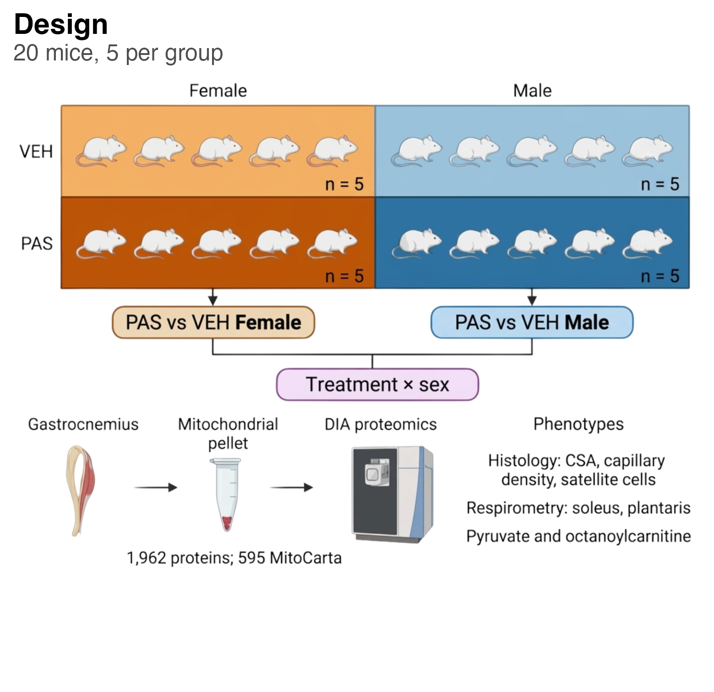

The 2 × 2 grid holds the four groups, female in orange and male in blue, vehicle in the lighter shade and PAS in the darker, with five mice in each cell. Below it sit the three contrasts in the colours every later figure uses: PAS against vehicle within females, the same within males, and their interaction, which asks whether the female response differs from the male one. The bottom row is the sample path: gastrocnemius, a mitochondrial pellet, DIA proteomics giving 1,962 proteins of which 595 are in MitoCarta. On the right are the phenotypes: fibre cross-sectional area, capillary density and satellite cells from histology, and pyruvate and octanoylcarnitine respiration from soleus and plantaris. The subtitle's count of 20 mice, 5 per group, is computed from the fit; everything inside the image is drawn, not computed.

### b. Phenotype PCA

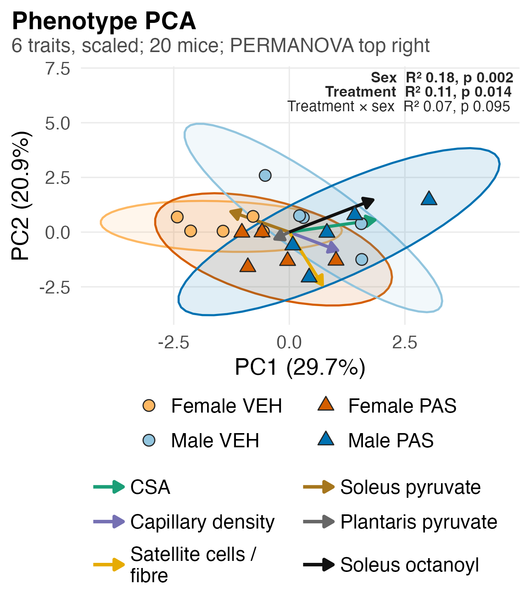

One point per mouse, placed by its scores on the first two principal components of the six phenotypes, each scaled to unit variance. Fill gives the group and shape the treatment (circle vehicle, triangle PAS); each shaded ellipse is a group's 95% t-ellipse. Each coloured arrow is one trait's loading, rescaled so the longest reaches 80% of the furthest score, so read only its direction and relative length.

PC1 carries 29.7% of the variance and PC2 20.9%. CSA (loading 0.59) and soleus octanoylcarnitine (0.57) drive PC1, and satellite cells mostly PC2 (−0.76). The PERMANOVA in the corner (adonis2, Euclidean, 999 permutations, sequential terms, bold at p ≤ 0.05) gives sex R² 0.18 (p 0.002), treatment 0.11 (p 0.014) and the interaction 0.07 (p 0.095). PAS mice sit to the right of their own sex's vehicle mice on average (group mean PC1 −1.47 to −0.31 in females, 0.62 to 1.15 in males). Group spreads do not clearly differ (betadisper p 0.086), so the treatment term mostly reflects a shift in location, though five mice per group leave the ellipses wide.

### c. Proteome PCA

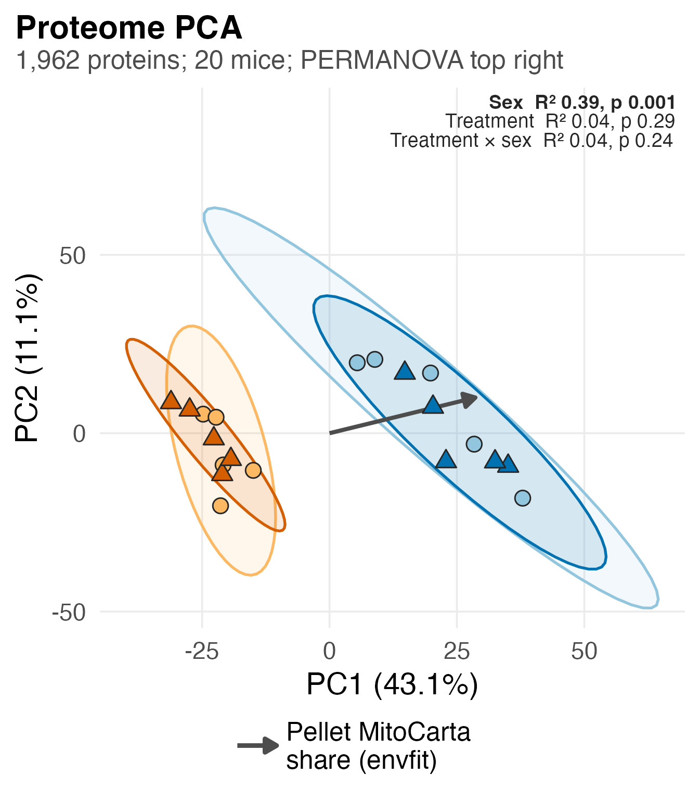

The same drawing for the proteome: one point per mouse on the first two components of the 1,962 normalised proteins, centred but not scaled. Its group key is the one in panel b.

PC1 carries 43.1% of the variance and PC2 11.1%. The sexes separate completely along PC1, females from −31.1 to −15.0 and males from 5.4 to 37.9, and within each sex PAS and vehicle mice overlap. The PERMANOVA agrees: sex R² 0.39 (p 0.001), treatment 0.04 (p 0.29), interaction 0.04 (p 0.24), with group spreads alike (betadisper p 0.49). The single dark grey arrow is the direction in which the pellet's MitoCarta share rises, fitted onto PC1 and PC2 by envfit (R² 0.91, p 0.001); it points almost along PC1. On PC1 alone sex explains R² 0.89, the MitoCarta share 0.88 and run depth 0.69. Sex and pellet composition therefore coincide on the main axis, and this panel cannot tell them apart. A treatment effect on the global proteome was not detected (R² 0.04, p 0.29), which is why the comparisons set PAS against vehicle within one sex, where the pellet MitoCarta share does not differ detectably between PAS and vehicle, although several marker scores do (S1 panel f). The PCA is descriptive and does not use the surrogate variable.

### d. Phenotype effects

One point per trait and sex: the % change of PAS against the same sex's vehicle mice, with its 95% CI as a bar, from a Welch t-test on log values. Orange is female, blue male; the key reads filled for p ≤ 0.05 and open for p > 0.05. The axis is log-scaled, so +100% and −50% sit the same distance from zero. Under each trait, "Treatment × sex p" is the interaction from `lm(log(value) ~ treatment * sex)`, the female response relative to the male.

Females gain capillary density (+138%, CI +41 to +303%, p 0.005), CSA (+22%, +10 to +34%, p 0.002) and satellite cells per fibre (+47%, +13 to +91%, p 0.009). The three respiration traits show no detectable change in females (p 0.30 to 0.45) and carry wide intervals; soleus octanoylcarnitine runs from −57% to +600%. No male trait reaches p ≤ 0.05 (p 0.086 to 0.77). Only capillary density has an interaction (p 0.014); for CSA (0.47) and satellite cells (0.89) a female-only result does not show that the sexes respond differently. The twelve p-values are not corrected for multiplicity, and respiration was measured in soleus and plantaris, not in the gastrocnemius that was sequenced.

### e. Proteins per contrast

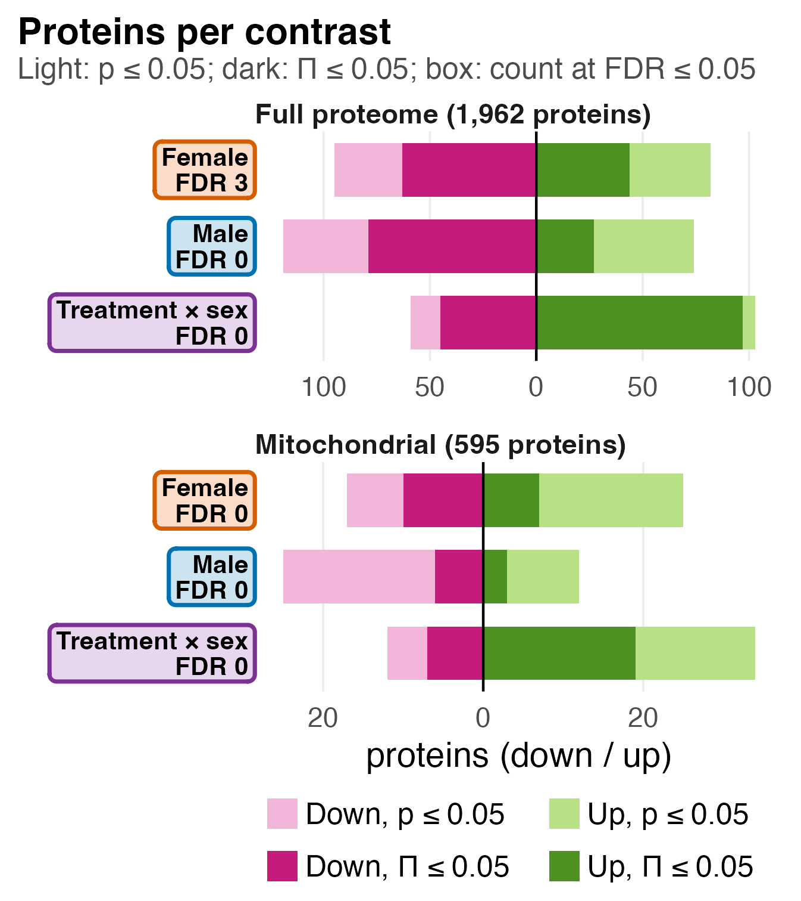

One row per contrast, the full proteome (1,962 proteins) above the mitochondrial universe (595). Bars to the left count proteins down and bars to the right proteins up. The light bar counts proteins at p ≤ 0.05; the dark bar drawn over it counts those at Π ≤ 0.05, which is always the smaller number. The box naming each row gives its count at FDR ≤ 0.05; the subtitle is the key to all three.

In the full proteome females have 95 down (63 at Π) and 82 up (44), males 119 down (79) and 74 up (27), and the interaction 59 down (45) and 103 up (97), where up means a larger female than male response. These nominal counts are exploratory: only three proteins pass FDR ≤ 0.05, all down in females (Cops3, Cops8, Dusp3), and none does in the mitochondrial universe. There, females have 17 down and 25 up, males 25 and 12, and the interaction 12 and 34. Π sits close to p in the interaction row because Π = p^|log2 FC| rewards large fold changes: the median |log2 FC| of p ≤ 0.05 proteins is 1.10 for the interaction against 0.81 and 0.82 within females and males (`01_fit.xlsx`, `protein_contrasts`).

### f. Cross-sex signatures

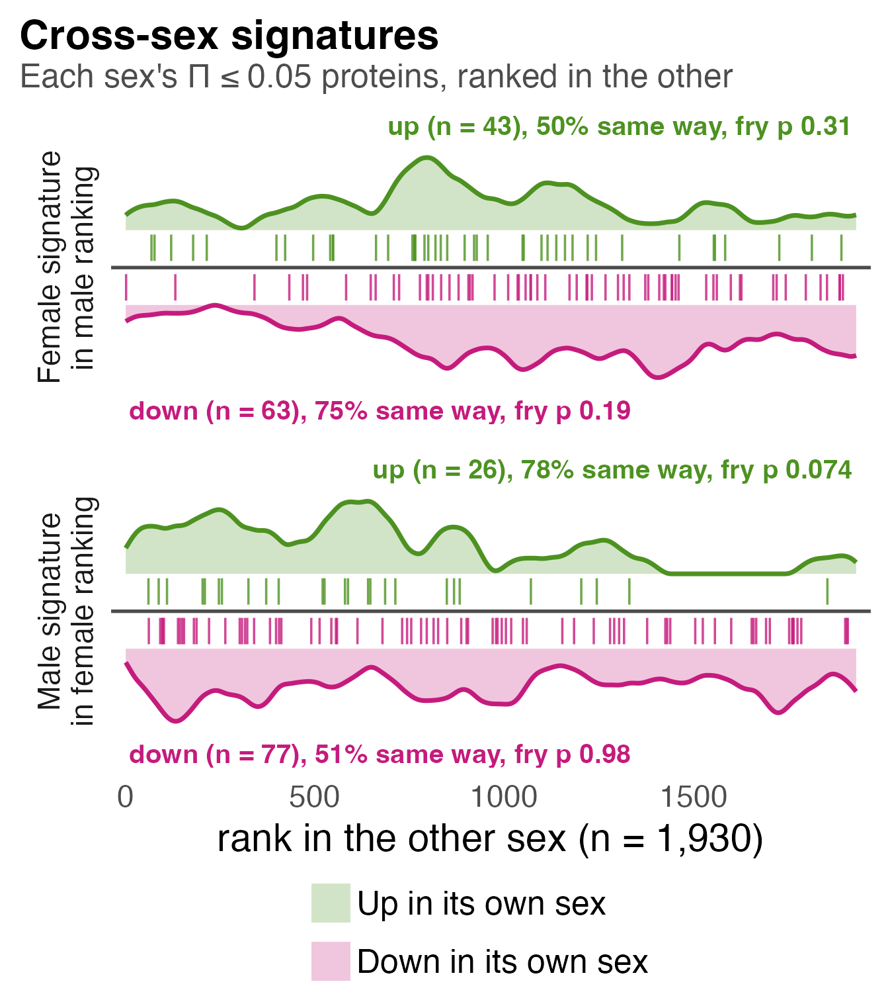

Each sex's PAS signature, its proteins at Π ≤ 0.05 split into up and down, placed in the other sex's ranking and drawn as limma's barcode (Wu & Smyth 2012). The x-axis ranks the other sex's 1,930 genes by moderated t, most up on the left. Each tick is one member of a list, green above the axis for proteins up in their own sex and magenta below for those down; the shaded curve is a moving average of where members fall along the rank, scaled to its own peak. If a signature carried over, green ticks would crowd the left and magenta ticks the right. Each label gives the members ranked, the share moving the same way in the other sex and the fry p, a self-contained test across mice on the fit's design with the other sex's contrast as first coefficient, unweighted and unstandardised.

The female up list (43 ranked) moves the same way in 50% of cases (p 0.31), the female down list (63) in 75% (p 0.19), the male up list (26) in 78% (p 0.074) and the male down list (77) in 51% (p 0.98). No signature reached p ≤ 0.05 in the other sex. The 75% and 78% shares look concordant, but fry, which allows for correlation between proteins, does not support them.

## Notes

Π (Xiao et al. 2014) ranks a protein on p and fold change together and controls no error rate; Π ≤ 0.05 can include proteins with p > 0.05. Two error-controlled measures sit beside it in `01_fit.xlsx`. TREAT tests for a fold change above 1.2 (McCarthy & Smyth 2009); no protein reaches TREAT FDR ≤ 0.05 in any contrast. ashr's local false sign rate (Stephens 2017) is ≤ 0.05 for five female proteins (Cops3, Dusp3, Ugp2, Appl1, Hook3), one male (Cd36) and no interaction protein.

Panel a is a 600 dpi redraw (2026-10-16) of an illustration drawn from `assets/design_spec/`. SPEC.md holds every label, EVIDENCE.md the source of each element and DONOTDRAW.md what the evidence rules out. The redraw labelled the interaction "Sex Interaction"; on 2026-10-17 that text was edited in the pixels to "Treatment × sex", the name the figures use.

## Supplementary Figure 1: processing

What processing kept and chose, and what else is in the pellet.

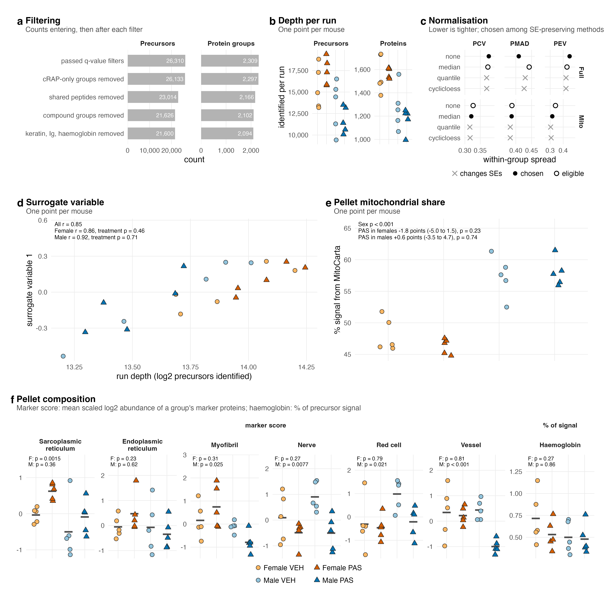

| | |
|---|---|
| Reads | `01_Processing/01_Filtering/c_data/precursors_filtered.rds`, `01_Processing/02_Quantification/c_data/proteins.rds`, `01_Processing/03_Design/c_data/design.rds`, `02_Statistics/05_Composition/c_data/composition.rds` |
| Writes | `b_reports/supp/S1<letter>_<name>.pdf/.png`, `b_reports/supp/S1.pdf/.png` (180 × 177 mm), `c_data/S1.xlsx` |
| Run | `Rscript 04_Figures/F01_Global/a_script/supp/S1.R` (each panel script also runs alone) |

Panels b, d, e and f use F01's points (fill for group, circle for vehicle, triangle for PAS) and share one group key, printed once under panel f.

### a. Filtering

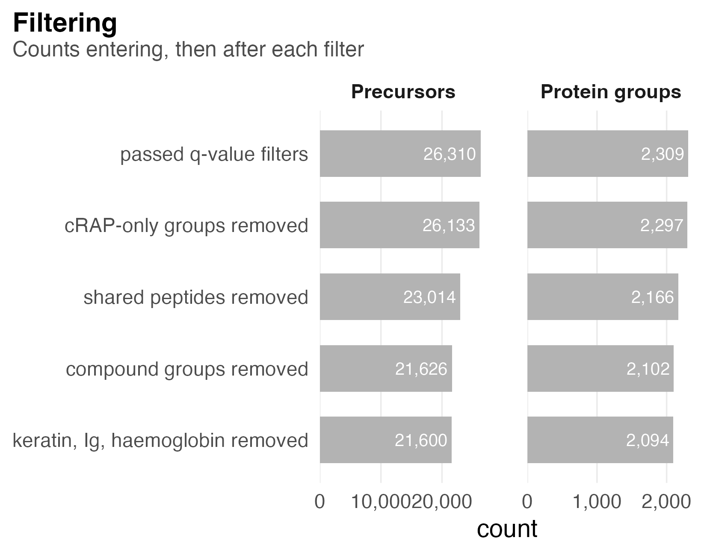

The top bar is what enters filtering: 26,310 precursors in 2,309 protein groups that passed the three q-value filters at 0.01. Each bar below it is the count left after one more filter, applied top to bottom, so the drop between consecutive bars is the cost of that filter. Removing the cRAP-only groups (lab contaminants the search appends, such as pig trypsin and human keratins) costs 177 precursors and 12 groups. Removing shared peptides costs the most, 3,119 precursors and 131 groups, and takes the retained signal from 98.3% to 75.0%, because muscle's most abundant proteins (myosins, actins, tropomyosins, troponins) come in isoform families that share peptides. Removing compound groups costs another 1,388 precursors and 64 groups, and removing the groups whose mouse gene symbols are all keratin, immunoglobulin or haemoglobin costs 26 precursors and 8 groups. The data end at 21,600 precursors in 2,094 groups.

### b. Depth per run

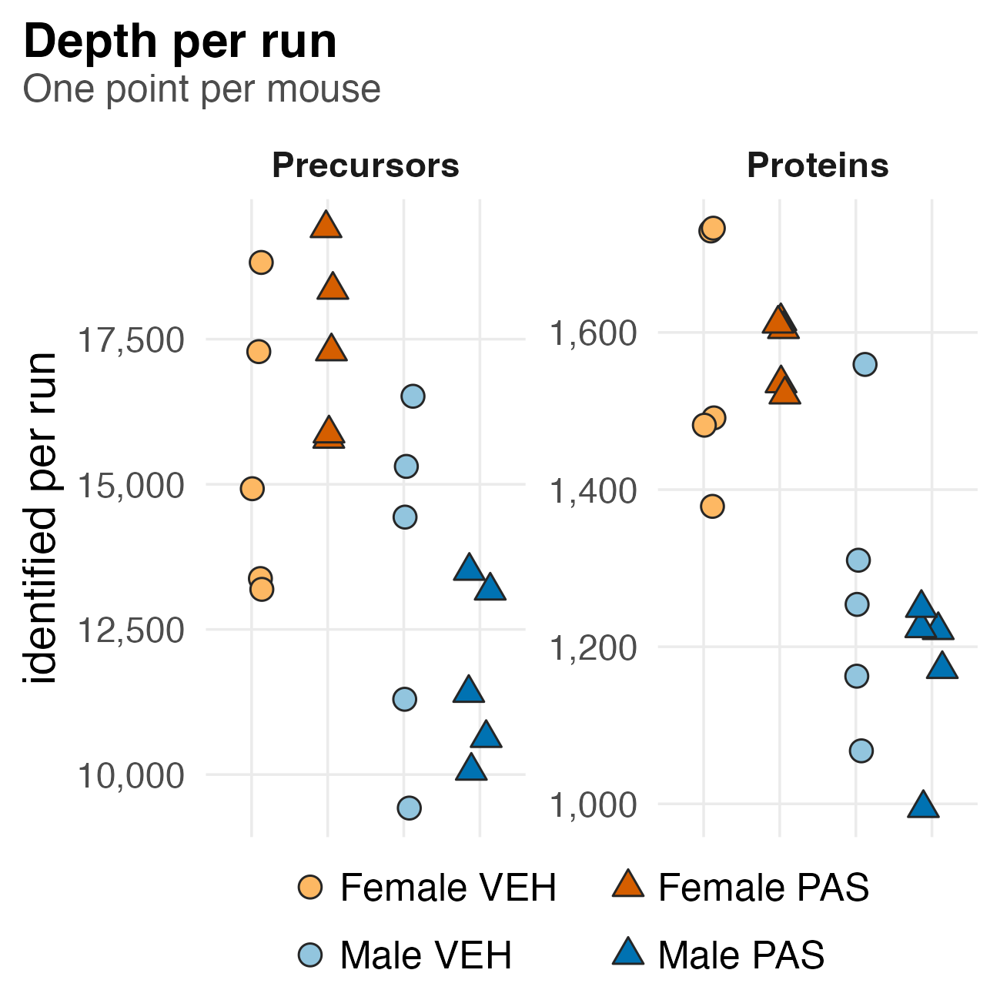

One point per mouse: the precursors (left) and protein groups (right) DIA-NN identified in that run. Higher points are deeper runs. Female runs identified 13,190 to 19,409 precursors and male runs 9,422 to 16,514, and the six shallowest runs are all male. The depth difference is technical. It is why the model in panel d carries a surrogate variable, and why the baseline male against female contrasts are reported as context only.

### c. Normalisation

The benchmark that chose the normalisation, run separately for the full proteome (top) and the MitoCarta universe (bottom). Each row is a method and each column a measure of how tightly the five replicates of a group agree: PCV, the mean within-group coefficient of variation; PMAD, the mean within-group median absolute deviation; PEV, the pooled within-group variance. Lower is tighter. A cross marks quantile and cyclic loess, which reshape each mouse's values and so no longer match limpa's standard errors; they are scored but cannot be chosen. Of the two eligible methods, the one with the lower PMAD is used (filled point): no normalisation for the full proteome (PMAD 0.409 against 0.442 for median centring) and median centring for MitoCarta (0.387 against 0.388, a near tie). No contrast enters the benchmark, so the choice cannot favour a result.

### d. Surrogate variable

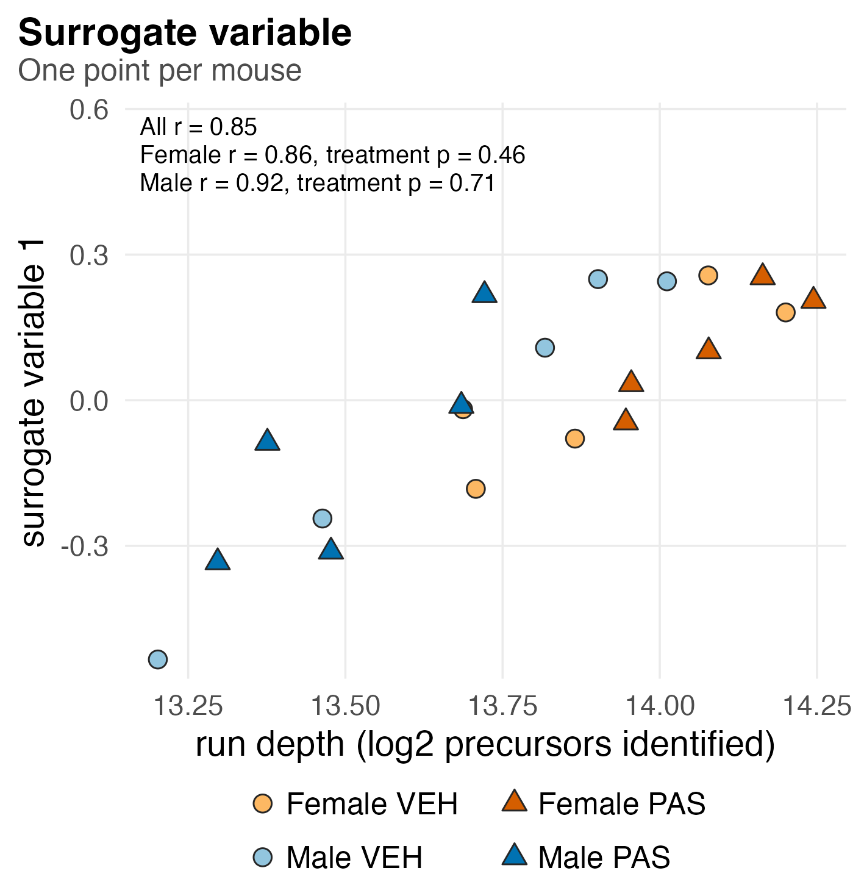

One point per mouse: its surrogate variable sv1 against run depth (log2 of the precursors identified). sv1 is the strongest pattern sva finds in the full proteome once the four group means are removed, and it enters every model as a covariate. It rises with run depth, r = 0.85 across all mice, 0.86 within females and 0.92 within males, and PAS and vehicle mice are interleaved along it (Welch p 0.46 in females, 0.71 in males). So sv1 absorbs run-depth noise and not the PAS effect.

### e. Pellet mitochondrial share

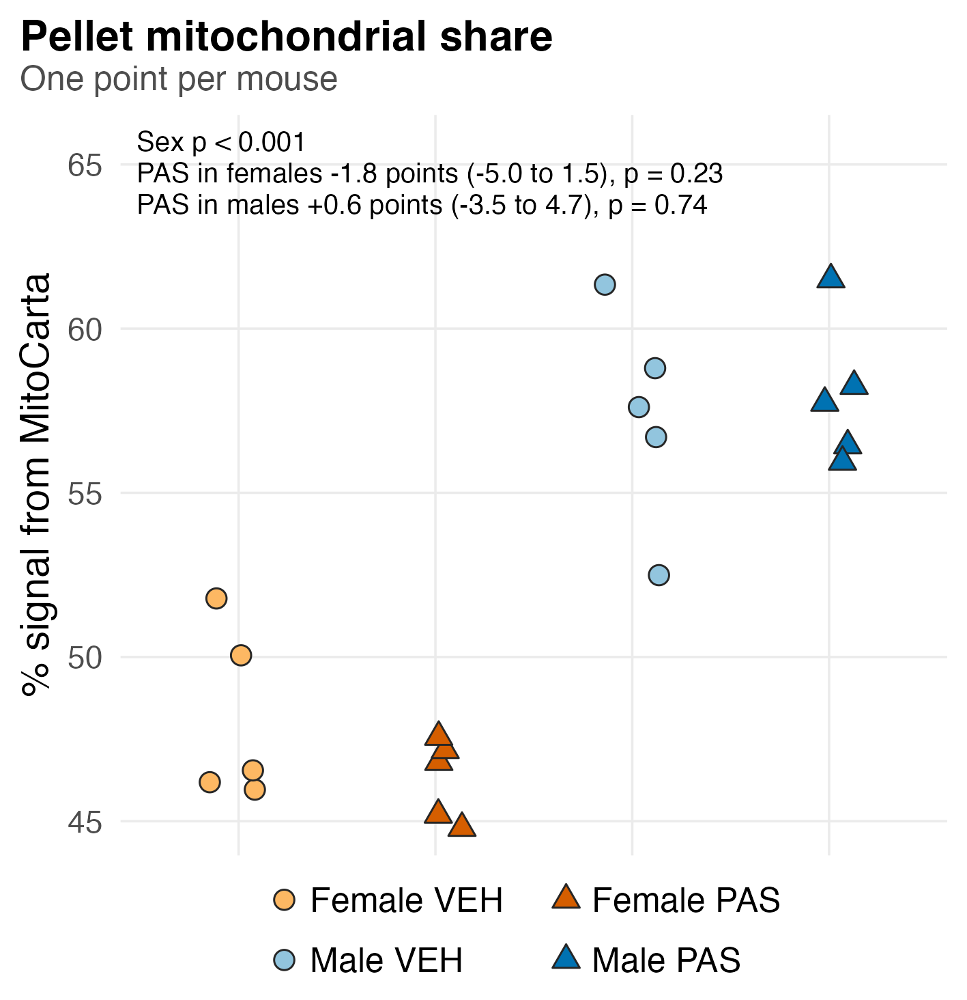

One point per mouse: the percentage of its protein signal that comes from MitoCarta proteins. The sexes do not overlap: every female pellet is at or below 51.8% and every male pellet at or above 52.4% (Welch p = 1.9e-08). Within each sex PAS makes no detectable change to the share: −1.8 points in females (95% CI −5.0 to 1.5, p 0.23) and +0.6 in males (−3.5 to 4.7, p 0.74). So a male against female comparison partly reflects mitochondrial enrichment, while the within-sex PAS contrasts are not confounded by it.

### f. Pellet composition

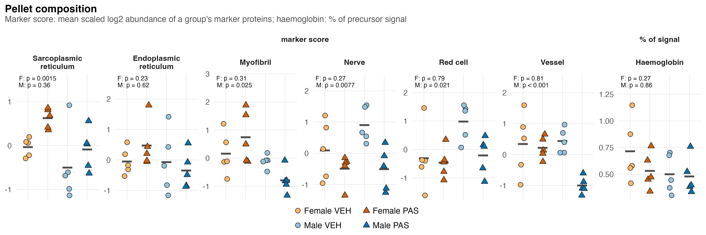

One point per mouse for each marker group, with the group mean as a dash. The strip above each column gives its unit. A marker score is the mean of the z-scored log2 abundances of the group's marker proteins seen in at least 15 of 20 mice, so 0 is the cohort average; the last column is haemoglobin as a percentage of precursor signal. The p-values above each column test PAS against vehicle within females (F) and within males (M). Female PAS pellets carry more sarcoplasmic reticulum (p 0.0015) and nothing else differs in females. Male PAS pellets carry less vessel (p 0.00028), nerve (0.0077), red cell (0.021) and myofibril (0.025) material, while haemoglobin's share of precursor signal does not differ (p 0.86). Read these as differences in what went into the tube: male PAS protein results can partly reflect pellet composition, and 02_Statistics/05_Composition analyses composition further.

## Supplementary Figure 2: structure

What the proteome components track, how the protein modules relate to PAS and to the phenotypes, and whether perfect separation exceeds the relabelling null.

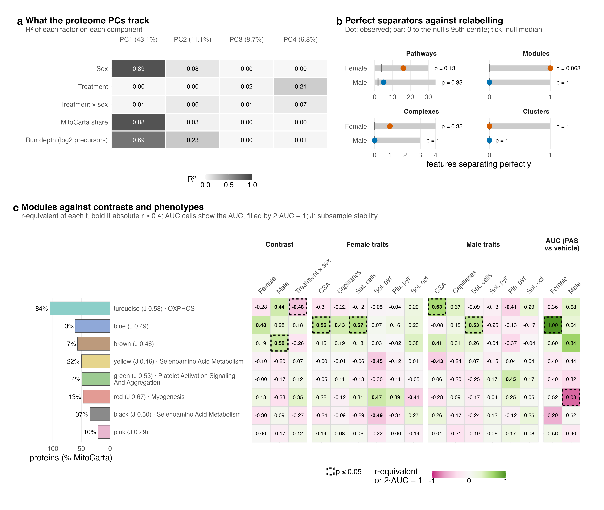

| | |
|---|---|
| Reads | `02_Statistics/04_PCA/c_data/pca.rds`, `02_Statistics/01_Fit/c_data/fit.rds`, `01_Processing/06_Modules/c_data/modules.rds`, `02_Statistics/03_Classification/c_data/classification.rds` |
| Writes | `b_reports/supp/S2<letter>_<name>.pdf/.png` (a and c 90 × 55 mm, b 180 × 92 mm), `b_reports/supp/S2.pdf/.png` (180 × 152 mm), `c_data/S2.xlsx` |
| Run | `Rscript 04_Figures/F01_Global/a_script/supp/S2.R` (each panel script also runs alone) |

Panels a and c share the top row; panel b takes the full width below.

### a. What the proteome components track

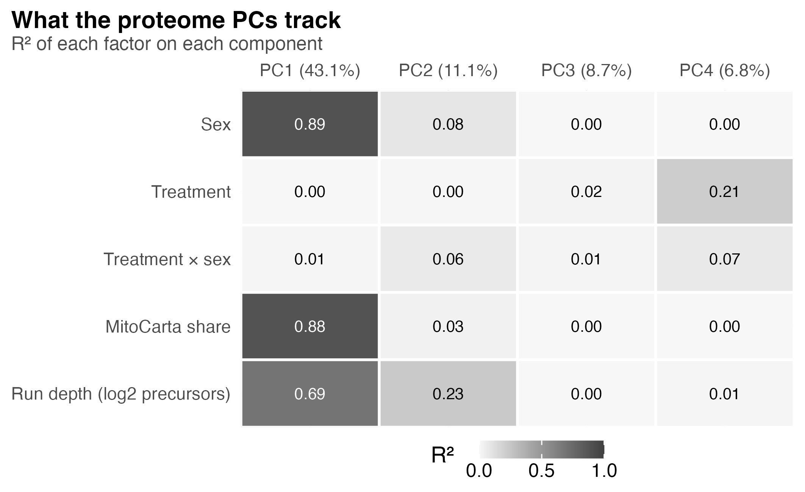

Each tile is the R² between one of the first four principal components of the normalised full proteome (columns, with the share of variance each explains) and one factor (rows). R² is the squared correlation of the component scores with sex and treatment coded ±1, their product, the pellet's MitoCarta share and run depth, the log2 precursors identified per run (`pca.rds`: `component_r2`). Darker grey is higher R², with white text above 0.5. PC1, 43.1% of the variance, tracks sex (0.89), MitoCarta share (0.88) and run depth (0.69), and not treatment (0.00). PC2 (11.1%) tracks run depth most (0.23), and PC3 (8.7%) tracks nothing above 0.02. Treatment reaches 0.21 only on PC4, 6.8% of the variance, with the interaction at 0.07. Sex, MitoCarta share and run depth coincide on PC1, so this panel cannot separate them, and treatment has no detectable association with the first three components.

The PCA is descriptive and does not carry the surrogate variable; `02_Statistics/04_PCA` tests the same factors by PERMANOVA (sex R² 0.39, p 0.001; treatment 0.04, p 0.29).

### b. Modules against contrasts and phenotypes

The modules come from the rebuilt network in `01_Processing/06_Modules`: 827 proteins detected in every mouse, with sex and measured run depth removed before building (the earlier build's two largest modules tracked run depth). The result is eight modules plus 402 unassigned proteins. Eigengenes are tested with ordinary least-squares t on the residual df (15 for the contrasts, 14 for the trait slopes) rather than eBayes, because eight features cannot estimate a prior.

One row per module, after YvO's module–trait heatmap. The bar on the left is the module's size in proteins, in a muted tone of the module's colour (`MODULE_COLOURS`, `figures.R`), with its MitoCarta share as a percentage; the label gives its stability J (median best-match Jaccard over 100 subsamples of four mice per group) and its top annotated set, if any (`modules.rds`: `sizes`). Each cell holds the r-equivalent of one limma t, t / √(t² + df), for the three contrasts and for each trait's slope within each sex (pooled model, adjusted for the surrogate variable; `fit.rds`: `score_contrasts`, `score_associations`), so value and outline come from one test. Fill runs from magenta (lower in PAS, or falling with the trait) to green, the scale F03 and F04 use; a solid outline would mark FDR ≤ 0.05 over the eight modules, a dashed one p ≤ 0.05, and bold text |r| ≥ 0.4. The last two columns give each eigengene's AUC for calling a mouse PAS rather than vehicle within a sex (`classification.rds`: `roc`), filled on 2·AUC − 1 so chance (0.5) is white and green still means higher in PAS; the outline there is the exact Wilcoxon p and its FDR over the modules.

No cell reaches FDR ≤ 0.05 (lowest 0.064, blue's female AUC of 1.00). Brown is higher in male PAS mice (r 0.50, p 0.042), turquoise (OXPHOS, 84% MitoCarta) differs between the sexes' PAS effects (r −0.48, p 0.049), and blue is higher in female PAS mice (r 0.48, p 0.052). Four of the 96 trait cells reach p ≤ 0.05. Pink is the least stable module (J 0.29) and red the most (J 0.67).

### c. Perfect separators against relabelling

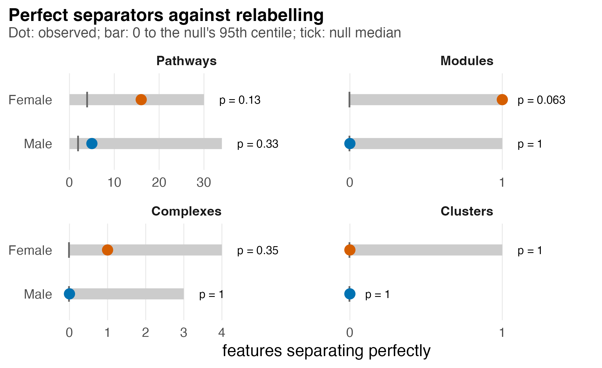

Each facet is one feature level, on its own x scale shared by both sexes, with one row per sex: 1,005 pathway scores, 8 module eigengenes, 98 complex scores and 7 cluster scores (`classification.rds`: `perfect`). The coloured dot counts the features that put all five PAS mice above, or all five below, all five vehicle mice. The grey bar runs from 0 to the 95th centile of the same count over all 252 ways of relabelling that sex's ten mice, a tick marks the null median, and the text gives the exact p, the share of relabellings with a count at least as large.

No level exceeds the relabelling null at p ≤ 0.05. Female pathways give the largest count, 16 against a null median of 4 (95th centile 30, p 0.13), and one female module separates perfectly against a null median of 0 (p 0.063). One female complex separates perfectly (p 0.35); male pathways give 5 against 2 (p 0.33), and no male module, complex or cluster separates. With five mice a side, some features will separate perfectly by chance alone, as the null shows.

## Workbooks

`c_data/F01.xlsx`, `c_data/S1.xlsx` and `c_data/S2.xlsx` hold one sheet per panel, named after the panel script (`a_design`, `S1a_filtering`, `S2b_module_traits`, …), each with the table that panel draws. The PERMANOVA, betadisper, envfit and per-component R² values quoted for F01 b and c and S2 a are in `02_Statistics/04_PCA/c_data/04_pca.xlsx`; the phenotype variance shares are in `pca.rds` and on the panel's axes.
