# F02_Proteins

Figure 2: within each sex, which proteins are the strongest candidates for follow-up, how they group by known interactions, and how every mouse looks for the strongest of them. Its supplements are S3, each comparison's protein list, and S4, sensitivity.

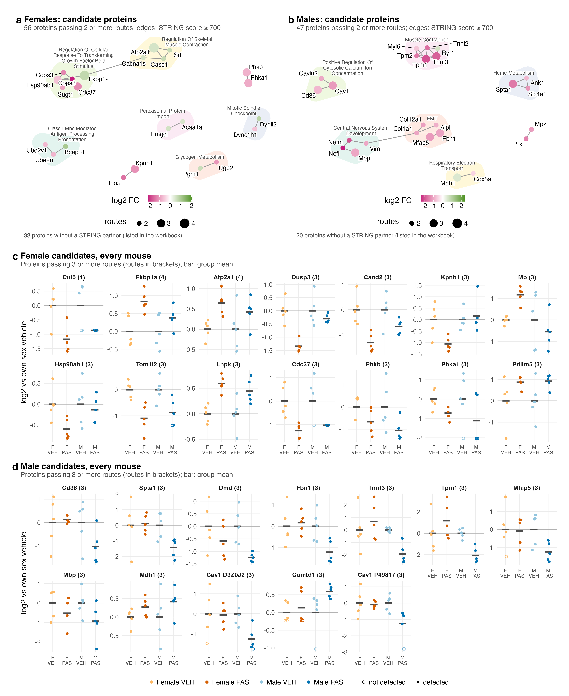

| | |
|---|---|
| Reads | `02_Statistics/06_Candidates/c_data/candidates.rds`, `02_Statistics/01_Fit/c_data/fit.rds`, `01_Processing/02_Quantification/c_data/proteins.rds` |
| Writes | `b_reports/<panel>.pdf/.png`, `b_reports/F02.pdf/.png` (180 × 220 mm), `c_data/F02.xlsx` |
| Run | `Rscript 04_Figures/F02_Proteins/a_script/F02.R` (each panel script also runs alone) |

Each panel is its own script in `a_script/`, beside the composite `F02.R`, which runs them, adds the letters, stitches them and writes one workbook; the supplements do the same from `a_script/supp/`. Panels read saved outputs and compute nothing beyond filtering, the network layout and centring on the vehicle mean. Candidates come from six routes (statistics, every mouse, both sexes, phenotype, module hub, pathway leading edge); 02_Statistics/06_Candidates describes each. They are discovery-stage candidates, not validated biomarkers.

## Panels

### a. Female candidate network

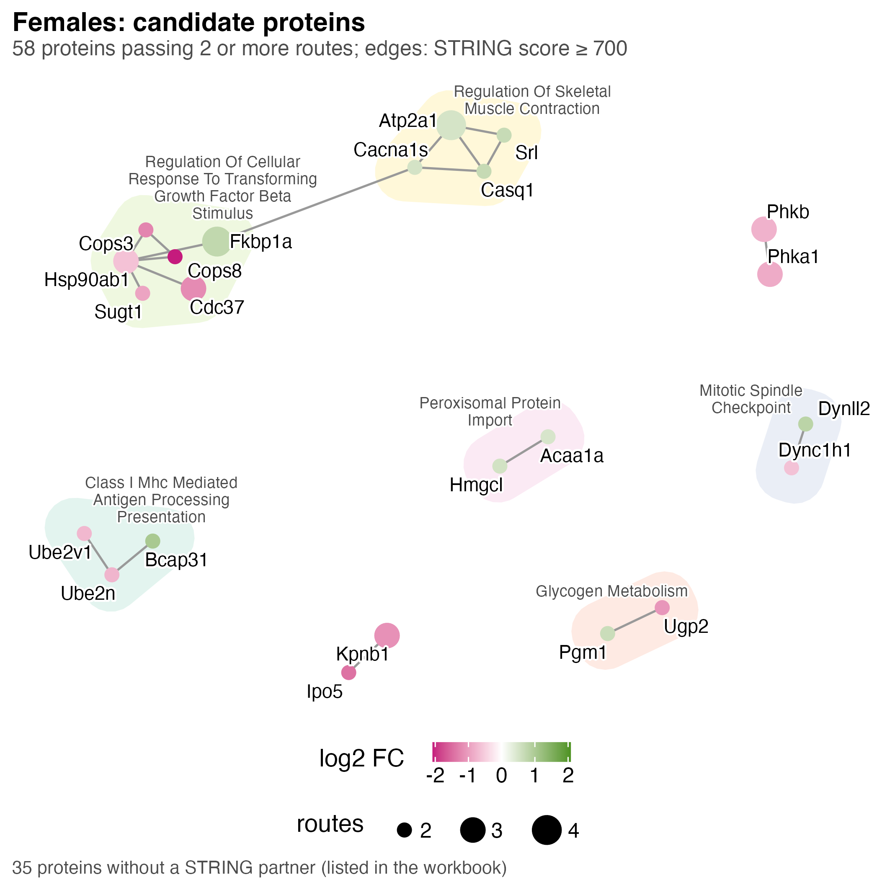

One node per female candidate passing two or more routes, 58 proteins. A grey edge joins two proteins whose STRING v12 combined score is at least 700. Node colour is the female PAS against vehicle log2 fold change, magenta down and green up, and node size the number of routes passed (2 to 4). A shaded hull marks a STRING community (igraph walktrap) of two or more members, named by its smallest-p over-represented Hallmark, Reactome or GO:BP term against the detected proteome and labelled with that name beside it. The layout pulls community members together, so distance between communities means nothing.

Of the 58, 32 fall and 26 rise, and 35 have no STRING partner, are counted under the panel and flagged `has_partner = FALSE` in the workbook, among them Cul5, which passes four routes. The other 23 form eight communities: TGF-β response regulation (Hsp90ab1, Cdc37, Cops3, Cops8, Sugt1, Fkbp1a), skeletal muscle contraction (Atp2a1, Cacna1s, Srl, Casq1), class I MHC antigen presentation (Ube2n, Ube2v1, Bcap31), and pairs for peroxisomal protein import, glycogen metabolism and the mitotic spindle checkpoint. Kpnb1 with Ipo5 and Phkb with Phka1 are linked but carry no over-represented term, so they have no hull. A hull's name may describe only some of its members. The every-mouse route is the commonest (55 proteins), then statistics (39) and pathway (22); no female protein passes the hub route.

### b. Male candidate network

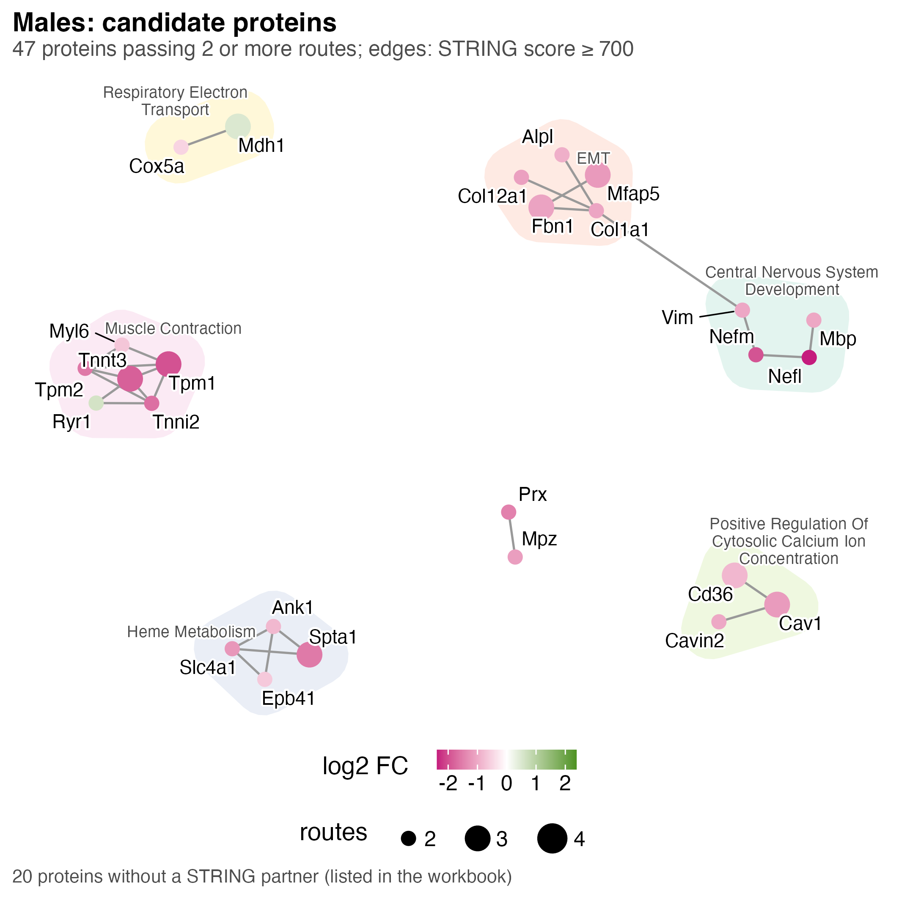

The same drawing for males: 47 candidate protein groups passing two or more routes, shown as 46 nodes because two Cav1 protein groups share one gene.

Of the 47, 36 fall and 11 rise, no protein passes more than three routes, and 20 genes have no STRING partner. The other 26 form seven communities: muscle contraction (Tpm1, Tpm2, Tnnt3, Tnni2, Myl6, Ryr1), EMT (Fbn1, Mfap5, Col1a1, Col12a1, Alpl), central nervous system development (Vim, Nefm, Nefl, Mbp), heme metabolism (Spta1, Slc4a1, Ank1, Epb41), positive regulation of cytosolic calcium (Cd36, Cav1, Cavin2), respiratory electron transport (Mdh1, Cox5a) and an unnamed pair, Prx with Mpz. Several of these are nerve (Mbp, Nefl, Nefm), red-cell (Spta1, Slc4a1, Ank1, Epb41) and extracellular matrix proteins, classes that fall in the male PAS composition scores (S1: vessel, nerve, red cell and myofibril all lower). Much of the male network may therefore record what went into the tube rather than a change inside the muscle fibres; read it beside 02_Statistics/05_Composition.

### c. Female candidates, every mouse

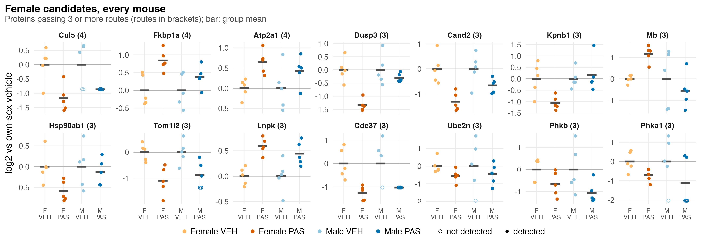

One small panel per female protein passing three or more routes, 14 in all, ordered by routes and then by p, with the route count in brackets. Each point is one mouse from any of the four groups, coloured by group and labelled under the x axis (F VEH, F PAS, M VEH, M PAS), with one group key under panel d for both c and d: its log2 abundance minus the mean of its own sex's vehicle mice, so each vehicle bar sits at zero. The black bar is the group mean, and each panel has its own y scale. An open circle marks a mouse in which the protein was not detected; its value is the quantified estimate, not a measurement.

Nine proteins fall and five rise in female PAS mice (log2 FC −1.39 to +0.85, p 2.1e-05 to 0.032), and all 14 were detected in every female mouse. Only Dusp3 reaches FDR ≤ 0.05 (0.022) or lfsr ≤ 0.05 (0.0098); Pdlim5 passes three routes without the statistics route (p 0.032). In males, eight of the 14 move the same way at p ≤ 0.05 (Cul5, Atp2a1, Tom1l2, Lnpk, Cdc37, Phkb, Phka1, Pdlim5), while Dusp3, Kpnb1, Mb and Hsp90ab1 show no detectable male change (p 0.30 to 0.77). The female separation is expected, since the routes chose these proteins from these same mice; it shows consistency, not independent confirmation.

### d. Male candidates, every mouse

The same drawing for the 11 male protein groups passing three or more routes. Cav1 appears twice, as two protein groups, each labelled with its accession (D3Z0J2, P49817). Nine fall and two rise (Mdh1, Comtd1), with log2 FC from −1.97 to +0.76 and p from 8.3e-05 to 0.0097. None reaches FDR ≤ 0.05 (the smallest is Cd36 at 0.094), and only Cd36 has lfsr ≤ 0.05 (0.013). Both Cav1 groups went undetected in one male PAS mouse, and Comtd1 in one male vehicle mouse. None of the 11 moves in females at p ≤ 0.05 (female p 0.11 to 0.98), and Tnnt3 and Tpm1 point the other way in female PAS mice (log2 FC +0.78 and +1.2). The list mixes myofibril (Tnnt3, Tpm1), extracellular matrix (Fbn1, Mfap5) and red-cell (Spta1) proteins, so the composition caveat from panel b applies here too.

## Notes

Route thresholds are deliberately loose and the routes are not independent: a strong protein tends to pass statistics and every mouse together. The cross-sex p-values in panels c and d come from `protein_contrasts` in `02_Statistics/01_Fit/c_data/01_fit.xlsx`.

## Supplementary Figure 3: proteins per contrast

Each comparison's own protein list, cut into co-expression clusters, and the sets each cluster over-represents.

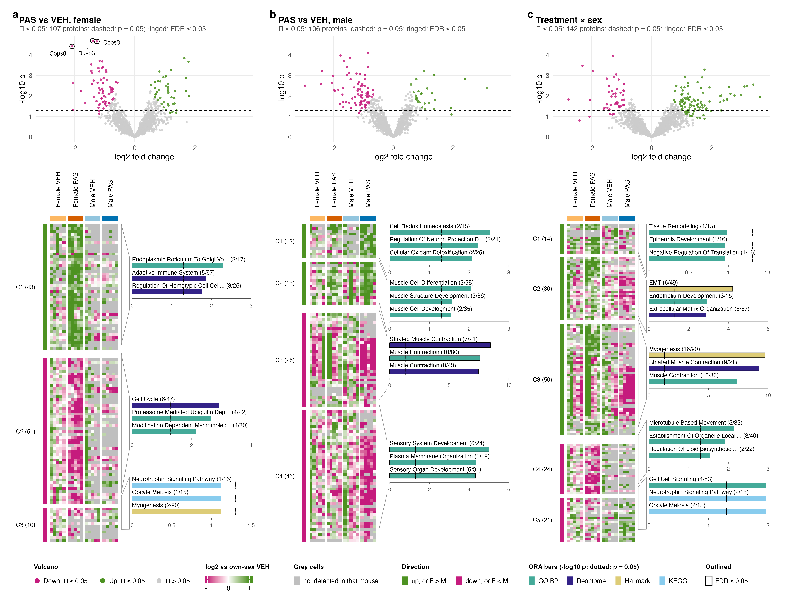

| | |
|---|---|
| Reads | `02_Statistics/01_Fit/c_data/fit.rds`, `01_Processing/02_Quantification/c_data/proteins.rds`, `02_Statistics/02_Enrichment/c_data/enrichment.rds` |
| Writes | `b_reports/supp/S3<letter>_<name>.pdf/.png`, `b_reports/supp/S3.pdf/.png` (180 × 242 mm), `c_data/S3.xlsx` |
| Run | `Rscript 04_Figures/F02_Proteins/a_script/supp/S3.R` (each panel script also runs alone) |

The three heatmaps sit over one shared key.

### a. Female PAS against vehicle

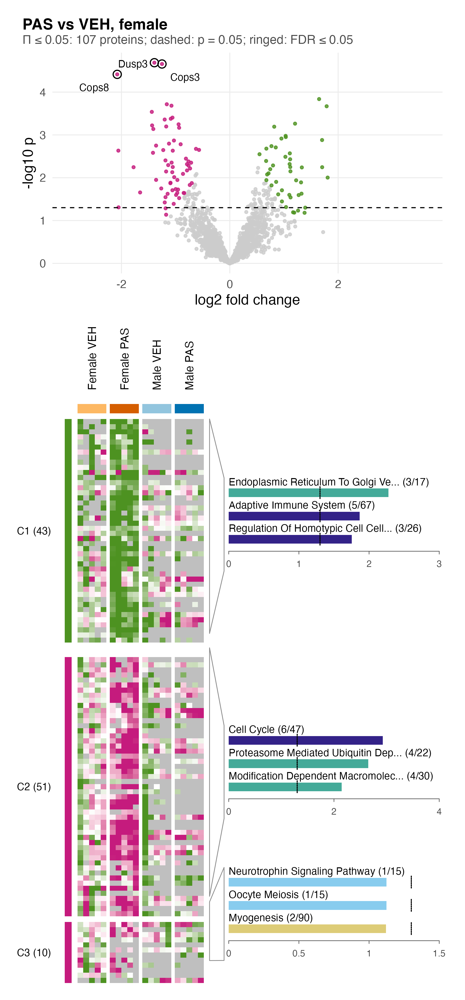

Each row is one of the 107 full-proteome proteins at Π ≤ 0.05 in the female PAS against vehicle contrast (`fit.rds`: `protein_contrasts`), and each column one of the 20 mice, grouped as Female VEH, Female PAS, Male VEH and Male PAS under the group colour bar. A cell is the protein's normalised log2 abundance (`E_norm`) minus its mean over the vehicle mice of the same sex, so green is above own-sex vehicle and magenta below, with the colour full at ±1.5 (the key's end breaks); a grey cell marks a mouse in which the protein was not detected (no precursor observed). Rows are split by the sign of the female fold change, 44 up (log2 FC 0.55 to 1.81) and 63 down (−2.08 to −0.57), and each block is cut into co-expression clusters in 02_Enrichment (`enrichment.rds`: `heatmap_clusters`). The tree is average-linkage clustering on 1 − Pearson r across the 20 mice of the drawn values, each pair of proteins over the mice where both were detected (`coexpression_tree()` in `helpers.R`), and `dynamicTreeCut::cutreeDynamic(method = "hybrid", deepSplit = 2, minClusterSize = 10)` cuts it. A pair sharing fewer than 5 such mice counts as uncorrelated (17 of 946 pairs in the up block and 121 of 1,953 in the down block here; 26 of 351 and 54 of 3,081 in panel b; 119 of 4,656 and 94 of 990 in panel c); a protein detected in fewer than 5 mice would stay off the tree, and none does. Clusters are numbered down the panel and labelled with their size, and rows run in tree order within each. A protein the cut leaves unassigned is drawn at the end of its block, under the block's last cluster label but outside its count and its ORA (here Siglec1 in the up block, Tubb2b and Rps15 in the down block). Up is one cluster, C1 (43); down splits into C2 (51) and C3 (10).

Beside each cluster are the three sets with the smallest p (ties broken by FDR) among those its proteins over-represent at p ≤ 0.05 against the detected proteome (`enrichment.rds`: `cluster_ora`, `fgsea::fora` on GO:BP, Reactome, Hallmark and KEGG, BH within cluster and collection), fewer where fewer qualify, and "no set at p ≤ 0.05" where none does. Overlapping sets are not merged, so near-duplicates such as Reactome and GO:BP muscle contraction can both appear. A cluster's bars sit in a frame centred on it, moved up or down only where the frame would overlap the next one or run past its block; bar length is −log10 p on one axis (0 to 10.2) shared by panels a to c, so a bar of a given length is the same p in every panel. Fill gives the database, a black outline marks FDR ≤ 0.05 and the dotted tick p = 0.05. Each label gives the set's proteins in the cluster over its size, in sentence case with a few long words shortened (Reg., Dev., Proc., Org., Pos., Neg., Dep., Loc., Biosynth.), on at most two lines of 24 characters; a name two lines cannot hold ends at its last whole word with an ellipsis (four here; the workbook has them in full), and where two sets of one cluster share a name a tag gives the database (GO, R, H or K). No female set reaches FDR ≤ 0.05. C1: ER to Golgi vesicle-mediated transport (3/17, p = 0.005), adaptive immune system (5/67, 0.014), regulation of homotypic cell-cell adhesion (3/26, 0.018). C2: Reactome cell cycle (6/47, p = 0.001, FDR 0.17), proteasome-mediated ubiquitin-dependent protein catabolic process (4/22, 0.002), modification-dependent macromolecule catabolic process (4/30, 0.007). C3 has none at p ≤ 0.05.

The clusters are cut from proteins chosen for responding, and ORA on a cluster of 10 to 51 proteins has little power, with BH run within that cluster only, so read the bars as a description of each cluster and not as a test.

The female PAS block separates by construction, since the female contrast chose the rows; the male columns are the informative part, and only 6 of the 107 are also on the male list. Of the 107, 20 have no precursor observed in any male run, so their male cells are grey.

### b. Male PAS against vehicle

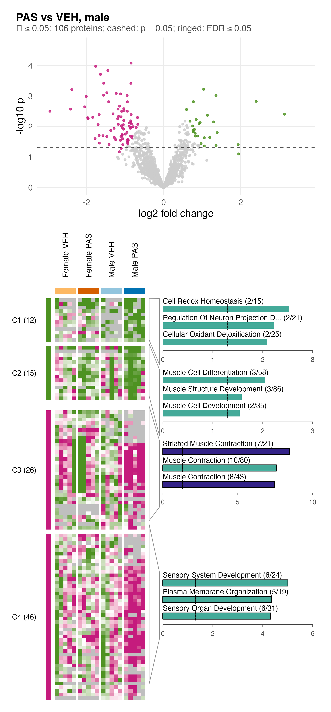

The same layout for the 106 proteins at Π ≤ 0.05 in the male PAS against vehicle contrast. Down outnumbers up, 79 (log2 FC −2.95 to −0.67) against 27 (0.60 to 3.14), and the male PAS block carries that pattern because the male contrast chose the rows. Up splits into C1 (12) and C2 (15), down into C3 (26) and C4 (46), with 7 down proteins unassigned (Srsf5, Srrm2, Nufip2, Ddah1, Eif4b, Faf1, Vcp). C3 holds the muscle sets, all three at FDR ≤ 0.05: Reactome striated muscle contraction (7/21, FDR 5e-7), GO:BP muscle contraction (10/80, 2e-5) and Reactome muscle contraction (8/43, 2e-6), out of 24 C3 sets at FDR ≤ 0.05. C4's three also pass: sensory system development (6/24, 0.007), plasma membrane organization (5/19, 0.012) and sensory organ development (6/31, 0.012), out of 5. The up clusters' sets, C1 cell redox homeostasis (2/15), regulation of neuron projection development (2/21) and cellular oxidant detoxification (2/25), and C2 muscle cell differentiation (3/58), muscle structure development (3/86) and muscle cell development (2/35), have p between 0.003 and 0.029 and FDR 1. Both up frames are taller than their 12 and 15 rows, so C1's frame starts level with the group colour bar.

The female columns are the informative part; of the 6 proteins shared with the female list, 3 fall in both sexes, 2 rise in females and fall in males, and 1 does the reverse. None of the 106 reaches FDR ≤ 0.05; the smallest FDR is 0.094. With five mice per group, a protein at Π ≤ 0.05 is a ranked candidate for follow-up and not a confirmed change.

The solid green stripe in one Female VEH and one Female PAS column, here and in panel c, is two mice, VEH_F5 and PAS_F2: 14 of the male list's proteins (fast-muscle sarcomere proteins such as Myh4, Tnnt3, Tnnc2 and Mybpc2, plus Acta1 and Col1a1) sit more than 1.5 log2 above the median of both mice's group-mates (20 of the 142 in panel c). Their limpa sample weights are 0.49 (VEH_F5, lowest of the females) and 0.92 (PAS_F2), their run depths 13,377 and 18,352 precursors, their haemoglobin shares 0.42% and 0.34%, and they score highest in their groups on the 05_Composition myofibril marker set.

### c. Treatment × sex

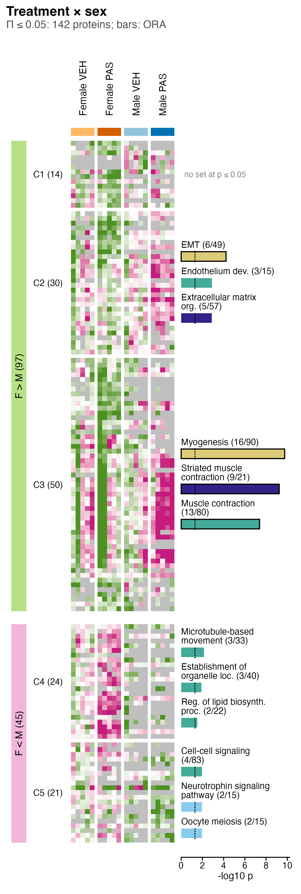

The same layout for the 142 proteins at Π ≤ 0.05 in the treatment × sex contrast, the female PAS effect minus the male PAS effect. Rows are split by the sign of that difference: F > M (97 proteins, log2 FC 0.75 to 3.60) where the female effect is the more positive, and F < M (45, −2.76 to −0.91) where it is the more negative. F > M splits into C1 (14), C2 (30) and C3 (50), with 3 unassigned (Siglec1, Abcg2, Sec11a), and F < M into C4 (24) and C5 (21). C3 holds the same muscle sets as the male C3: Hallmark myogenesis (16/90, FDR 6e-9), Reactome striated muscle contraction (9/21, 8e-8) and GO:BP muscle contraction (13/80, 3e-5), out of 36 at FDR ≤ 0.05. C2 has Hallmark EMT (6/49, FDR 0.002), endothelium development (3/15, p = 0.001, FDR 0.54) and Reactome extracellular matrix organization (5/57, p = 0.001, FDR 0.10); C1 has no set at p ≤ 0.05. The F < M sets, C4 microtubule-based movement (3/33), establishment of organelle localization (3/40) and regulation of lipid biosynthetic process (2/22), and C5 cell-cell signaling (4/83), KEGG neurotrophin signaling (2/15) and KEGG oocyte meiosis (2/15), have p between 0.007 and 0.029 and FDR 0.18 to 1.

A positive difference can come from a rise in females, a fall in males or both, and the heatmap shows which: many F > M rows are green in female PAS and magenta in male PAS. Of the 142, 60 are also on the female list and 45 on the male list, and 15 have no precursor observed in any male run, so their male cells are grey and the difference rests on the females alone. No protein reaches FDR ≤ 0.05 (smallest 0.21).

### d. Volcano plots

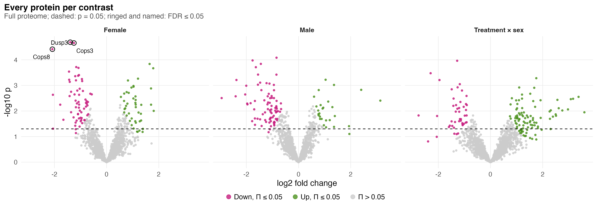

One point per full-proteome protein, 1,962 per contrast, with log2 fold change on the x axis and −log10 p on the y axis; facets are female PAS against vehicle, male PAS against vehicle and the female minus male difference. Points at Π ≤ 0.05 are green when up and magenta when down, the rest grey; the dashed line marks p = 0.05, and a black ring and the gene name mark FDR ≤ 0.05 (BH within contrast). Π is a curved boundary, so a fold change above 2 can pass it with p above 0.05 (7 female, 3 male and 25 interaction proteins do) and a small fold change can fail it with p below 0.05.

At p ≤ 0.05 the contrasts give 177 (female), 193 (male) and 162 (interaction) proteins. Only three proteins pass FDR ≤ 0.05, all female and all down: Cops3 (log2 FC −1.25, FDR 0.022), Dusp3 (−1.39, 0.022) and Cops8 (−2.08, 0.025).

Π is p^|log2 FC| (Xiao et al. 2014); it ranks on p and fold change together and controls no error rate. The heatmaps' rows are chosen on the contrast they show, so the selected sex's PAS columns will always look separated; the other sex's columns and the volcano's FDR rings are the fairer read.

## Supplementary Figure 4: sensitivity

How the protein results move when one processing or model choice changes.

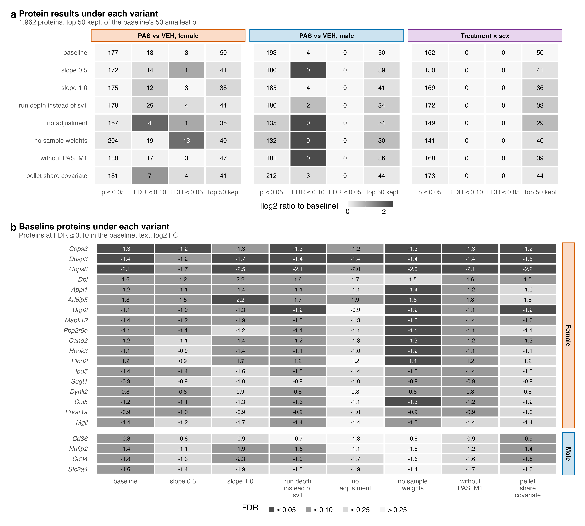

| | |
|---|---|
| Reads | `02_Statistics/07_Sensitivity/c_data/sensitivity.rds` |
| Writes | `b_reports/supp/S4<letter>_<name>.pdf/.png`, `b_reports/supp/S4.pdf/.png` (180 × 162 mm), `c_data/S4.xlsx` |
| Run | `Rscript 04_Figures/F02_Proteins/a_script/supp/S4.R` (each panel script also runs alone) |

Each variant changes one choice and refits the three comparison contrasts in the full proteome (see `02_Statistics/07_Sensitivity/README.md`).

### a. Protein results under each variant

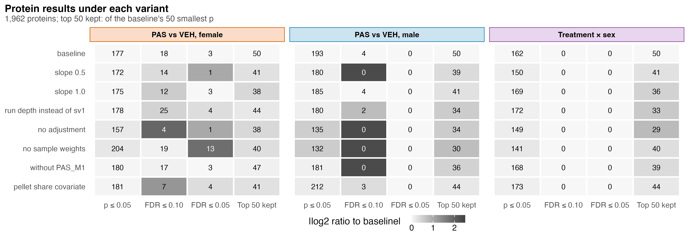

Each cell is one variant (row) in one contrast (facet: female PAS against vehicle, male PAS against vehicle, treatment × sex) and one measure (column). The measures are the number of the 1,962 proteins at p ≤ 0.05, at FDR ≤ 0.10 and at FDR ≤ 0.05, and how many of the baseline's 50 smallest p-values stay among the variant's 50 smallest. The number in each cell is the count; the fill is the count's log2 ratio to the baseline with one added to both, red for fewer and grey for more, capped at ±2.5, so the baseline row is white.

Every variant finds 132 to 212 proteins at p ≤ 0.05. Males drop most without adjustment (135) or without sample weights (132), from 193 at baseline. The female FDR ≤ 0.10 count runs from 4 (no adjustment) to 25 (run depth instead of sv1), and the female FDR ≤ 0.05 count from 1 to 13 (no sample weights). The male FDR ≤ 0.10 count is 4 at baseline and 0 under four variants, and no variant finds a male protein at FDR ≤ 0.05 or an interaction protein at FDR ≤ 0.10. The top 50 keeps 38 to 47 in females, 30 to 44 in males and 29 to 44 for the interaction. The short list that clears an FDR line depends on the choice.

### b. Baseline proteins under each variant

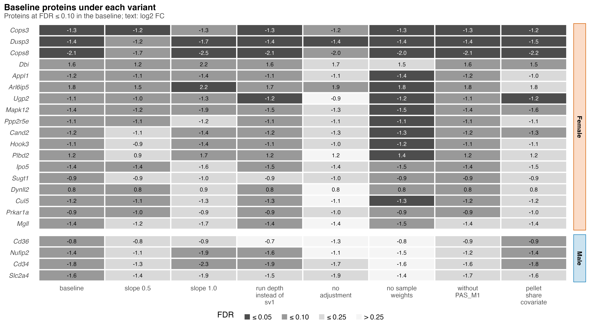

Each row is one of the 22 proteins at FDR ≤ 0.10 in the baseline (18 female, 4 male, none for the interaction), sorted by baseline FDR within each sex, and each column a variant. Tile shade bins the protein's FDR under that variant, from dark grey (≤ 0.05) through mid grey (≤ 0.10) and light grey (≤ 0.25) to near white (> 0.25); the text is the log2 FC, white on the darkest tiles.

No protein changes sign under any variant. Cops3, Dusp3 and Cops8 stay at FDR ≤ 0.10 under all seven variants and at FDR ≤ 0.05 under five, six and five of them; Dusp3's worst is 0.051, under slope 0.5. Arl6ip5, Mapk12 and Ugp2 hold under six, and Mgll and Sugt1 under only two. The four male proteins start just under the line (baseline FDR 0.094 to 0.096): Nufip2 and Cd34 stay at FDR ≤ 0.10 under slope 1.0, run depth and pellet share (3 of 7), Cd36 under pellet share alone, and Slc2a4 under none (best 0.108). So only two of the four male proteins that slope 1.0 finds in panel a are baseline proteins. The direction of each change is steadier than its FDR: with five mice per group most of these proteins sit near the FDR line, and a small change to the model moves them across it.

The variants are: limpa detection-curve slope 0.5 or 1.0 instead of 0.7 (dpcQuant rerun on the same 1,962 proteins, surrogate variable kept from the baseline); measured log2 run depth as the covariate instead of sv1; no covariate; `dpcDE(sample.weights = FALSE)`; the re-injected male PAS run (PAS_M1) removed; and the pellet's MitoCarta share added to the design. The baseline row is checked against `02_Statistics/01_Fit`.

## Workbooks

`c_data/F02.xlsx`, `c_data/S3.xlsx` and `c_data/S4.xlsx` hold one sheet per panel, named after the panel script, each with the table that panel draws. In `S3.xlsx` each heatmap panel gives two sheets: its proteins in drawn order with direction and cluster (`<panel>_heatmap`, cluster empty where unassigned) and its ORA bars (`<panel>_ora`, the drawn `cluster_ora` rows as stored). The cross-sex p-values in F02 c and d come from `protein_contrasts` in `02_Statistics/01_Fit/c_data/01_fit.xlsx`.
