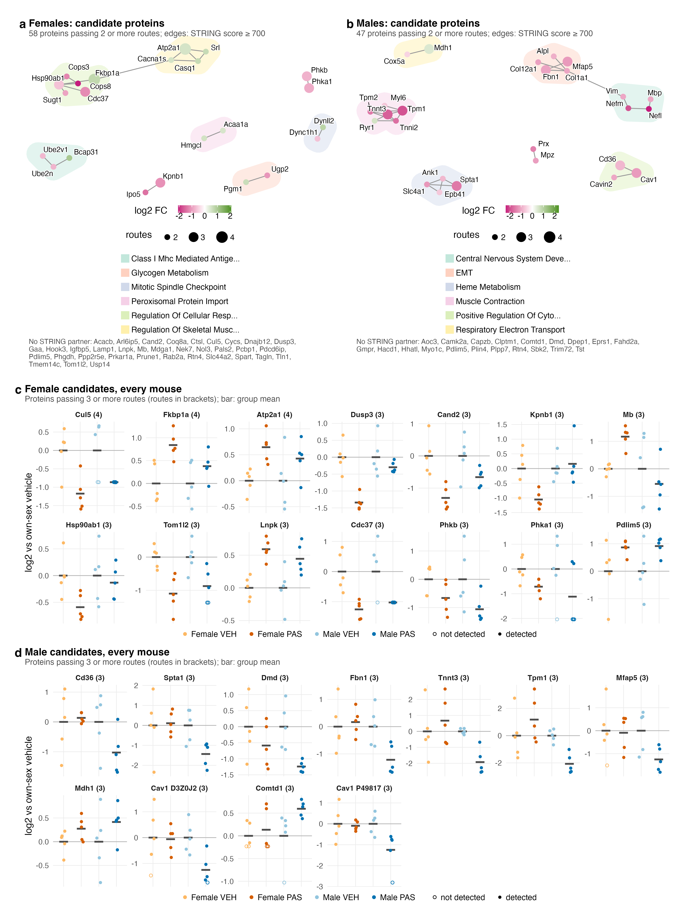
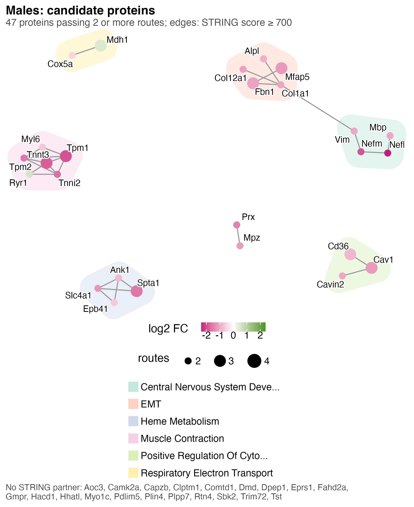
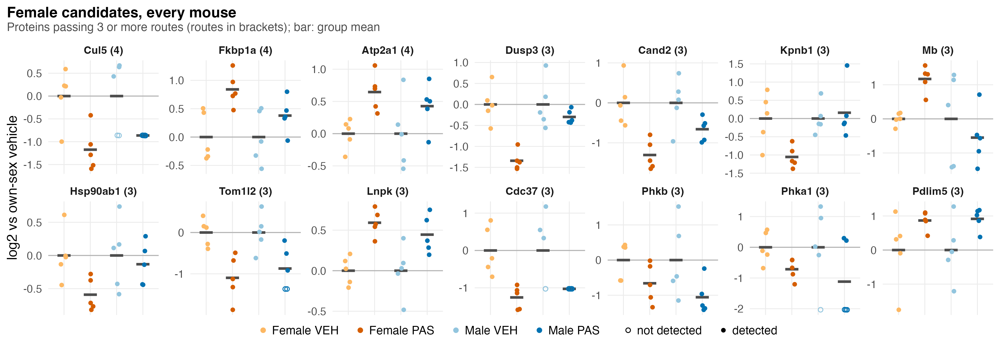
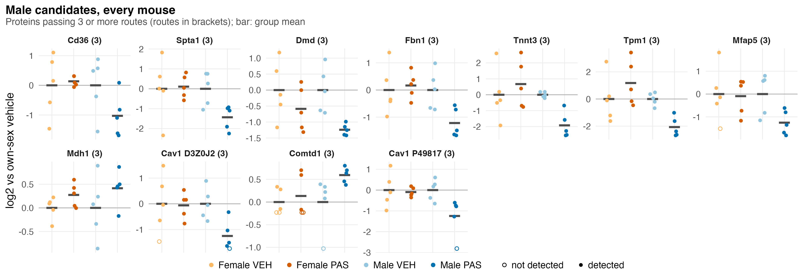

# F02_Proteins

Figure 2: within each sex, which proteins are the strongest candidates for follow-up, how they group by known interactions, and how every mouse looks for the strongest of them.

| | |
|---|---|
| Reads | `02_Statistics/06_Candidates/c_data/candidates.rds`, `02_Statistics/01_Fit/c_data/fit.rds`, `01_Processing/02_Quantification/c_data/proteins.rds` |
| Writes | `b_reports/panels/<panel>.pdf/.png`, `b_reports/F02_composite.pdf/.png` (180 × 240 mm), `c_data/F02.xlsx` |
| Run | `Rscript 04_Figures/F02_Proteins/a_script/F02_composite.R` (each panel script also runs alone) |

Each panel is its own script in `a_script/panels/`; the composite runs them, adds the letters, stitches them and writes one workbook. Panels read saved outputs and compute nothing beyond filtering, the network layout and centring on the vehicle mean. Candidates come from six routes (statistics, every mouse, both sexes, phenotype, module hub, pathway leading edge); 02_Statistics/06_Candidates describes each. They are discovery-stage candidates, not validated biomarkers.

## Panels

### a. Female candidate network

One node per female candidate passing two or more routes, 58 proteins. A grey edge joins two proteins whose STRING v12 combined score is at least 700. Node colour is the female PAS against vehicle log2 fold change, magenta down and green up, and node size the number of routes passed (2 to 4). A shaded hull marks a STRING community (igraph walktrap) of two or more members, named by its smallest-p over-represented Hallmark, Reactome or GO:BP term against the detected proteome; long names are cut short in the key. The layout pulls community members together, so distance between communities means nothing.

Of the 58, 32 fall and 26 rise, and 35 have no STRING partner and are listed under the panel, among them Cul5, which passes four routes. The other 23 form eight communities: TGF-β response regulation (Hsp90ab1, Cdc37, Cops3, Cops8, Sugt1, Fkbp1a), skeletal muscle contraction (Atp2a1, Cacna1s, Srl, Casq1), class I MHC antigen presentation (Ube2n, Ube2v1, Bcap31), and pairs for peroxisomal protein import, glycogen metabolism and the mitotic spindle checkpoint. Kpnb1 with Ipo5 and Phkb with Phka1 are linked but carry no over-represented term, so they have no hull. A hull's name may describe only some of its members. The every-mouse route is the commonest (55 proteins), then statistics (39) and pathway (22); no female protein passes the hub route.

### b. Male candidate network

The same drawing for males: 47 candidate protein groups passing two or more routes, shown as 46 nodes because two Cav1 protein groups share one gene.

Of the 47, 36 fall and 11 rise, no protein passes more than three routes, and 20 genes have no STRING partner. The other 26 form seven communities: muscle contraction (Tpm1, Tpm2, Tnnt3, Tnni2, Myl6, Ryr1), EMT (Fbn1, Mfap5, Col1a1, Col12a1, Alpl), central nervous system development (Vim, Nefm, Nefl, Mbp), heme metabolism (Spta1, Slc4a1, Ank1, Epb41), positive regulation of cytosolic calcium (Cd36, Cav1, Cavin2), respiratory electron transport (Mdh1, Cox5a) and an unnamed pair, Prx with Mpz. Several of these are nerve (Mbp, Nefl, Nefm), red-cell (Spta1, Slc4a1, Ank1, Epb41) and extracellular matrix proteins, classes that fall in the male PAS composition scores (S1: vessel, nerve, red cell and myofibril all lower). Much of the male network may therefore record what went into the tube rather than a change inside the muscle fibres; read it beside 02_Statistics/05_Composition.

### c. Female candidates, every mouse

One small panel per female protein passing three or more routes, 14 in all, ordered by routes and then by p, with the route count in brackets. Each point is one mouse from any of the four groups, coloured by group: its log2 abundance minus the mean of its own sex's vehicle mice, so each vehicle bar sits at zero. The black bar is the group mean, and each panel has its own y scale. An open circle marks a mouse in which the protein was not detected; its value is the quantified estimate, not a measurement.

Nine proteins fall and five rise in female PAS mice (log2 FC −1.39 to +0.85, p 2.1e-05 to 0.032), and all 14 were detected in every female mouse. Only Dusp3 reaches FDR ≤ 0.05 (0.022) or lfsr ≤ 0.05 (0.0098); Pdlim5 passes three routes without the statistics route (p 0.032). In males, eight of the 14 move the same way at p ≤ 0.05 (Cul5, Atp2a1, Tom1l2, Lnpk, Cdc37, Phkb, Phka1, Pdlim5), while Dusp3, Kpnb1, Mb and Hsp90ab1 show no detectable male change (p 0.30 to 0.77). The female separation is expected, since the routes chose these proteins from these same mice; it shows consistency, not independent confirmation.

### d. Male candidates, every mouse

The same drawing for the 11 male protein groups passing three or more routes. Cav1 appears twice, as two protein groups, each labelled with its accession (D3Z0J2, P49817). Nine fall and two rise (Mdh1, Comtd1), with log2 FC from −1.97 to +0.76 and p from 8.3e-05 to 0.0097. None reaches FDR ≤ 0.05 (the smallest is Cd36 at 0.094), and only Cd36 has lfsr ≤ 0.05 (0.013). Both Cav1 groups went undetected in one male PAS mouse, and Comtd1 in one male vehicle mouse. None of the 11 moves in females at p ≤ 0.05 (female p 0.11 to 0.98), and Tnnt3 and Tpm1 point the other way in female PAS mice (log2 FC +0.78 and +1.2). The list mixes myofibril (Tnnt3, Tpm1), extracellular matrix (Fbn1, Mfap5) and red-cell (Spta1) proteins, so the composition caveat from panel b applies here too.

## Notes

Route thresholds are deliberately loose and the routes are not independent: a strong protein tends to pass statistics and every mouse together. The cross-sex p-values in panels c and d come from `protein_contrasts` in `02_Statistics/01_Fit/c_data/01_fit.xlsx`.

The moderated F-test heatmap and its pattern enrichment, which this figure replaced, are in `S6_Protein_patterns`.

## Workbook

`c_data/F02.xlsx` holds one sheet per panel, plus `read_me`, `input_manifest` and `package_versions`.
