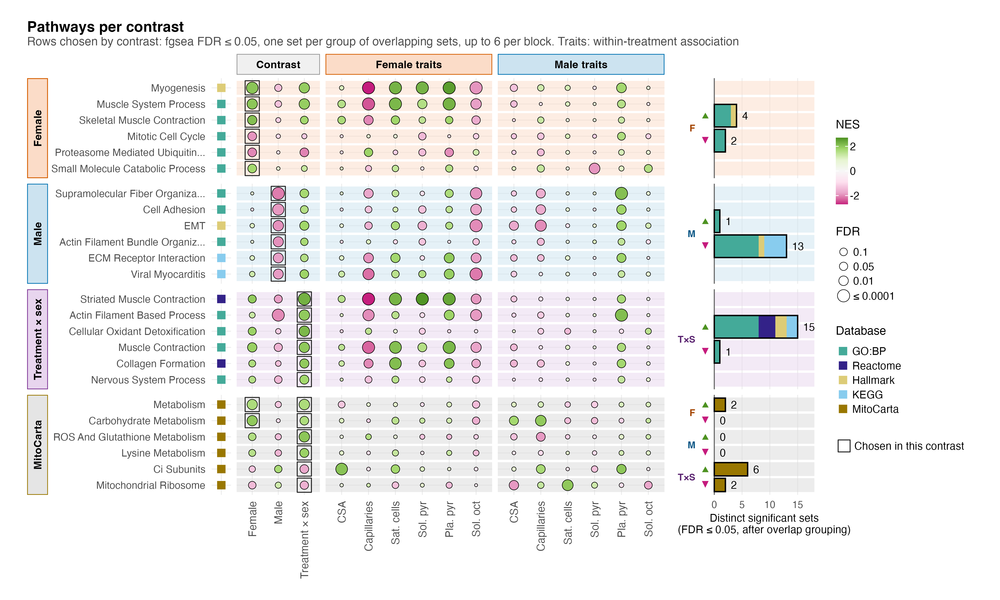
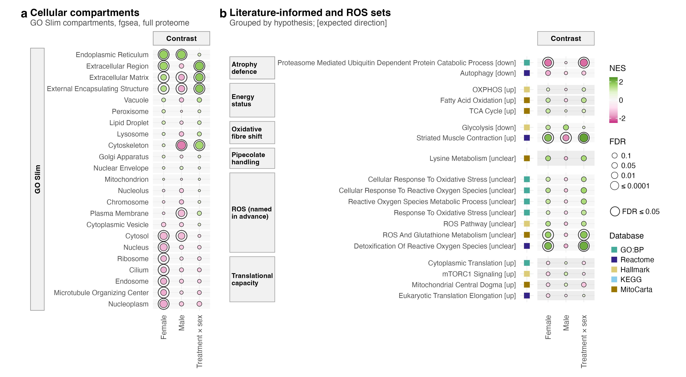
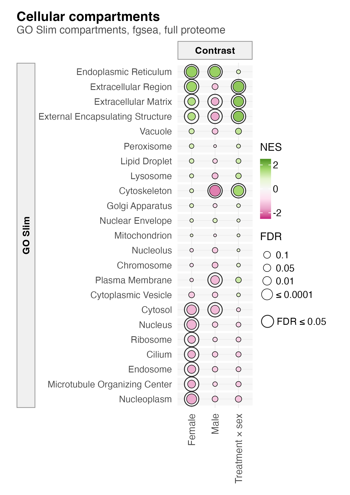
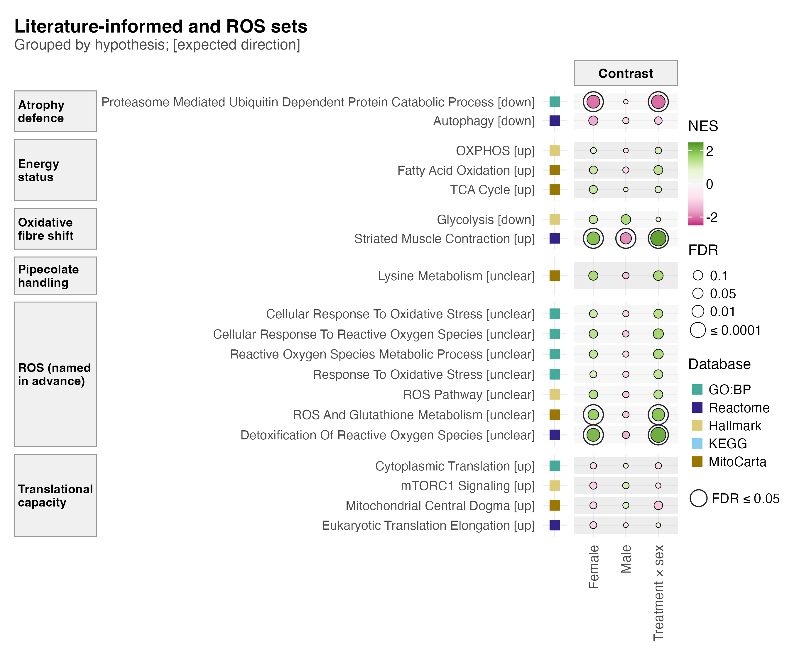

# F03_Pathways

- Figure 3: which pathways each comparison moves.
- Supplementary Figure 5: how the GO Slim compartments and the literature and ROS sets move in each comparison.

## Figure 3

### a. Pathways per contrast

24 gene sets in four blocks of six: the shown full-proteome sets of the female, male and interaction contrasts, then MitoCarta pathways shown in any contrast (shown sets are defined in [`02_Enrichment`](../../02_Statistics/02_Enrichment/README.md)). Each row is drawn in the three contrast columns and at every trait in both sexes; dot fill is NES (magenta down, green up) and area −log10 FDR. Bars count distinct sets at FDR ≤ 0.05: females 4 up and 2 down, males 1 up and 13 down, interaction 15 up and 1 down; in MitoCarta, females 2 up, interaction 6 up and 2 down, males none. fgsea permutes genes and runs optimistic: camera gives p ≤ 0.05 for only 3 of the 24 rows in the contrast that shows them, and the male falls in cytoskeletal, adhesion and matrix sets match the male pellet composition shifts (S1 f).

## Supplementary Figure 5

### a. Cellular compartments

23 GO Slim compartments (27 to 737 proteins; organelle, holding most of the proteome, is not tested) per contrast, drawn as in Figure 3 with a ring at FDR ≤ 0.05 (BH across the 23). Females have 11 passing (endoplasmic reticulum and extracellular terms up, nuclear and cytosolic terms down), males 6 (5 down, 1 up) and the interaction 4 (all up). Mitochondrion shows no shift in any contrast (FDR ≥ 0.98). The compartments overlap heavily, so these FDRs run optimistic.

### b. Literature and ROS sets

19 sets, one block per hypothesis, each label ending in the direction its hypothesis expected under PAS. In females the proteasome set falls (NES −2.03, FDR 0.0028) and striated muscle contraction rises (1.95, 0.0033), both as expected, and two ROS sets rise. In males only striated muscle contraction passes, and it falls (−1.83, 0.020). The 12 literature-informed sets were named after the first contrast results had been seen; the 7 ROS sets were named before.

## Run

`Rscript 04_Figures/F03_Pathways/a_script/F03.R` and `a_script/supp/S5.R`. Each panel script also runs alone.

## Workbook

`c_data/F03.xlsx` holds `a_pathways_cells` (every drawn cell) and `a_pathways_counts` (distinct and all sets at FDR ≤ 0.05). camera p and FDR for every set are in the `fgsea` sheet of [`02_Enrichment`](../../02_Statistics/02_Enrichment/README.md)'s workbook. `c_data/S5.xlsx` holds `S5a_compartments` and `S5b_literature`.
