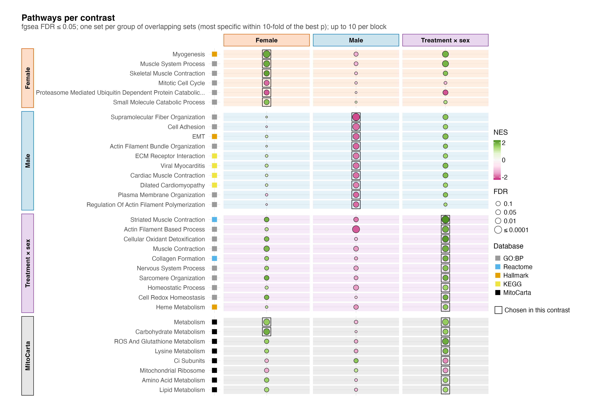
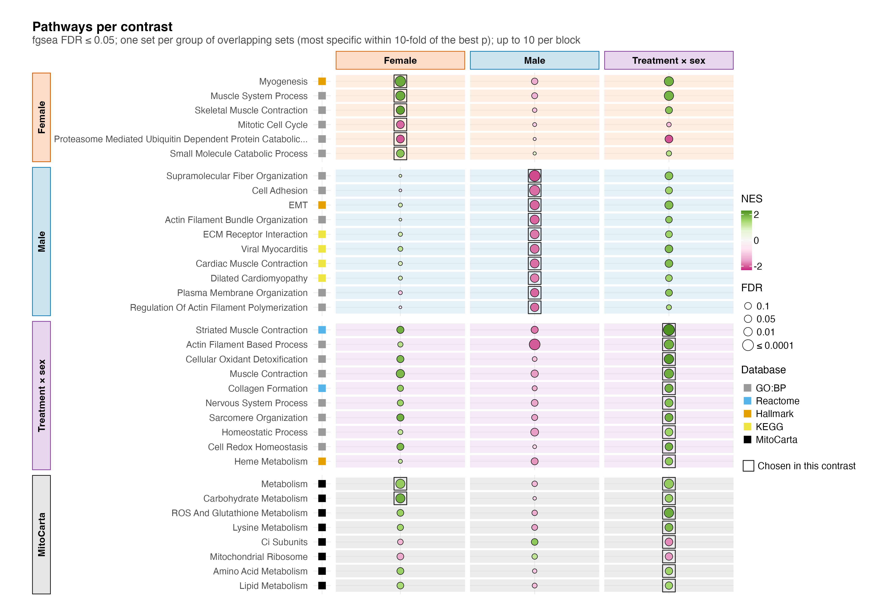

# F03_Pathways

Figure 3: which pathways each comparison moves.

| | |
|---|---|
| Reads | `02_Statistics/02_Enrichment/c_data/enrichment.rds` |
| Writes | `b_reports/panels/a_pathways.pdf/.png`, `b_reports/F03_composite.pdf/.png` (180 × 124 mm), `c_data/F03.xlsx` |
| Run | `Rscript 04_Figures/F03_Pathways/a_script/F03_composite.R` (the panel script also runs alone) |

The figure is one panel, its own script in `a_script/panels/`; the composite runs it and writes one workbook, with no panel letter. The panel reads saved outputs and computes nothing beyond filtering and ordering: its rows are the sets 02_Enrichment flags as `shown`, and each row is drawn in all three contrasts. Within one contrast, the sets at fgsea FDR ≤ 0.05 are grouped by an average-linkage Jaccard tree on their tested members, cut at 0.70, and each group is shown by its most specific set whose p is within 10-fold of the group's best; `representative_sets()` in `helpers.R` gives the rule and its sources (EnrichmentMap, DAVID, HRvLR).

## Panels

### a. Pathways per contrast

One row per gene set and one column per contrast: PAS against vehicle in females, the same in males, and the interaction (Treatment × sex, the female response minus the male). Each dot's fill is the fgsea normalised enrichment score, magenta for sets whose proteins fall and green for sets that rise, on a scale set by the largest |NES| drawn (±2.3); its area grows with −log10 FDR from a small minimum, so a cell near FDR 1 still shows its colour, and stops growing at FDR 0.0001; the key reads in FDR (0.1, 0.05, 0.01, ≤ 0.0001). The square before each row gives its collection: GO:BP grey, Reactome blue, Hallmark orange, KEGG legacy yellow, MitoCarta black. The rows sit in four blocks. Female, Male and Treatment × sex hold the full-proteome sets that contrast shows, by FDR, up to 10 each; MitoCarta holds the MitoCarta pathways (mitochondrial universe, 595 proteins) shown in any contrast, by their smallest p. A set is listed once, in the first block that reaches it. That gives 34 rows: 6 Female, 10 Male, 10 Treatment × sex and 8 MitoCarta. A thin dark outline marks the cell that put each row in its block ("Chosen in this contrast" in the key): the block's own contrast in the first three blocks, and in the MitoCarta block every contrast that shows the set (female and the interaction for metabolism and carbohydrate metabolism, the interaction alone for the other six). Each row sits on a light band in its block's colour, the same as the block's strip.

Females show six full-proteome sets, four up (myogenesis at FDR 0.00029, muscle system process, skeletal muscle contraction, small molecule catabolism) and two down (mitotic cell cycle, proteasome-mediated catabolism). Males show 14, and the 10 drawn are all down, among them supramolecular fibre organisation (FDR 1.5e-05), cell adhesion, actin, extracellular matrix, EMT, plasma membrane and cardiac sets. The interaction shows 16; four are already listed in the blocks above, and 10 of the other 12 are drawn, all higher in the female response and led by striated muscle contraction (FDR 9.2e-05).

Read across the columns and the sexes mostly disagree: female and male NES differ in sign in 20 of the 26 full-proteome rows, and the interaction takes the female sign in 23. Because the interaction subtracts the male response, a green interaction dot can come from a male fall as much as a female rise, and all 10 male rows pair a male fall with a small female NES (|NES| ≤ 1.22). Two male FDR-level sets, actin filament based process and homeostatic process, sit under Treatment × sex because another set represents each of their groups in males. The male falls in cytoskeletal, extracellular matrix and cardiac-muscle sets line up with the lower vessel, nerve, red-cell and myofibril content of male PAS pellets (S1), so they may reflect pellet composition as much as a change in the fibres.

In the MitoCarta block, females gain the broad metabolism set (NES 1.65) and carbohydrate metabolism (1.97), both at FDR 0.0033 and both also shown in the interaction. The other six rows come from the interaction alone: ROS and glutathione metabolism (NES 2.02, FDR 0.0024), lysine metabolism (1.86, 0.023), complex I subunits (−1.70, 0.031), the mitochondrial ribosome (−1.60, 0.048), and amino acid and lipid metabolism (1.55 and 1.52, both 0.050). No MitoCarta set reaches FDR ≤ 0.05 in males. The female and male NES differ in sign in all eight rows, so each interaction result combines a move one way in females with a move the other way in males. For the six interaction-only sets, neither sex reaches FDR ≤ 0.05 alone (female 0.089 to 0.30, male 0.12 to 0.68).

A shift in the pellet's MitoCarta share between PAS and vehicle was not detected within either sex (S1 e), but several other marker scores do differ (S1 f: sarcoplasmic reticulum in females; vessel, nerve, red cell and myofibril in males), so pellet composition cannot be ruled out as a contributor to the within-sex results here. ROS and glutathione metabolism in the interaction is one of the four rows camera supports at p ≤ 0.05 (p 0.013), and 02_Enrichment notes that several FDR-level MitoCarta terms have singscore p > 0.2.

## Notes

fgsea permutes genes, so its FDR runs optimistic when genes are correlated (Wu & Smyth 2012). Two checks sit beside every set in the 02_Enrichment workbook: camera (`camera_p`, `camera_fdr`), which estimates the set's own inter-protein correlation, and the set's singscore contrast tested across mice. Of the 34 rows, camera gives p ≤ 0.05 in the contrast that shows the set for 4 and FDR ≤ 0.05 for none. The 4 are proteasome-mediated catabolism, lower in female PAS (camera p 0.003), plasma membrane organisation in males (p 0.034), and nervous system process (p 0.043) and MitoCarta ROS and glutathione metabolism (p 0.013) in the interaction. Read the rest as rankings, not confirmed set shifts.

## Workbook

`c_data/F03.xlsx` holds one sheet, `a_pathways`, with every drawn cell (block, set, collection, universe, contrast, NES, p, FDR, whether that contrast shows the set, whether the cell is outlined (`selected`), camera p and FDR), plus `read_me`, `input_manifest` and `package_versions`.
