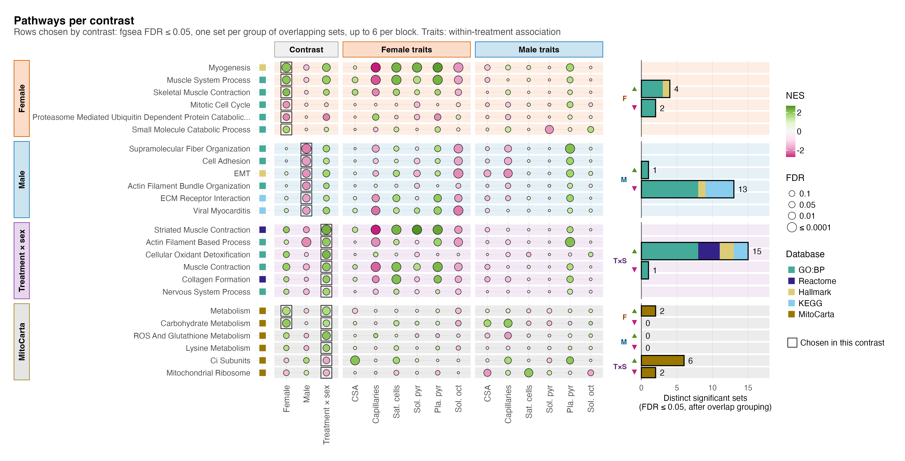

# F03_Pathways

Figure 3: which pathways each comparison moves. Its supplement is S5, the GO Slim compartments and the literature-informed and ROS sets.

| | |
|---|---|
| Reads | `02_Statistics/02_Enrichment/c_data/enrichment.rds` |
| Writes | `b_reports/a_pathways.pdf/.png`, `b_reports/F03.pdf/.png` (212 × 108 mm), `c_data/F03.xlsx` |
| Run | `Rscript 04_Figures/F03_Pathways/a_script/F03.R` (the panel script also runs alone) |

The figure is one panel, its own script `a_script/a_pathways.R`; the composite runs it and writes one workbook, with no panel letter. The panel reads saved outputs and computes nothing beyond filtering, ordering and counting: its rows are the sets 02_Enrichment flags as `shown`, and each row is drawn in all three contrasts and at every trait in both sexes, the same columns as F04, and bars to the right count each contrast's distinct significant sets. Within one contrast, the sets at fgsea FDR ≤ 0.05 are grouped by an average-linkage Jaccard tree on their tested members, cut at 0.70, and each group is shown by its most specific set whose p is within 10-fold of the group's best; `representative_sets()` in `helpers.R` gives the rule and its sources (EnrichmentMap, DAVID, HRvLR).

## Panels

### a. Pathways per contrast

One row per gene set. The columns come in three blocks: Contrast (PAS against vehicle in females, the same in males, and the interaction, Treatment × sex, the female response minus the male), then Female traits and Male traits, the within-treatment association fgsea at each of the six traits in that sex, as in F04. Only the contrast columns choose the rows; the trait columns show how the same sets track the phenotypes. Each dot's fill is the fgsea normalised enrichment score, magenta for sets whose proteins fall and green for sets that rise, on a scale set by the largest |NES| drawn (±2.7); its area grows with −log10 FDR from a small minimum, so a cell near FDR 1 still shows its colour, and stops growing at FDR 0.0001; the key reads in FDR (0.1, 0.05, 0.01, ≤ 0.0001). The square before each row gives its collection: GO:BP teal, Reactome indigo, Hallmark sand, KEGG legacy light blue, MitoCarta ochre (Paul Tol's colours, away from the direction and sex colours). The rows sit in four blocks. Female, Male and Treatment × sex hold the full-proteome sets that contrast shows, by FDR then p, up to 6 each; MitoCarta holds the MitoCarta pathways (mitochondrial universe, 595 proteins) shown in any contrast, by their smallest p, up to 6. A set is listed once, in the first block that reaches it. That gives 24 rows, 6 in each block. A thin dark outline marks the cell that put each row in its block ("Chosen in this contrast" in the key): the block's own contrast in the first three blocks, and in the MitoCarta block every contrast that shows the set (female and the interaction for metabolism and carbohydrate metabolism, the interaction alone for the other four). Each row sits on a light band in its block's colour, the same as the block's strip, carried across all 15 columns.

The bars to the right count distinct significant sets: sets at fgsea FDR ≤ 0.05 that 02_Enrichment flags as `shown`, so each group of overlapping sets counts once. Each contrast block has an up bar (▲) above a down bar (▼), split by database inside one outline, with the total at its end; the MitoCarta block has one pair per contrast. Females have 4 up and 2 down, males 1 up and 13 down, and Treatment × sex 15 up and 1 down. In MitoCarta, females have 2 up, the interaction 6 up and 2 down, and males none. The bars count every distinct set, so they run past the six rows a block draws; the counts before overlap grouping are in the workbook.

Females show six full-proteome sets, four up (myogenesis at FDR 0.00029, muscle system process, skeletal muscle contraction, small molecule catabolism) and two down (mitotic cell cycle, proteasome-mediated catabolism). Males show 14, and the top 6 drawn are all down: supramolecular fibre organisation (FDR 1.5e-05), cell adhesion, EMT, actin filament bundle organisation, ECM-receptor interaction and viral myocarditis. The interaction shows 16; three are already listed in the blocks above (EMT, proteasome-mediated catabolism, viral myocarditis), and the top 6 of the other 13 are drawn, all higher in the female response and led by striated muscle contraction (FDR 9.2e-05).

Read across the columns and the sexes mostly disagree: female and male NES differ in sign in 14 of the 18 full-proteome rows, and the interaction takes the female sign in 17. Because the interaction subtracts the male response, a green interaction dot can come from a male fall as much as a female rise, and all 6 male rows pair a male fall with a small female NES (|NES| ≤ 1.22). One male FDR-level set, actin filament based process (male FDR 0.00014), sits under Treatment × sex because another set represents its group in males. The male falls in cytoskeletal, adhesion and extracellular matrix sets line up with the lower vessel, nerve, red-cell and myofibril content of male PAS pellets (S1), so they may reflect pellet composition as much as a change in the fibres.

In the MitoCarta block, females gain the broad metabolism set (NES 1.65) and carbohydrate metabolism (1.97), both at FDR 0.0033 and both also shown in the interaction. The other four rows come from the interaction alone: ROS and glutathione metabolism (NES 2.02, FDR 0.0024), lysine metabolism (1.86, 0.023), complex I subunits (−1.70, 0.031) and the mitochondrial ribosome (−1.60, 0.048). Amino acid and lipid metabolism (both FDR 0.050 in the interaction) fall below the cap. No MitoCarta set reaches FDR ≤ 0.05 in males. The female and male NES differ in sign in all six rows, so each interaction result combines a move one way in females with a move the other way in males. For the four interaction-only sets, neither sex reaches FDR ≤ 0.05 alone (female 0.10 to 0.30, male 0.12 to 0.34).

A shift in the pellet's MitoCarta share between PAS and vehicle was not detected within either sex (S1 e), but several other marker scores do differ (S1 f: sarcoplasmic reticulum in females; vessel, nerve, red cell and myofibril in males), so pellet composition cannot be ruled out as a contributor to the within-sex results here. ROS and glutathione metabolism in the interaction is one of the three rows camera supports at p ≤ 0.05 (p 0.013), and 02_Enrichment notes that several FDR-level MitoCarta terms have singscore p > 0.2.

## Notes

fgsea permutes genes, so its FDR runs optimistic when genes are correlated (Wu & Smyth 2012). Two checks sit beside every set in the 02_Enrichment workbook: camera (`camera_p`, `camera_fdr`), which estimates the set's own inter-protein correlation, and the set's singscore contrast tested across mice. Of the 24 rows, camera gives p ≤ 0.05 in the contrast that shows the set for 3 and FDR ≤ 0.05 for none. The 3 are proteasome-mediated catabolism, lower in female PAS (camera p 0.003), and nervous system process (p 0.043) and MitoCarta ROS and glutathione metabolism (p 0.013) in the interaction. Read the rest as rankings, not confirmed set shifts.

## Supplementary Figure 5: pathway sets

The GO Slim compartments and the literature-informed and ROS sets.

| | |
|---|---|
| Reads | `02_Statistics/02_Enrichment/c_data/enrichment.rds` |
| Writes | `b_reports/supp/S5<letter>_<name>.pdf/.png`, `b_reports/supp/S5.pdf/.png` (180 × 102 mm; panels a 70 × 102 mm and b 116 × 95.5 mm on their own), `c_data/S5.xlsx` |
| Run | `Rscript 04_Figures/F03_Pathways/a_script/supp/S5.R` (each panel script also runs alone) |

Both panels sit under one shared key. The grids have fixed row heights, so the shorter panel b sits vertically centred beside a. Both panels use F03's `pathway_grid()`: a boxed Contrast block of three columns (Female, Male, Treatment × sex), row blocks in boxed strips on the left, a light band behind each row, dot fill NES and dot area −log10 FDR.

### a. Cellular compartments

Each dot is one of 24 GO Slim cellular compartments (27 to 1,703 proteins) in one contrast: female PAS against vehicle, male PAS against vehicle, and the female minus male difference. Fill is the fgsea normalised enrichment score on the full-proteome moderated t, green when the compartment's proteins sit towards the up end of the ranking and magenta towards the down end. Dot area grows with −log10 FDR (BH across the 24 within each contrast) from a small minimum and stops growing at FDR 0.0001, with the key in FDR (0.1, 0.05, 0.01, ≤ 0.0001), and a ring around the dot marks FDR ≤ 0.05. All 24 rows sit in one GO Slim block, ordered by the female NES, highest at the top. There is one database, so no database squares.

In females, 11 compartments pass: endoplasmic reticulum (NES 1.75), extracellular region, extracellular matrix and external encapsulating structure lean up, and seven, among them nucleus, nucleoplasm and cytosol, lean down. In males the endoplasmic reticulum also leans up (1.74), but cytoskeleton (−1.93), extracellular matrix, external encapsulating structure, plasma membrane and cytosol lean down. All four interaction hits (cytoskeleton and the three extracellular terms) are positive: the female shift is above the male. Mitochondrion shows no detectable shift in any contrast (FDR ≥ 0.99). The compartments overlap heavily, and fgsea permutes genes, so these FDRs run optimistic.

### b. Literature and ROS sets

Each dot is one of 19 sets (12 to 145 proteins) in one contrast, drawn as in panel a, with the rows in one block per hypothesis that named them and each label ending in the direction that hypothesis expected under PAS, in brackets. The one-set Pipecolate handling block is drawn 5.5 mm tall rather than 3 mm, so its two-line strip fits. A square before the first column gives the set's database, read from the prefix of its name (GOBP, HALLMARK, MITOCARTA, REACTOME). FDR here is BH across the 19 sets within each contrast. Only the 7 ROS sets were named before the results; the 12 literature-informed sets were named on 2026-10-05, after the first contrast results had been seen (`01_Processing/04_Gene_Sets`).

In females, the proteasome set falls as its hypothesis expected (NES −2.03, FDR 0.0028) and striated muscle contraction rises as expected (1.95, 0.0033). Two ROS sets, detoxification of reactive oxygen species (2.03, 0.0028) and MitoCarta ROS and glutathione metabolism (1.74, 0.040), rise too. In males only striated muscle contraction passes, and it falls (−1.83, 0.020), against its expected rise. The interaction carries the same four sets as the females, with the same signs. No energy-status or translational-capacity set passes in any contrast. Glycolysis, expected to fall, has a positive NES in both sexes without reaching FDR ≤ 0.05.

Both lists call `fgsea::fgsea(nPermSimple = 10000)` directly on the ranking the main tests use (`enrichment.rds`: `compartments`, `literature`), because at fgsea's default a set with unbalanced gene-level statistics loses its p-value.

There are no trait columns, unlike F03. `association_fgsea` has no GO Slim compartments. It does hold 18 of the 19 sets in panel b, but from a different test: fgsea at its default permutations, the five MitoCarta sets on the mitochondrial ranking rather than the full one, and BH across the whole collection rather than the 19. Detoxification of reactive oxygen species is missing from it. Those columns would not be comparable with the contrast columns beside them.

## Workbooks

`c_data/F03.xlsx` holds `a_pathways`, with every drawn cell, 360 in all (row block, set, collection, universe, column block, contrast or sex and phenotype, NES, fgsea p, FDR, whether that column shows the set, whether the cell is outlined (`selected`), camera p and FDR), and `counts`, the sets at FDR ≤ 0.05 per block, contrast, direction and collection, distinct (`n_distinct`, what the bars draw) and all (`n_all`). `c_data/S5.xlsx` holds `S5a_compartments` and `S5b_literature` (per set and contrast: label, NES, fgsea p, BH FDR and size; panel b adds hypothesis, expected direction and database).
