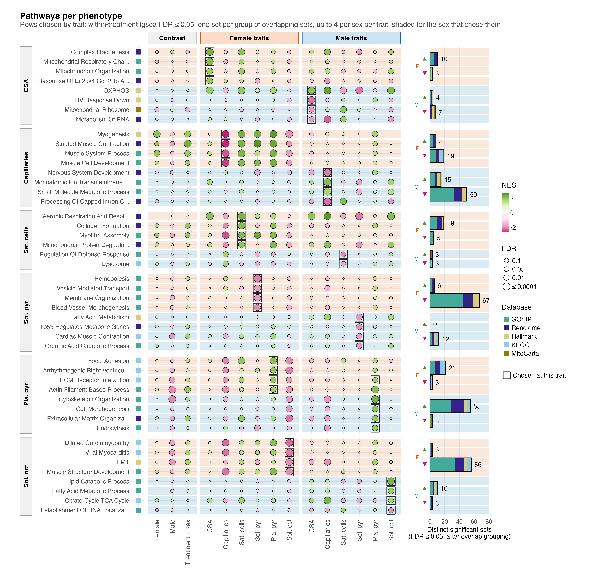
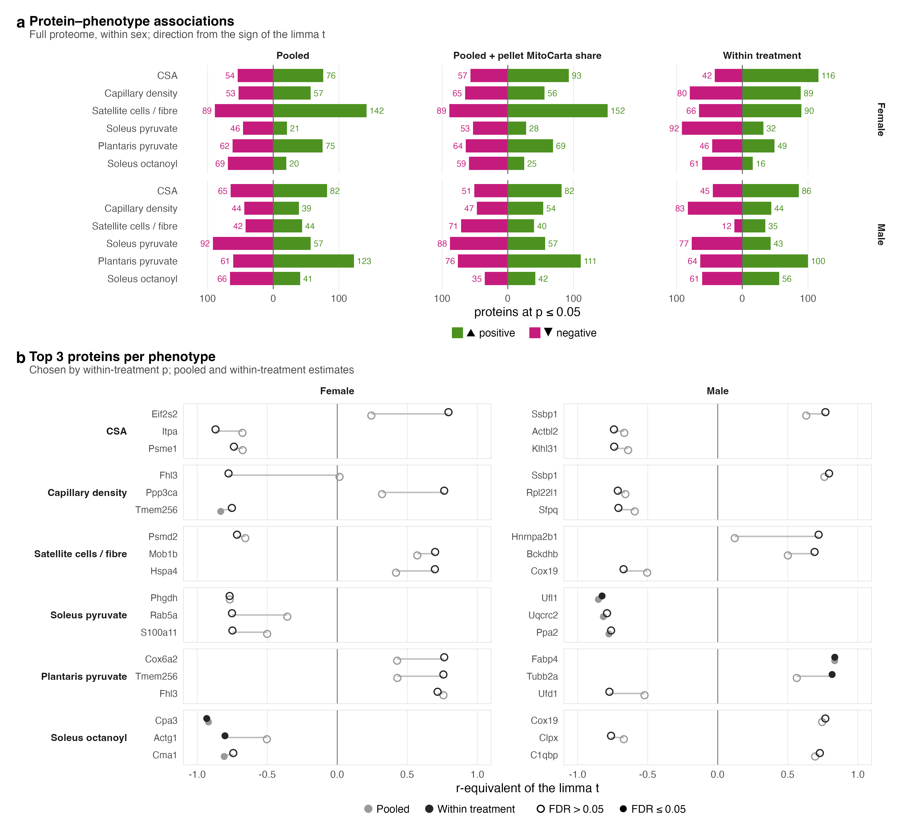
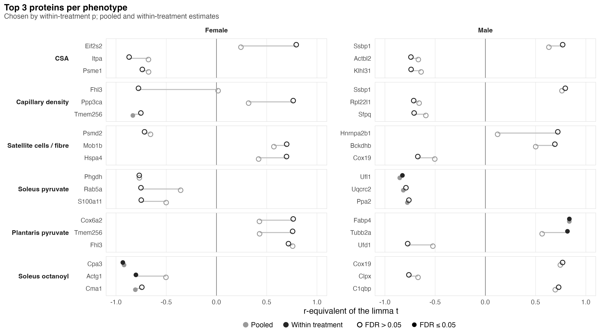

# F04_Phenotype_pathways

- Figure 4: within each sex, which pathways track each phenotype across the ten mice.
- Supplementary Figure 6: how many proteins track each phenotype, in which direction, and which three track it most closely.

Associations are co-movement across mice and say nothing about what PAS did. The models are described in [`02_Statistics/01_Fit`](../../02_Statistics/01_Fit/README.md).

## Figure 4

### a. Pathways per phenotype

46 gene sets in one block per trait: up to four sets each trait shows in females, then up to four in males (male satellite cells show two), under the within-treatment model (shown sets are defined in [`02_Enrichment`](../../02_Statistics/02_Enrichment/README.md)). Every row is drawn in the three contrast columns and at all six traits in both sexes; fill is NES and area −log10 FDR. Bars count distinct sets at FDR ≤ 0.05: 220 in females (67 up, 153 down) and 165 in males (87 up, 78 down). Of the 47 outlined cells that chose a row, camera gives p ≤ 0.05 for 7 and FDR ≤ 0.05 for none, so read the grid as a ranking.

## Supplementary Figure 6

### a. Association counts

Proteins whose association with each phenotype reaches p ≤ 0.05, split by sign, under the pooled, pooled with MitoCarta share, and within-treatment models. Within treatment, females have 392 up and 387 down summed over the six phenotypes, males 364 and 342. No bar holds more than 5 proteins at FDR ≤ 0.05. Proteins co-vary and each sex has ten mice, so a count is not a test.

### b. Top three proteins per phenotype

The three proteins with the smallest within-treatment p for each phenotype and sex, as the r-equivalent of the limma t under the pooled (light grey) and within-treatment (near-black) models; filled points pass FDR ≤ 0.05. Five pass within treatment, the strongest Cpa3 with female soleus octanoylcarnitine conductance (−0.93, FDR 0.012). Each was picked from 1,962 proteins, so the selection inflates its estimate.

## Run

`Rscript 04_Figures/F04_Phenotype_pathways/a_script/F04.R` and `a_script/supp/S6.R`. Each panel script also runs alone.

## Workbook

`c_data/F04.xlsx` holds `a_trait_pathways_cells` (every drawn cell) and `a_trait_pathways_counts` (distinct and all within-treatment sets at FDR ≤ 0.05). camera p and FDR for every set are in the `association_fgsea` sheet of [`02_Enrichment`](../../02_Statistics/02_Enrichment/README.md)'s workbook. `c_data/S6.xlsx` holds `S6a_counts` and `S6b_top_proteins`.
