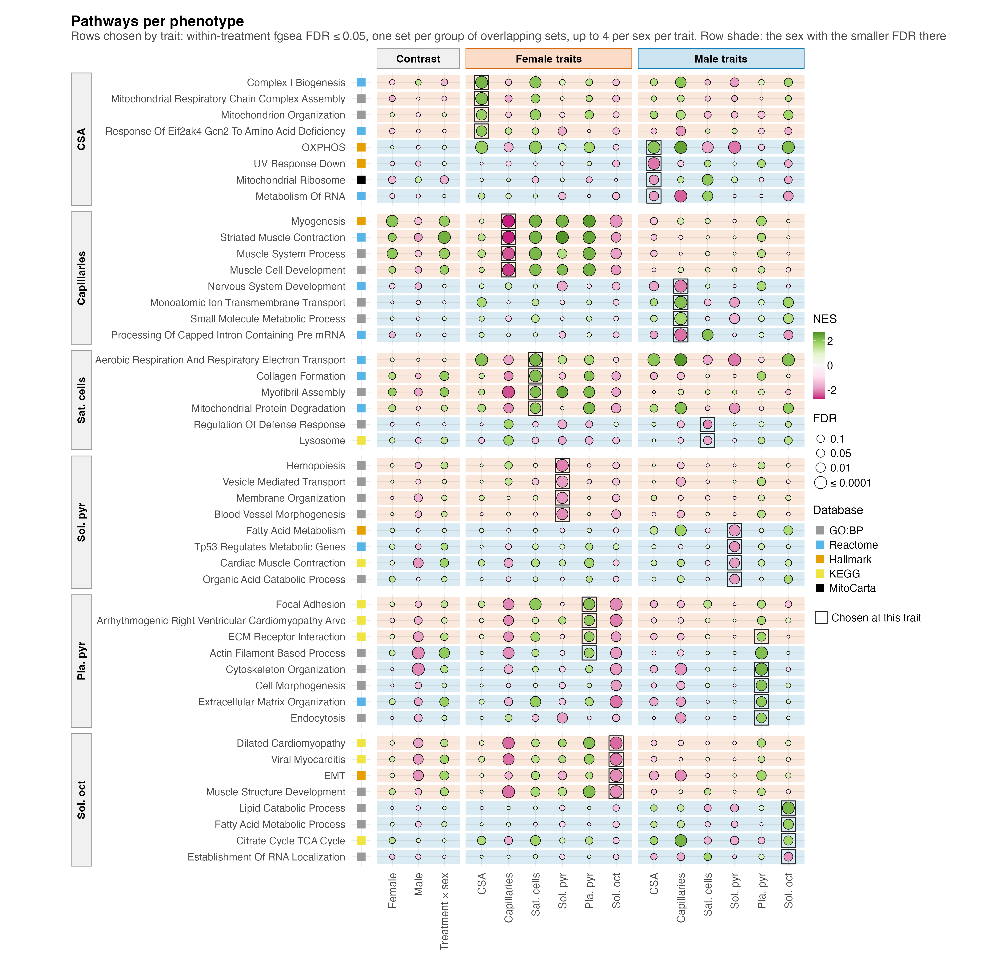

# F04_Phenotype_pathways

Figure 4: within each sex, which pathways track each phenotype across the ten mice.

| | |
|---|---|
| Reads | `02_Statistics/02_Enrichment/c_data/enrichment.rds` |
| Writes | `b_reports/panels/a_trait_pathways.pdf/.png`, `b_reports/F04_composite.pdf/.png` (180 × 174 mm), `c_data/F04.xlsx` |
| Run | `Rscript 04_Figures/F04_Phenotype_pathways/a_script/F04_composite.R` (the panel script also runs alone) |

The figure is one panel, its own script in `a_script/panels/`; the composite runs it and writes one workbook, with no panel letter. The panel reads saved outputs and computes nothing beyond filtering and ordering. It draws the same columns as F03, the three contrasts and then every trait in each sex; its rows are the sets 02_Enrichment flags as `shown` for a trait in either sex, under the within-treatment model. For each sex and trait, the sets at fgsea FDR ≤ 0.05 (both universes together) are grouped by an average-linkage Jaccard tree on their tested members, cut at 0.70, and each group is shown by its most specific set whose p is within 10-fold of the group's best; `representative_sets()` in `helpers.R` gives the rule and its sources (EnrichmentMap, DAVID, HRvLR). The pooled model is not drawn; both models are in the `association_fgsea` sheet of `02_enrichment.xlsx`.

## Panels

### a. Pathways per phenotype

One grid with three column blocks: Contrast (Female, Male and Treatment × sex, the fgsea results F03 draws), then Female traits and Male traits. Only the trait columns choose the rows; the contrast columns show what PAS does to the same sets. In the trait columns there is one dot per gene set, trait and sex: fgsea (`association_fgsea` in `enrichment.rds`) on each protein's association t with that trait across the sex's ten mice, under the within-treatment model. Fill is the NES, green when the set's proteins rise with the trait and magenta when they fall, on a scale set by the largest |NES| drawn (±2.7); dot area grows with −log10 FDR from a small minimum, so a cell near FDR 1 still shows its colour, and stops growing at FDR 0.0001, with the key in FDR (0.1, 0.05, 0.01, ≤ 0.0001); the square beside each name gives its collection. Rows come in one block per trait: the four sets that trait shows in females, by FDR then p, then the four it shows in males. A set is listed once in the figure, so a set already listed in an earlier block is passed over for the next one. Every row is drawn in all 15 columns. A thin dark outline marks the block's trait cell in each sex that shows the set ("Chosen at this trait" in the key). A light band behind the whole row, across all columns, gives the sex with the smaller FDR at the block's trait, orange for female and blue for male. That gives 46 rows: four female and four male rows in every block except satellite cells, where males show six sets but four are already listed in earlier blocks, leaving two male rows. ECM-receptor interaction, taken in the female plantaris pyruvate rows, is also shown in males there, so it is outlined in both sexes (24 outlined cells in females, 23 in males). Shade and outline name the same sex in every row but one: actin filament based process is chosen in females for plantaris pyruvate conductance but has the smaller FDR in males (9.9e-05 against 0.0058), where a different set represents its group. Of 586 female set–trait pairs at FDR ≤ 0.05, 220 are shown; for males, 165 of 410. Of the 276 drawn trait cells per sex, 99 in females and 71 in males reach FDR ≤ 0.05.

In females, complex I biogenesis, respiratory chain assembly, mitochondrion organisation and the GCN2 amino-acid response rise with CSA (NES 1.9 to 2.3), and aerobic respiration and OXPHOS rise with satellite cells (2.0 to 2.2) and with CSA. Collagen formation, myofibril assembly and mitochondrial protein degradation also rise with satellite cells (2.0 to 2.1). Muscle contraction and development sets fall with capillary density (NES −2.4 to −2.7, FDR down to 1.9e-12) and rise with satellite cells and both pyruvate conductances. Dilated cardiomyopathy, viral myocarditis, EMT and muscle structure development fall with soleus octanoylcarnitine conductance (NES −2.0 to −2.3), and focal adhesion, ARVC cardiomyopathy, ECM-receptor interaction and actin filament based process rise with plantaris pyruvate conductance (1.8 to 2.1). The sets chosen for soleus pyruvate conductance (haemopoiesis, vesicle transport, membrane organisation, blood vessel morphogenesis) fall with it (NES −1.8 to −2.1) and move little with the other traits.

In males, OXPHOS rises with CSA (NES 2.1) and more strongly with capillaries (2.5), while UV response down, the mitochondrial ribosome and RNA metabolism fall with CSA (−1.9 to −2.2). Ion transport and small molecule metabolism rise with capillaries (2.1 and 1.7), and nervous system development and pre-mRNA processing fall with them (−2.1 and −2.2). Defence response regulation and the lysosome fall with satellite cells (−2.0 and −1.7). The sets chosen for soleus pyruvate conductance (fatty acid metabolism, TP53-regulated metabolic genes, cardiac muscle contraction, organic acid catabolism) fall with it (NES −1.8 to −2.0), and OXPHOS falls with it too (−2.2); fatty acid metabolism and OXPHOS both rise with capillaries and with soleus octanoylcarnitine conductance. Lipid catabolism, fatty acid metabolism and the citric acid cycle rise with soleus octanoylcarnitine conductance (1.8 to 2.2). A falling OXPHOS signal with rising respiratory conductance runs against expectation; respirometry was done on soleus and the proteome comes from gastrocnemius, so treat this pairing as an unexplained association. Cytoskeleton organisation, cell morphogenesis, extracellular matrix organisation, endocytosis and ECM-receptor interaction rise with plantaris pyruvate conductance (NES 1.8 to 2.3).

These associations are co-movement across mice, not PAS effects. The gene-permutation FDR runs optimistic when genes are correlated (Wu & Smyth 2012), so two checks sit beside every set in the `association_fgsea` sheet: camera (`camera_p`, `camera_fdr`), which estimates the set's own inter-protein correlation, and the set's singscore slope on the trait, tested across mice (`score_p`, `score_fdr`). For the 24 outlined female cells, camera gives p ≤ 0.05 for 4 and FDR ≤ 0.05 for none. The singscore slope gives p ≤ 0.05 for 6 and FDR ≤ 0.05 for 2, dilated cardiomyopathy (0.031) and viral myocarditis (0.040), both falling with soleus octanoylcarnitine conductance. For the 23 outlined male cells, camera gives p ≤ 0.05 for 3 and the singscore slope for 4, with neither reaching FDR ≤ 0.05. Read the grids as rankings of which biology moves with each trait, not as confirmed set-level associations.

## Workbook

`c_data/F04.xlsx` holds one sheet, `a_trait_pathways`, with every drawn cell, 690 in all (trait block, set, collection, universe, column block, contrast or sex and phenotype, NES, fgsea p and FDR, whether that column shows the set, whether the cell is outlined (`selected`), the row's `stronger_sex` (the row shade: the sex with the smaller FDR at the block's trait), camera p and FDR), plus `read_me`, `input_manifest` and `package_versions`.
