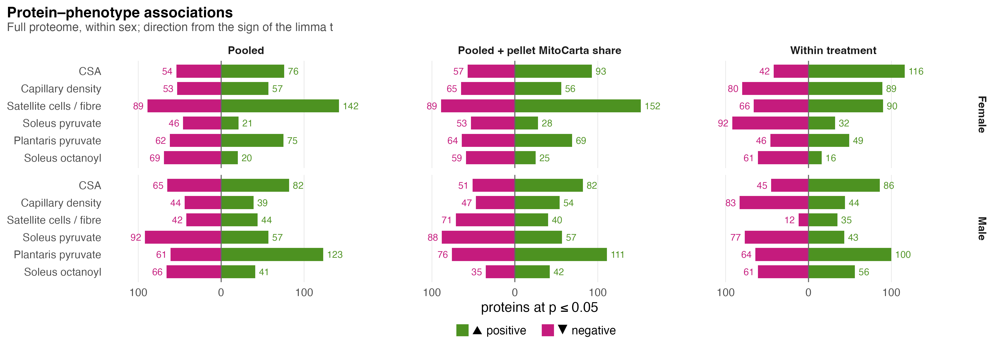

# F04_Phenotype_pathways

Figure 4: within each sex, which pathways track each phenotype across the ten mice. Its supplement is S7, how many proteins track each phenotype.

| | |
|---|---|
| Reads | `02_Statistics/02_Enrichment/c_data/enrichment.rds` |
| Writes | `b_reports/a_trait_pathways.pdf/.png`, `b_reports/F04.pdf/.png` (212 × 176 mm), `c_data/F04.xlsx` |
| Run | `Rscript 04_Figures/F04_Phenotype_pathways/a_script/F04.R` (the panel script also runs alone) |

The figure is one panel, its own script `a_script/a_trait_pathways.R`; the composite runs it and writes one workbook, with no panel letter. The panel reads saved outputs and computes nothing beyond filtering, ordering and counting. It draws the same columns as F03, the three contrasts and then every trait in each sex; its rows are the sets 02_Enrichment flags as `shown` for a trait in either sex, under the within-treatment model, and bars to the right count each trait's distinct significant sets in each sex. For each sex and trait, the sets at fgsea FDR ≤ 0.05 (both universes together) are grouped by an average-linkage Jaccard tree on their tested members, cut at 0.70, and each group is shown by its most specific set whose p is within 10-fold of the group's best; `representative_sets()` in `helpers.R` gives the rule and its sources (EnrichmentMap, DAVID, HRvLR). The pooled model is not drawn; both models are in the `association_fgsea` sheet of `02_enrichment.xlsx`.

## Panels

### a. Pathways per phenotype

One grid with three column blocks: Contrast (Female, Male and Treatment × sex, the fgsea results F03 draws), then Female traits and Male traits. Only the trait columns choose the rows; the contrast columns show what PAS does to the same sets. In the trait columns there is one dot per gene set, trait and sex: fgsea (`association_fgsea` in `enrichment.rds`) on each protein's association t with that trait across the sex's ten mice, under the within-treatment model. Fill is the NES, green when the set's proteins rise with the trait and magenta when they fall, on a scale set by the largest |NES| drawn (±2.7); dot area grows with −log10 FDR from a small minimum, so a cell near FDR 1 still shows its colour, and stops growing at FDR 0.0001, with the key in FDR (0.1, 0.05, 0.01, ≤ 0.0001); the square beside each name gives its collection. Rows come in one block per trait: the four sets that trait shows in females, by FDR then p, then the four it shows in males. A set is listed once in the figure, so a set already listed in an earlier block is passed over for the next one. Every row is drawn in all 15 columns. A thin dark outline marks the block's trait cell in each sex that shows the set ("Chosen at this trait" in the key). A light band behind the whole row, across all columns, gives the sex that chose it, orange for female and blue for male. That gives 46 rows: four female and four male rows in every block except satellite cells, where males show six sets but four are already listed in earlier blocks, leaving two male rows. ECM-receptor interaction, taken in the female plantaris pyruvate rows, is also shown in males there, so it is outlined in both sexes (24 outlined cells in females, 23 in males). Actin filament based process is chosen in females for plantaris pyruvate conductance but has the smaller FDR in males (9.9e-05 against 0.0058), where a different set represents its group, so only its female cell is outlined. Of the 276 drawn trait cells per sex, 99 in females and 71 in males reach FDR ≤ 0.05.

The bars to the right count distinct significant sets: within-treatment sets at fgsea FDR ≤ 0.05 that 02_Enrichment flags as `shown`, so each group of overlapping sets counts once, with direction from the sign of the NES. In each trait block the female pair sits beside the female rows and the male pair beside the male rows, an up bar (▲) above a down bar (▼), split by database inside one outline, with the total at its end. Across the six traits females have 220 distinct sets (67 up, 153 down) and males 165 (87 up, 78 down). The largest counts are falls with soleus pyruvate conductance in females (67) and with soleus octanoylcarnitine conductance in females (56), falls with capillary density in males (50), and rises with plantaris pyruvate conductance in males (55). Males have no rising set for soleus pyruvate conductance. The counts before overlap grouping are in the workbook.

In females, complex I biogenesis, respiratory chain assembly, mitochondrion organisation and the GCN2 amino-acid response rise with CSA (NES 1.9 to 2.3), and aerobic respiration and OXPHOS rise with satellite cells (2.0 to 2.2) and with CSA. Collagen formation, myofibril assembly and mitochondrial protein degradation also rise with satellite cells (2.0 to 2.1). Muscle contraction and development sets fall with capillary density (NES −2.4 to −2.7, FDR down to 1.9e-12) and rise with satellite cells and both pyruvate conductances. Dilated cardiomyopathy, viral myocarditis, EMT and muscle structure development fall with soleus octanoylcarnitine conductance (NES −2.0 to −2.3), and focal adhesion, ARVC cardiomyopathy, ECM-receptor interaction and actin filament based process rise with plantaris pyruvate conductance (1.8 to 2.1). The sets chosen for soleus pyruvate conductance (haemopoiesis, vesicle transport, membrane organisation, blood vessel morphogenesis) fall with it (NES −1.8 to −2.1) and move little with the other traits.

In males, OXPHOS rises with CSA (NES 2.1) and more strongly with capillaries (2.5), while UV response down, the mitochondrial ribosome and RNA metabolism fall with CSA (−1.9 to −2.2). Ion transport and small molecule metabolism rise with capillaries (2.1 and 1.7), and nervous system development and pre-mRNA processing fall with them (−2.1 and −2.2). Defence response regulation and the lysosome fall with satellite cells (−2.0 and −1.7). The sets chosen for soleus pyruvate conductance (fatty acid metabolism, TP53-regulated metabolic genes, cardiac muscle contraction, organic acid catabolism) fall with it (NES −1.8 to −2.0), and OXPHOS falls with it too (−2.2); fatty acid metabolism and OXPHOS both rise with capillaries and with soleus octanoylcarnitine conductance. Lipid catabolism, fatty acid metabolism and the citric acid cycle rise with soleus octanoylcarnitine conductance (1.8 to 2.2). A falling OXPHOS signal with rising respiratory conductance runs against expectation; respirometry was done on soleus and the proteome comes from gastrocnemius, so treat this pairing as an unexplained association. Cytoskeleton organisation, cell morphogenesis, extracellular matrix organisation, endocytosis and ECM-receptor interaction rise with plantaris pyruvate conductance (NES 1.8 to 2.3).

These associations are co-movement across mice, not PAS effects. The gene-permutation FDR runs optimistic when genes are correlated (Wu & Smyth 2012), so two checks sit beside every set in the `association_fgsea` sheet: camera (`camera_p`, `camera_fdr`), which estimates the set's own inter-protein correlation, and the set's singscore slope on the trait, tested across mice (`score_p`, `score_fdr`). For the 24 outlined female cells, camera gives p ≤ 0.05 for 4 and FDR ≤ 0.05 for none. The singscore slope gives p ≤ 0.05 for 6 and FDR ≤ 0.05 for 2, dilated cardiomyopathy (0.031) and viral myocarditis (0.040), both falling with soleus octanoylcarnitine conductance. For the 23 outlined male cells, camera gives p ≤ 0.05 for 3 and the singscore slope for 4, with neither reaching FDR ≤ 0.05. Read the grids as rankings of which biology moves with each trait, not as confirmed set-level associations.

## Supplementary Figure 7: protein associations

How many proteins track each phenotype and in which direction, and the strongest three.

| | |
|---|---|
| Reads | `02_Statistics/01_Fit/c_data/fit.rds` |
| Writes | `b_reports/supp/S7<letter>_<name>.pdf/.png`, `b_reports/supp/S7.pdf/.png` (180 × 165 mm), `c_data/S7.xlsx` |
| Run | `Rscript 04_Figures/F04_Phenotype_pathways/a_script/supp/S7.R` (each panel script also runs alone) |

### a. Association counts

Each pair of bars counts the full-proteome proteins whose association with one phenotype, within one sex, reaches p ≤ 0.05 under one model, split by the sign of the limma t: positive (▲, green) to the right of zero and negative (▼, magenta) to the left. Columns are the three models: pooled across PAS and vehicle mice, pooled with the pellet's MitoCarta share added, and within treatment; rows are the sexes. The counts come from `fit.rds`: `protein_associations` (filtered and counted; their totals match `association_summary`). The within-treatment model removes the group means and asks whether a protein tracks the trait among mice given the same treatment.

Female satellite cells per fibre give the largest counts under the pooled models (142 up and 89 down; 152 and 89 with the MitoCarta share) and fall to 90 and 66 within treatment. Within treatment, female CSA leans positive (116 up, 42 down) and female soleus pyruvate negative (32 up, 92 down). Female soleus octanoyl leans negative under all three models (20, 25 and 16 up against 69, 59 and 61 down). In males, plantaris pyruvate leans positive (123, 111 and 100 up against 61, 76 and 64 down) and soleus pyruvate negative (57, 57 and 43 up against 92, 88 and 77 down); male satellite cells drop to 35 up and 12 down within treatment, and male capillary density turns negative there (44 up, 83 down). Summed over the six phenotypes, up and down counts are close in every sex and model (within treatment: females 392 up and 387 down, males 364 and 342). FDR ≤ 0.05 is rare: at most 5 proteins in any bar (male soleus pyruvate, negative, pooled + MitoCarta share), and within treatment 2 negative in females and 2 positive and 1 negative in males. Proteins co-vary and each sex has ten mice, so a count is not itself a test.

### b. Top three proteins per phenotype

For each phenotype (rows, grouped) and sex (columns), the three proteins with the smallest within-treatment p, smallest at the top (`fit.rds`: `protein_associations`). Each protein's two points are the r-equivalent of the limma t, t / sqrt(t² + df), under the pooled (light grey) and within-treatment (near-black) models, joined by a line and offset slightly so neither hides the other. Filled points pass FDR ≤ 0.05 and open points do not.

Within-treatment r-equivalents of the 36 proteins run from 0.67 to 0.93 in size. Five reach FDR ≤ 0.05 within treatment: Cpa3 with female soleus octanoyl (−0.93, FDR 0.012), Actg1 with female soleus octanoyl (−0.80, 0.047), Fabp4 with male plantaris pyruvate (0.84, 0.024), Tubb2a with male plantaris pyruvate (0.82, 0.027) and Ufl1 with male soleus pyruvate (−0.83, 0.039). Seven pass pooled: Cpa3, Fabp4 and Ufl1 again, plus Tmem256 with female capillary density (−0.83), Uqcrc2 and Ppa2 with male soleus pyruvate (−0.82, −0.78) and Cma1 with female soleus octanoyl (−0.81). Some proteins differ sharply between models: Fhl3 with female capillary density is −0.78 within treatment and 0.02 pooled, Hnrnpa2b1 with male satellite cells 0.72 against 0.12, and Eif2s2 with female CSA 0.79 against 0.24. A few proteins recur: Ssbp1 is the top male protein for both CSA and capillary density; Tmem256 and Fhl3 fall with female capillary density and rise with female plantaris pyruvate; Cox19 falls with male satellite cells and rises with male soleus octanoyl. Each protein was picked from 1,962, so its within-treatment estimate runs optimistic.

The models come from `02_Statistics/01_Fit`: all three regress each protein on one z-scored phenotype within one sex with the surrogate variable fitted within sex; the MitoCarta share in the check model is centred within group. All three measure co-movement, not a PAS effect.

## Workbooks

`c_data/F04.xlsx` holds `a_trait_pathways`, with every drawn cell, 690 in all (trait block, set, collection, universe, column block, contrast or sex and phenotype, NES, fgsea p and FDR, whether that column shows the set, whether the cell is outlined (`selected`), the row's `chosen_sex` (the sex that chose it, its shade), camera p and FDR), and `counts`, the within-treatment sets at FDR ≤ 0.05 per trait, sex, direction and collection, distinct (`n_distinct`, what the bars draw) and all (`n_all`). `c_data/S7.xlsx` holds `S7a_counts` and `S7b_top_proteins`, the table each panel draws.
