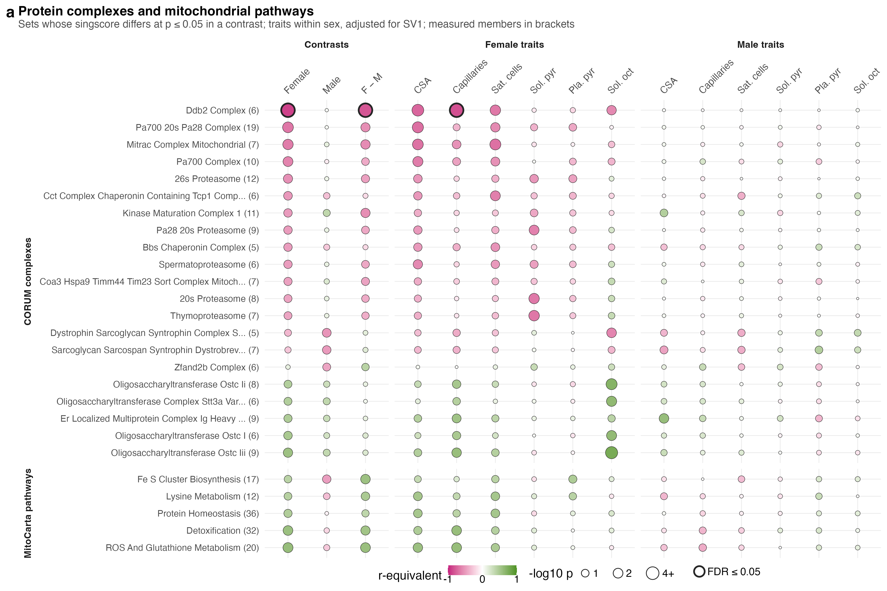

# F05_Complexes

Figure 5 (complexes version): CORUM complexes and MitoCarta pathways that PAS shifts, against the contrasts and the phenotypes. The WGCNA version is `F05_Modules`; one of the two goes forward.

| | |
|---|---|
| Reads | `02_Statistics/01_Fit/c_data/fit.rds`, `01_Processing/04_Gene_Sets/c_data/gene_sets.rds` |
| Writes | `b_reports/panels/a_set_matrix.pdf/.png`, `b_reports/F05_composite.pdf/.png` (180 × 120 mm), `c_data/F05_complexes.xlsx` |
| Run | `Rscript 04_Figures/F05_Complexes/a_script/F05_composite.R` (the panel script also runs alone) |

Each set has one singscore per mouse (`01_Processing/05_Scores`), the mean within-mouse rank of its members, so it uses no group label. `01_Fit` tests the scores with limma: the three contrasts, and each trait's slope within each sex (pooled model, adjusted for the surrogate variable). Unlike fgsea in F03, this tests whether the set's members move together across mice, not whether they sit high in a protein ranking.

## Panels

| Panel | Shows | Source |
|---|---|---|
| a | The 21 CORUM complexes and 5 MitoCarta pathways at p ≤ 0.05 in at least one contrast. Fill: r-equivalent of the t; size: −log10 p; ring: BH FDR ≤ 0.05 over every scored set in the universe (1,066 full, 44 MitoCarta). Measured members in brackets. Only the DDB2 complex passes FDR: lower in female PAS (r −0.89), different between the sexes' PAS effects, and lower with more female capillaries. In CORUM it holds Cops3, Cops4, Cops8, Gps1, Ddb1 and Rbx1, so it is mostly the COP9 signalosome, whose Cops3 and Cops8 also stand out at protein level (S8). Proteasome and chaperonin complexes are lower in female PAS at p ≤ 0.05; oligosaccharyltransferase complexes and the MitoCarta ROS, detoxification and protein homeostasis pathways are higher. | `score_contrasts`, `score_associations`, `membership` |

Complexes share subunits (the 20S core subunits recur across the proteasome entries), so neighbouring rows are not independent results.

## Workbook

`c_data/F05_complexes.xlsx` holds one sheet per panel with the numbers it draws, plus `read_me`, `input_manifest` and `package_versions`.
