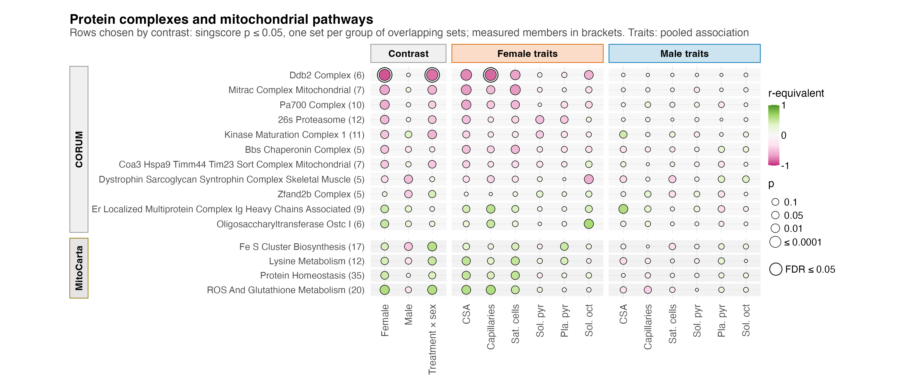
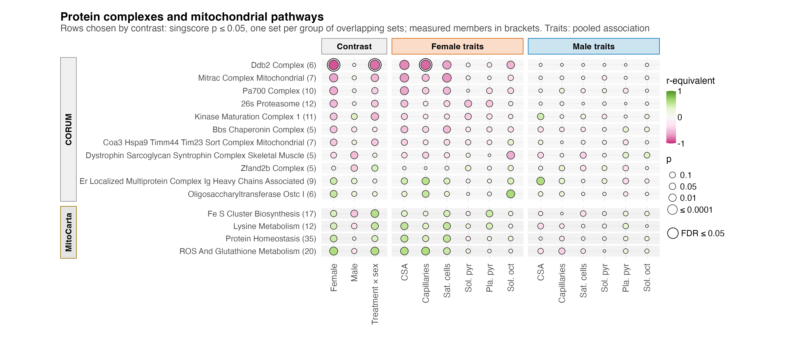

# F05_Complexes

Figure 5 (complexes version): CORUM complexes and MitoCarta pathways that PAS shifts, against the contrasts and the phenotypes. The WGCNA version is `F05_Modules`; one of the two goes forward.

| | |
|---|---|
| Reads | `02_Statistics/01_Fit/c_data/fit.rds` |
| Writes | `b_reports/panels/a_set_matrix.pdf/.png`, `b_reports/F05_complexes_composite.pdf/.png` (180 × 77 mm), `c_data/F05_complexes.xlsx` |
| Run | `Rscript 04_Figures/F05_Complexes/a_script/F05_complexes_composite.R` (the panel script also runs alone) |

Each set has one singscore per mouse (`01_Processing/05_Scores`), the mean within-mouse rank of its members, so it uses no group label. `01_Fit` tests the scores with limma: the three contrasts, and each trait's slope within each sex (pooled model, adjusted for the surrogate variable). Unlike fgsea in F03, the score test asks whether the set's members move together across mice, not whether they sit high in a protein ranking.

## Panels

### a. Complexes and mitochondrial pathways

One dot per set and column, in F03's grid, for the 11 CORUM complexes and 4 MitoCarta pathways that at least one contrast shows (`score_contrasts`: `shown`, `members`; `score_associations`). 01_Fit picks them as 02_Enrichment picks fgsea sets: within each contrast and universe, the sets at singscore p ≤ 0.05 are grouped by `representative_sets()` on their measured members, and each group is shown by its most specific set within 10-fold of the group's best p. Rows sit in a CORUM block and a MitoCarta block, by r-equivalent in female PAS. The columns are Contrast (PAS against vehicle in females and in males, and Treatment × sex, the female PAS effect minus the male), then Female traits and Male traits, each trait's slope within one sex (pooled model). Fill is the r-equivalent of the limma t on F03's magenta–green scale, magenta when the score is lower in PAS or falls with the trait and green when it is higher or rises; dot area grows with −log10 p and stops growing at p 0.0001, with the key in p (0.1, 0.05, 0.01, ≤ 0.0001); a ring marks BH FDR ≤ 0.05 over every set scored in that universe (1,066 full, 44 MitoCarta); the number in brackets counts the set's measured members.

The DDB2 complex is the only set to pass FDR: lower in female PAS (r −0.89, FDR 9.4e-05), different between the sexes' PAS effects (r −0.81, FDR 0.0096), and lower with more female capillaries (r −0.84, FDR 0.0066). Its six measured members are Cops3, Cops4, Cops8, Gps1, Ddb1 and Rbx1, so the measured set is mostly the COP9 signalosome, whose Cops3 and Cops8 also pass FDR ≤ 0.05 at protein level and stay at FDR ≤ 0.10 under every sensitivity variant (S8). Of the 21 complexes and pathways at p ≤ 0.05 in female PAS, 11 remain after grouping: 7 lower (the PA700 and 26S proteasome, the BBS chaperonin, kinase maturation, TIM23 sorting and MITRAC complexes, and DDB2) and 4 higher (an oligosaccharyltransferase, the ER-localised immunoglobulin complex, and the MitoCarta ROS and protein homeostasis pathways). In male PAS 3 of 4 remain, all lower (a dystrophin–sarcoglycan complex, Zfand2b, Fe-S cluster biosynthesis). Of the 90 trait cells in each sex, 27 reach p ≤ 0.05 in females and 1 in males.

Grouping drops 11 of the earlier 26 rows: five proteasome entries (20S, PA28–20S, PA700–20S–PA28, thymoproteasome, spermatoproteasome) fold into the 26S proteasome, three oligosaccharyltransferase entries into one, CCT into BBS chaperonin, the sarcoglycan–sarcospan complex into the dystrophin one, and MitoCarta detoxification into ROS and glutathione metabolism. The remaining rows can still share subunits, and they were chosen on uncorrected p, so read the female block as a consistent direction across related complexes rather than as 11 separate findings.

## Workbook

`c_data/F05_complexes.xlsx` holds one sheet per panel with the numbers it draws, plus `read_me`, `input_manifest` and `package_versions`.
