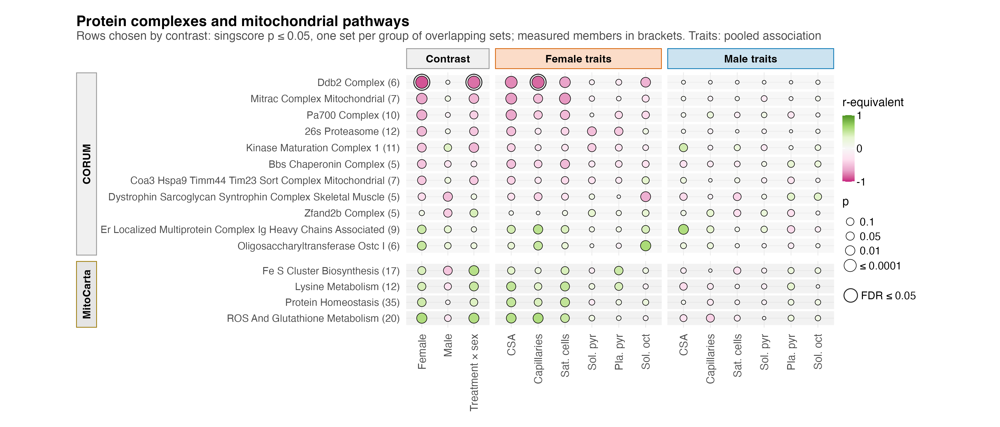

# F05_Complexes

- Figure 5: which CORUM complexes and MitoCarta pathways PAS shifts, scored per mouse, and how the same scores track the phenotypes.

## Figure 5

### a. Complexes and mitochondrial pathways

11 CORUM complexes and 4 MitoCarta pathways shown in at least one contrast, from singscores tested by limma in [`02_Statistics/01_Fit`](../../02_Statistics/01_Fit/README.md): fill is the r-equivalent (magenta lower in PAS or falling with the trait, green higher or rising), area −log10 p, and a ring marks FDR ≤ 0.05. Only the DDB2 complex passes FDR: lower in female PAS (r −0.89, FDR 9.4e-05), different between the sexes' PAS effects and lower with more female capillaries. Its six measured members are mostly COP9 signalosome subunits, including Cops3 and Cops8, which pass at protein level too. The rows were chosen on uncorrected p and can share subunits, so read the female block as one direction across related complexes, not 11 findings.

## Run

`Rscript 04_Figures/F05_Complexes/a_script/F05.R`. The panel script also runs alone.

## Workbook

`c_data/F05.xlsx` holds `a_set_matrix`, the table the panel draws.
