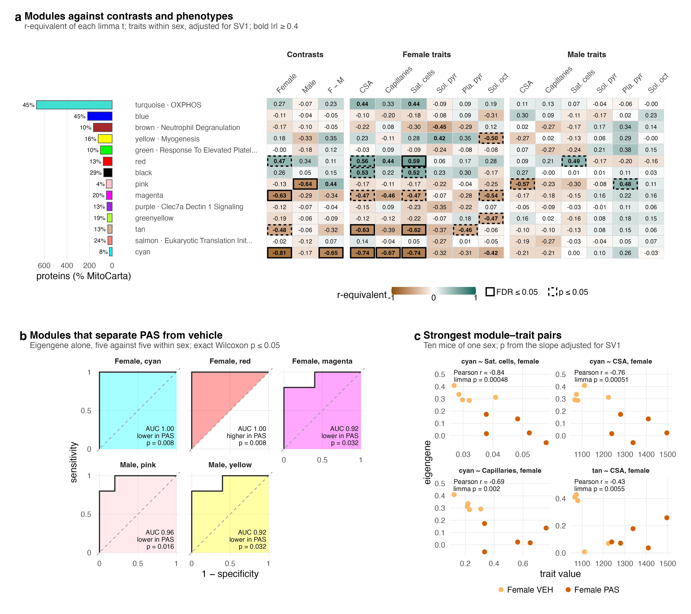

# F05_Modules

Figure 5: how the WGCNA protein modules relate to PAS and to the phenotypes.

| | |
|---|---|
| Reads | `02_Statistics/01_Fit/c_data/fit.rds`, `01_Processing/06_Modules/c_data/modules.rds`, `02_Statistics/03_Classification/c_data/classification.rds` |
| Writes | `b_reports/panels/<panel>.pdf/.png`, `b_reports/F05_composite.pdf/.png` (180 × 160 mm), `c_data/F05.xlsx` |
| Run | `Rscript 04_Figures/F05_Modules/a_script/F05_composite.R` (each panel script also runs alone) |

Each panel is its own script in `a_script/panels/`; the composite runs them, adds the letters, stitches them and checks the cell count, the shown ROC modules against `03_classification.xlsx`, and ten mice per scatter. Panels read saved outputs and compute nothing beyond counts, filtering and scaling.

## Panels

| Panel | Shows | Source |
|---|---|---|
| a | Each module eigengene against the three contrasts and each phenotype within each sex, after YvO's module–trait heatmap. Every cell is the r-equivalent of its limma t, t / √(t² + df), so value and outline come from one test; solid outline FDR ≤ 0.05 over the 14 modules, dashed p ≤ 0.05, bold \|r\| ≥ 0.4. Left: module size, MitoCarta share and top annotated set. | `fit.rds`: `score_contrasts`, `score_associations`; `modules.rds`: `sizes` |
| b | ROC curves for the modules at exact Wilcoxon p ≤ 0.05 in either sex (five against five). A module lower in PAS is drawn as 1 − its curve and labelled so. | `classification.rds`: `roc`, `module_curves` |
| c | The four strongest module–phenotype pairs (pooled model), mouse by mouse. The label gives Pearson r across the ten points and the limma p, which also adjusts for the surrogate variable; the two can differ. | `fit.rds`: `score_associations`, `scores`, `phenotypes` |

## Workbook

`c_data/F05.xlsx` holds one sheet per panel with the numbers it draws, plus `read_me`, `input_manifest` and `package_versions`.
