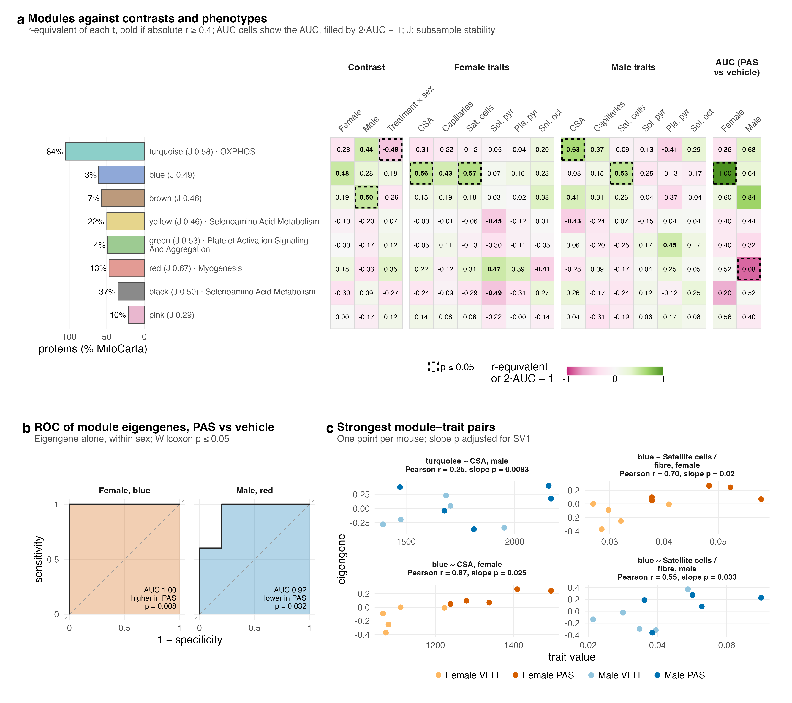
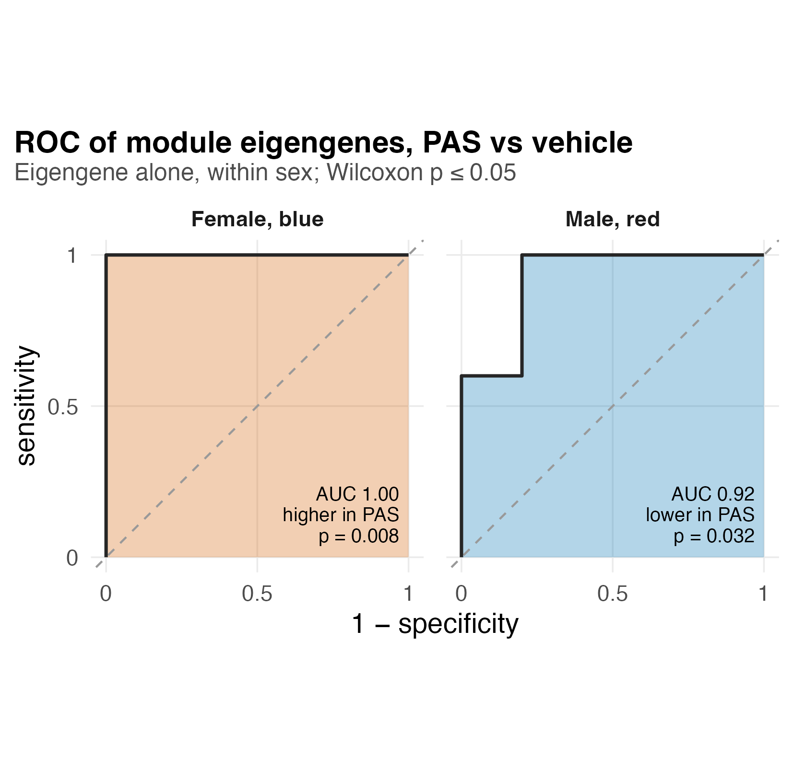
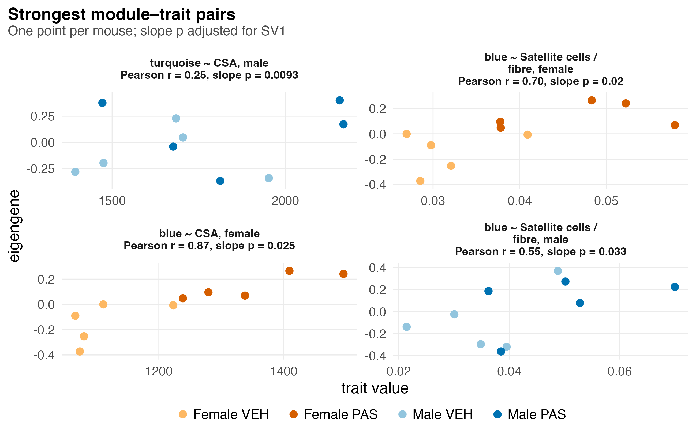

# F05_Modules

Figure 5 (WGCNA version): how the protein modules relate to PAS and to the phenotypes. The alternative Figure 5, MitoCarta pathways and CORUM complexes, is `F05_Complexes`.

The modules come from the rebuilt network in `01_Processing/06_Modules`: 827 proteins detected in every mouse, with sex and measured run depth removed before building (the earlier build's two largest modules tracked run depth). The result is eight modules plus 402 unassigned proteins. Eigengenes are tested with ordinary least-squares t on the residual df (15 for the contrasts, 14 for the trait slopes) rather than eBayes, because eight features cannot estimate a prior.

| | |
|---|---|
| Reads | `02_Statistics/01_Fit/c_data/fit.rds`, `01_Processing/06_Modules/c_data/modules.rds`, `02_Statistics/03_Classification/c_data/classification.rds` |
| Writes | `b_reports/panels/<panel>.pdf/.png`, `b_reports/F05_modules_composite.pdf/.png` (180 × 160 mm; panel a 92 mm tall, panels b and c 68 mm, b 70 mm wide), `c_data/F05_modules.xlsx` |
| Run | `Rscript 04_Figures/F05_Modules/a_script/F05_modules_composite.R` (each panel script also runs alone) |

Each panel is its own script in `a_script/panels/`; the composite runs them, adds the letters, stitches them and writes one workbook. Panels read saved outputs and compute nothing beyond counts, filtering and scaling.

## Panels

### a. Modules against contrasts and phenotypes

One row per module, after YvO's module–trait heatmap. The bar on the left is the module's size in proteins, in a muted tone of the module's colour (`MODULE_COLOURS`, `figures.R`), with its MitoCarta share as a percentage; the label gives its stability J (median best-match Jaccard over 100 subsamples of four mice per group) and its top annotated set, if any (`modules.rds`: `sizes`). Each cell holds the r-equivalent of one limma t, t / √(t² + df), for the three contrasts and for each trait's slope within each sex (pooled model, adjusted for the surrogate variable; `fit.rds`: `score_contrasts`, `score_associations`), so value and outline come from one test. Fill runs from magenta (lower in PAS, or falling with the trait) to green, the scale F03 and F04 use; a solid outline would mark FDR ≤ 0.05 over the eight modules, a dashed one p ≤ 0.05, and bold text |r| ≥ 0.4. The last two columns give each eigengene's AUC for calling a mouse PAS rather than vehicle within a sex (`classification.rds`: `roc`), filled on 2·AUC − 1 so chance (0.5) is white and green still means higher in PAS; the outline there is the exact Wilcoxon p and its FDR over the modules.

No cell reaches FDR ≤ 0.05 (lowest 0.064, blue's female AUC of 1.00). Brown is higher in male PAS mice (r 0.50, p 0.042), turquoise (OXPHOS, 84% MitoCarta) differs between the sexes' PAS effects (r −0.48, p 0.049), and blue is higher in female PAS mice (r 0.48, p 0.052). Four of the 96 trait cells reach p ≤ 0.05. Pink is the least stable module (J 0.29) and red the most (J 0.67).

### b. ROC for single modules

One curve per module at exact Wilcoxon p ≤ 0.05 in either sex, five PAS against five vehicle mice (`classification.rds`: `roc`, `module_curves`). The x axis is 1 − specificity and the y axis sensitivity for calling a mouse PAS from its eigengene alone; the shaded area is the AUC and the dashed diagonal is chance. A module lower in PAS is drawn as 1 − its curve, with AUC 1 − AUC, and labelled so.

Blue separates female PAS from vehicle perfectly (AUC 1.00, p 0.0079, the smallest p five against five can give; FDR 0.063 over the eight modules), and red is lower in male PAS (AUC 0.92, p 0.032, FDR 0.25). The eigengenes enter unadjusted, so blue reaches p 0.0079 here while its limma contrast, adjusted for the surrogate variable, sits at p 0.052 in panel a. With five mice a group, one perfect separator among eight modules is weak evidence on its own.

### c. Strongest module–trait pairs

One point per mouse for the four module–trait pairs with the smallest slope p in the pooled model over both sexes (`fit.rds`: `score_associations`, `scores`, `phenotypes`): trait value on the x axis, eigengene on the y axis, coloured by group. The facet title gives Pearson r across the ten points and the limma slope p, which also adjusts for the surrogate variable; the two can differ.

Turquoise against male CSA has the smallest p (0.0093) yet a Pearson r of only 0.25, so its signal depends on the surrogate variable adjustment. Blue against female CSA (r 0.87, p 0.025) and female satellite cells (r 0.70, p 0.020) is largely carried by the treatment split: every female PAS mouse sits above every vehicle mouse on CSA (1,238 to 1,496 against 1,066 to 1,223) and on the blue eigengene. Blue against male satellite cells (r 0.55, p 0.033) completes the four. None passes FDR, and these are the top four of 96 tests.

## Workbook

`c_data/F05_modules.xlsx` holds one sheet per panel with the numbers it draws, plus `read_me`, `input_manifest` and `package_versions`.
