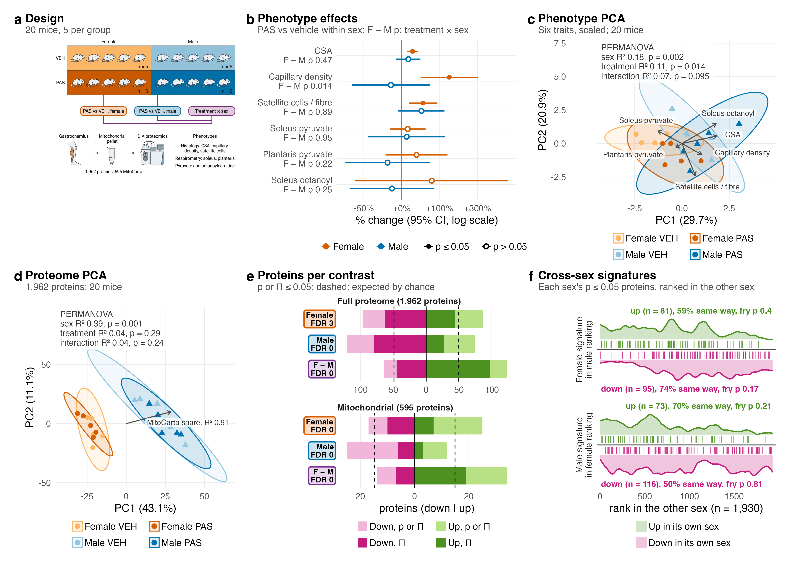

# 04_Figures

Figures that cross the comparisons. Each figure folder holds one script per panel in `a_script/panels/` and a composite script that runs them and stitches the result; panel and composite PDFs and PNGs in `b_reports/`; a workbook with one sheet per panel in `c_data/`; and a README with a panel table. Every script reads saved outputs only.

| Figure | Shows |
|---|---|
| [`F01_Global`](F01_Global/README.md) | design; phenotype effects and PCA; proteome PCA; proteins per contrast; cross-sex signatures |

Figures for each comparison come next, one comparison at a time.
