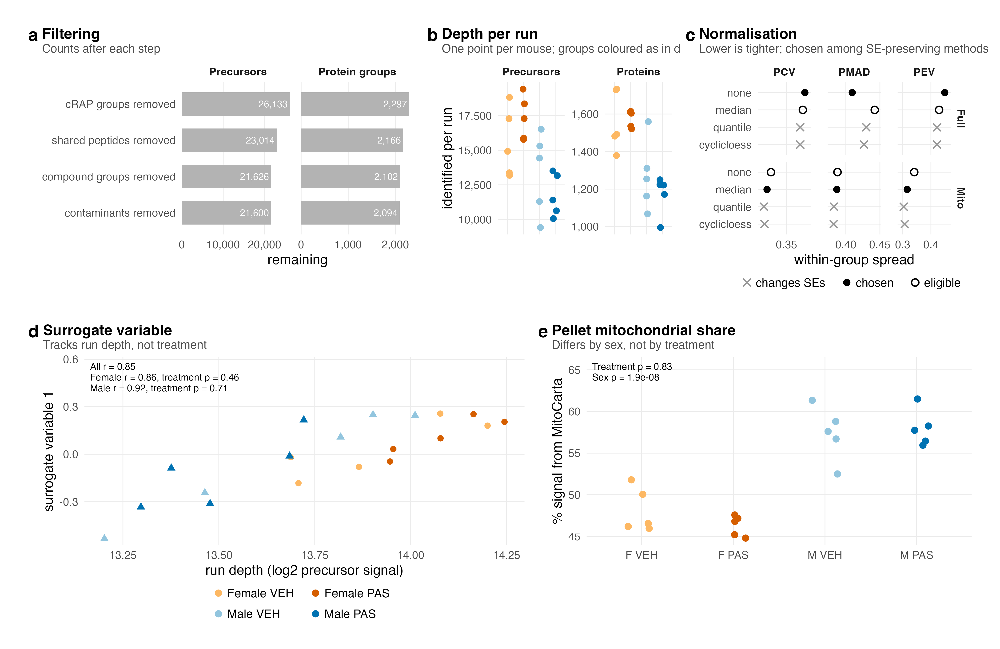
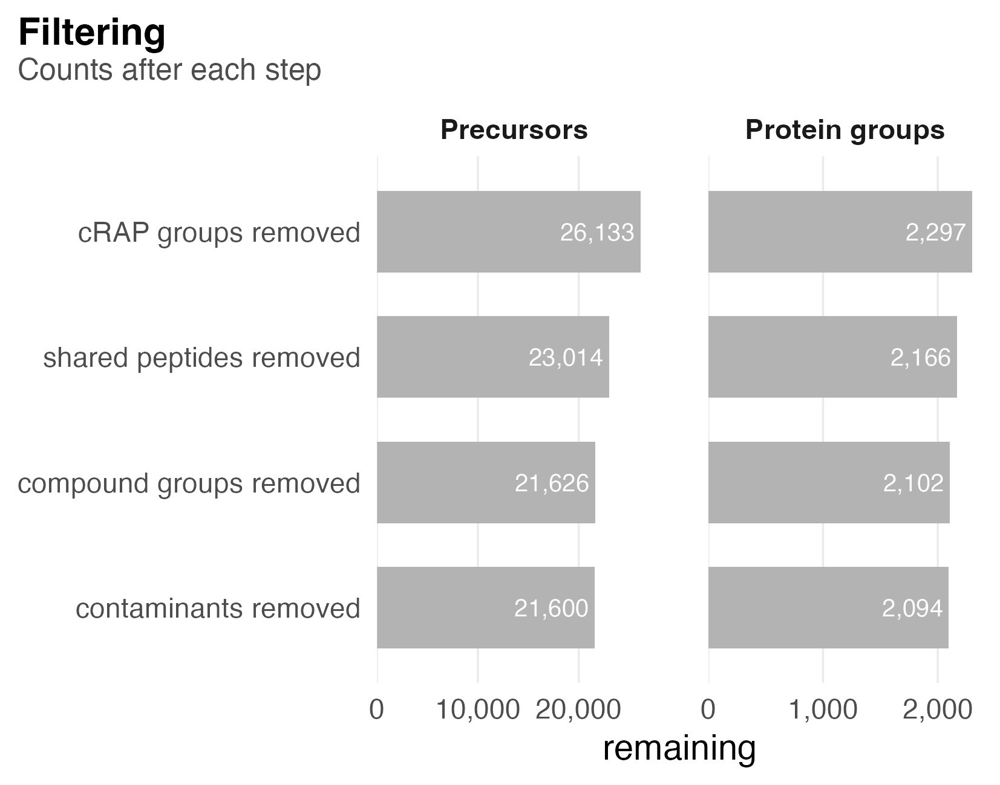
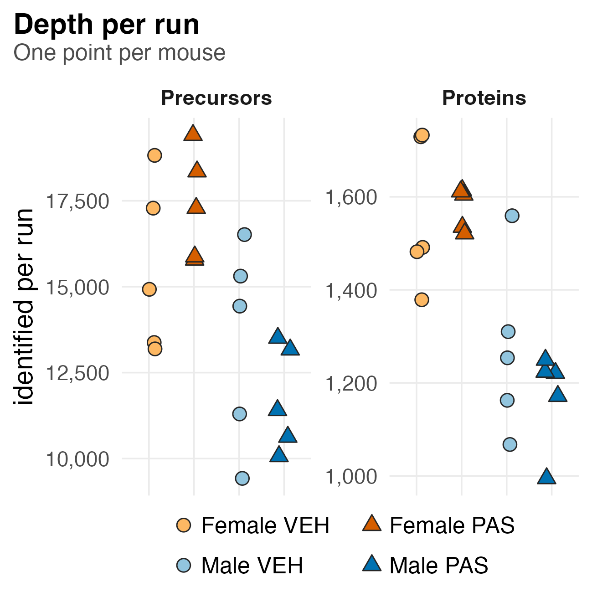
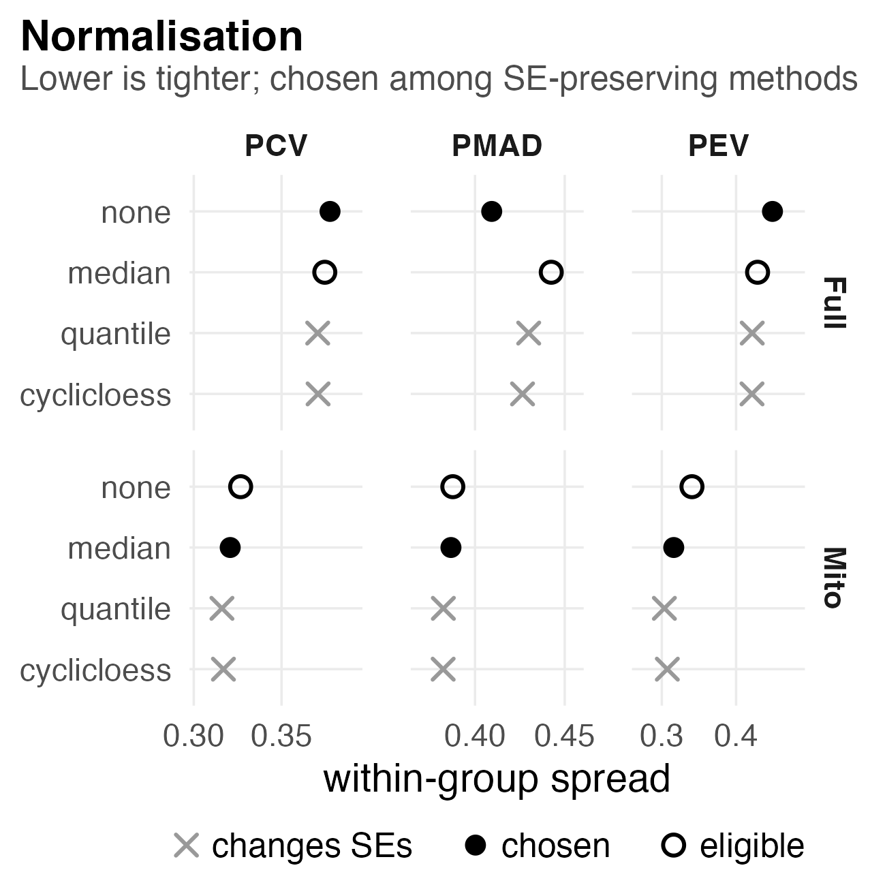
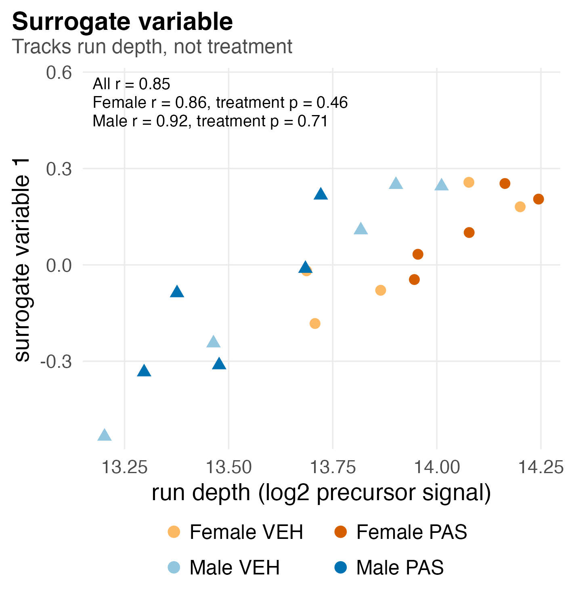
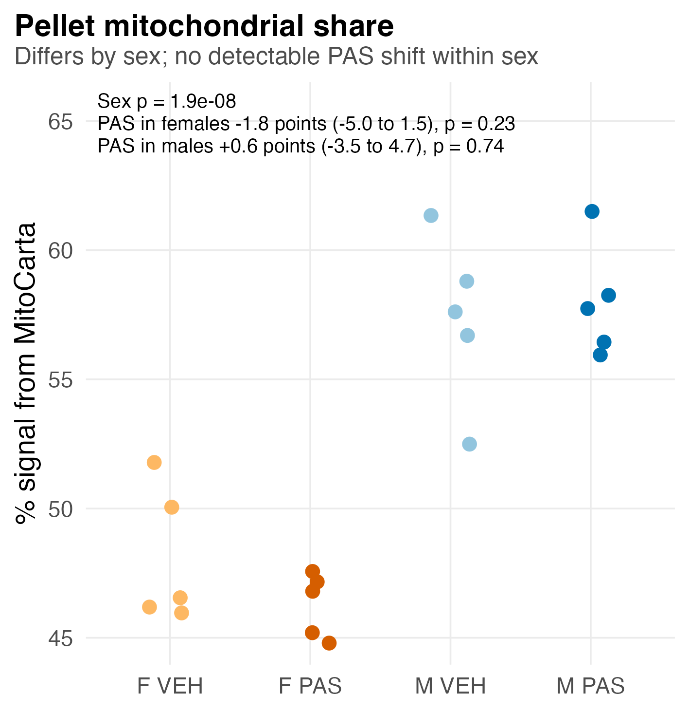
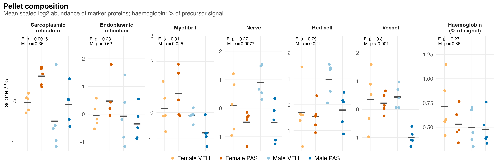

# S1_Processing

Supplementary Figure 1: what processing kept and chose, and what else is in the pellet.

| | |
|---|---|
| Reads | `01_Processing/01_Filtering/c_data/precursors_filtered.rds`, `01_Processing/02_Quantification/c_data/proteins.rds`, `01_Processing/03_Design/c_data/design.rds`, `02_Statistics/05_Composition/c_data/composition.rds` |
| Writes | `b_reports/panels/<panel>.pdf/.png`, `b_reports/S1_composite.pdf/.png` (180 × 177 mm), `c_data/S1.xlsx` |
| Run | `Rscript 04_Figures/S1_Processing/a_script/S1_composite.R` (each panel script also runs alone) |

Each panel is its own script in `a_script/panels/`; the composite runs them, adds the letters, stitches them and writes one workbook. Panels read saved outputs and compute nothing beyond counts, filtering and scaling.

## Panels

### a. Filtering

Each bar is the number of precursors (left) and protein groups (right) still in the data after one filter, applied top to bottom; the precursors entering this panel have already passed the three q-value filters at 0.01. Read the drop between consecutive bars as the cost of that filter. Removing shared peptides costs the most, 3,119 precursors and 131 groups, and takes the retained signal from 98.3% to 75.0%, because muscle's most abundant proteins (myosins, actins, tropomyosins, troponins) come in isoform families that share peptides. Removing compound groups costs another 1,388 precursors and 64 groups, and removing mouse keratin, immunoglobulin and haemoglobin costs 26 precursors and 8 groups. The data end at 21,600 precursors in 2,094 groups.

### b. Depth per run

One point per mouse, coloured by group: the precursors (left) and protein groups (right) DIA-NN identified in that run. Higher points are deeper runs. Female runs identified 13,190 to 19,409 precursors and male runs 9,422 to 16,514, and the six shallowest runs are all male. The depth difference is technical. It is why the model in panel d carries a surrogate variable, and why the baseline male against female contrasts are reported as context only.

### c. Normalisation

The benchmark that chose the normalisation, run separately for the full proteome (top) and the MitoCarta universe (bottom). Each row is a method and each column a measure of how tightly the five replicates of a group agree: PCV, the mean within-group coefficient of variation; PMAD, the mean within-group median absolute deviation; PEV, the pooled within-group variance. Lower is tighter. A cross marks quantile and cyclic loess, which reshape each mouse's values and so no longer match limpa's standard errors; they are scored but cannot be chosen. Of the two eligible methods, the one with the lower PMAD is used (filled point): no normalisation for the full proteome (PMAD 0.409 against 0.442 for median centring) and median centring for MitoCarta (0.387 against 0.388, a near tie). No contrast enters the benchmark, so the choice cannot favour a result.

### d. Surrogate variable

One point per mouse: its surrogate variable sv1 against run depth (log2 of the precursors identified), coloured by group with triangles for males. sv1 is the strongest pattern sva finds in the full proteome once the four group means are removed, and it enters every model as a covariate. It rises with run depth, r = 0.85 across all mice, 0.86 within females and 0.92 within males, and PAS and vehicle mice are interleaved along it (Welch p 0.46 in females, 0.71 in males). So sv1 absorbs run-depth noise and not the PAS effect.

### e. Pellet mitochondrial share

One point per mouse: the percentage of its protein signal that comes from MitoCarta proteins. The sexes do not overlap: every female pellet is at or below 51.8% and every male pellet at or above 52.4% (Welch p = 1.9e-08). Within each sex PAS makes no detectable change to the share: −1.8 points in females (95% CI −5.0 to 1.5, p 0.23) and +0.6 in males (−3.5 to 4.7, p 0.74). So a male against female comparison partly reflects mitochondrial enrichment, while the within-sex PAS contrasts are not confounded by it.

### f. Pellet composition

One point per mouse for each marker group, with the group mean as a dash. A marker score is the mean of the z-scored log2 abundances of the group's marker proteins seen in at least 15 of 20 mice, so 0 is the cohort average; the last column is haemoglobin as a percentage of precursor signal. The p-values above each column test PAS against vehicle within females (F) and within males (M). Female PAS pellets carry more sarcoplasmic reticulum (p 0.0015) and nothing else differs in females. Male PAS pellets carry less vessel (p 0.00028), nerve (0.0077), red cell (0.021) and myofibril (0.025) material, while haemoglobin's share of precursor signal does not differ (p 0.86). Read these as differences in what went into the tube: male PAS protein results can partly reflect pellet composition, and 02_Statistics/05_Composition analyses composition further.

## Workbook

`c_data/S1.xlsx` holds one sheet per panel with the numbers it draws, plus `read_me`, `input_manifest` and `package_versions`.
