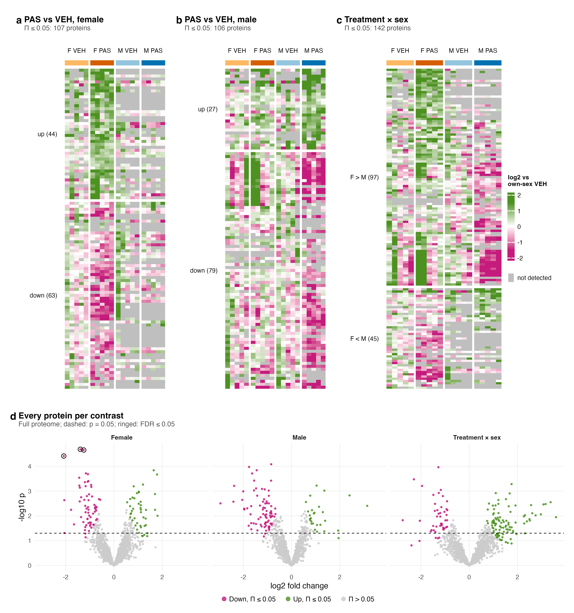
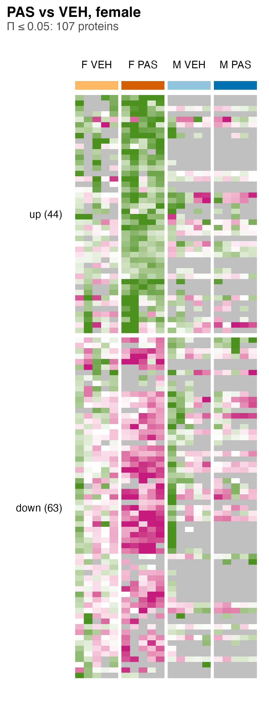
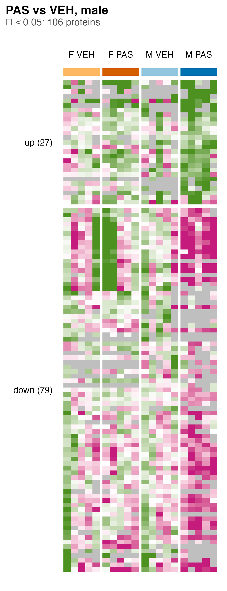
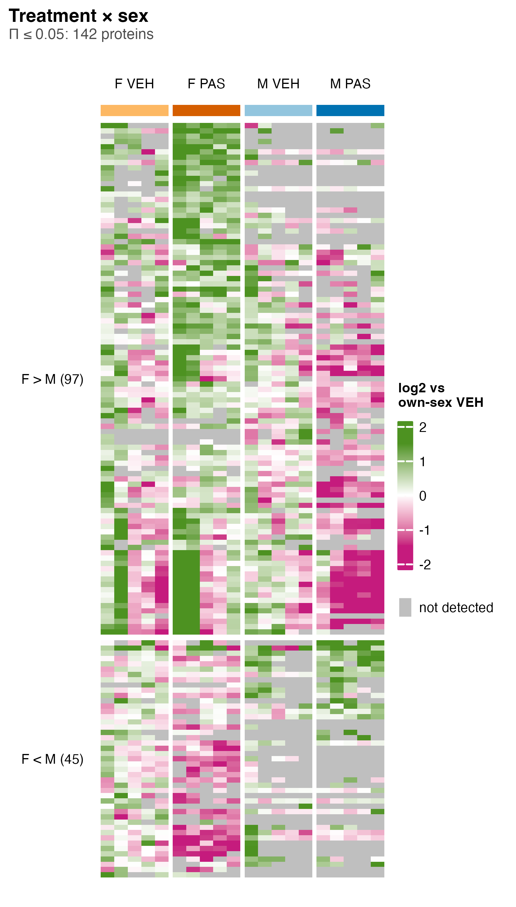
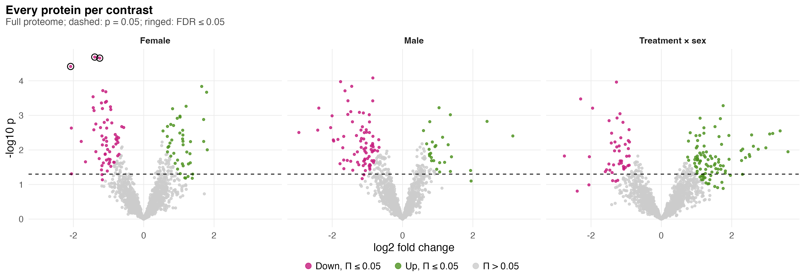

# S2_Proteins

Supplementary Figure 2: each comparison's own protein list.

| | |
|---|---|
| Reads | `02_Statistics/01_Fit/c_data/fit.rds`, `01_Processing/02_Quantification/c_data/proteins.rds` |
| Writes | `b_reports/panels/<panel>.pdf/.png`, `b_reports/S2_composite.pdf/.png` (180 × 192 mm), `c_data/S2.xlsx` |
| Run | `Rscript 04_Figures/S2_Proteins/a_script/S2_composite.R` (each panel script also runs alone) |

Each panel is its own script in `a_script/panels/`; the composite runs them, adds the letters, stitches them and writes one workbook. Panels read saved outputs and compute nothing beyond counts, filtering and scaling.

## Panels

### a. Female PAS against vehicle

Each row is one of the 107 full-proteome proteins at Π ≤ 0.05 in the female PAS against vehicle contrast (`fit.rds`: `protein_contrasts`), and each column one of the 20 mice, grouped as female vehicle, female PAS, male vehicle and male PAS under the group colour bar. A cell is the protein's normalised log2 abundance (`E_norm`) minus its mean over the vehicle mice of the same sex, so green is above own-sex vehicle and magenta below, with the colour full at ±1.5; a grey cell marks a mouse in which the protein was not detected (no precursor observed). Rows are split by the sign of the female fold change and clustered within each block: 44 up (log2 FC 0.55 to 1.81) and 63 down (−2.08 to −0.57).

The female PAS block separates by construction, since the female contrast chose the rows; the male columns are the informative part, and only 6 of the 107 are also on the male list. Of the 107, 20 have no precursor observed in any male run, so their male cells are grey.

### b. Male PAS against vehicle

The same layout for the 106 proteins at Π ≤ 0.05 in the male PAS against vehicle contrast. Down outnumbers up, 79 (log2 FC −2.95 to −0.67) against 27 (0.60 to 3.14), and the male PAS block carries that pattern because the male contrast chose the rows. The female columns are the informative part; of the 6 proteins shared with the female list, 3 fall in both sexes, 2 rise in females and fall in males, and 1 does the reverse. None of the 106 reaches FDR ≤ 0.05; the smallest FDR is 0.094. With five mice per group, a protein at Π ≤ 0.05 is a ranked candidate for follow-up and not a confirmed change.

### c. Treatment by sex

The same layout for the 142 proteins at Π ≤ 0.05 in the treatment × sex contrast, the female PAS effect minus the male PAS effect. Rows are split by the sign of that difference: F > M (97 proteins, log2 FC 0.75 to 3.60) where the female effect is the more positive, and F < M (45, −2.76 to −0.91) where it is the more negative.

A positive difference can come from a rise in females, a fall in males or both, and the heatmap shows which: many F > M rows are green in female PAS and magenta in male PAS. Of the 142, 60 are also on the female list and 45 on the male list, and 15 have no precursor observed in any male run, so their male cells are grey and the difference rests on the females alone. No protein reaches FDR ≤ 0.05 (smallest 0.21).

### d. Volcano plots

One point per full-proteome protein, 1,962 per contrast, with log2 fold change on the x axis and −log10 p on the y axis; facets are female PAS against vehicle, male PAS against vehicle and the female minus male difference. Points at Π ≤ 0.05 are green when up and magenta when down, the rest grey; the dashed line marks p = 0.05, and a black ring marks FDR ≤ 0.05 (BH within contrast). Π is a curved boundary, so a fold change above 2 can pass it with p above 0.05 (7 female, 3 male and 25 interaction proteins do) and a small fold change can fail it with p below 0.05.

At p ≤ 0.05 the contrasts give 177 (female), 193 (male) and 162 (interaction) proteins, against 98 expected by chance. Only three proteins pass FDR ≤ 0.05, all female and all down: Cops3 (log2 FC −1.25, FDR 0.022), Dusp3 (−1.39, 0.022) and Cops8 (−2.08, 0.025).

Π is p^|log2 FC| (Xiao et al. 2014); it ranks on p and fold change together and controls no error rate. The heatmaps' rows are chosen on the contrast they show, so the selected sex's PAS columns will always look separated; the other sex's columns and the volcano's FDR rings are the fairer read.

## Workbook

`c_data/S2.xlsx` holds one sheet per panel with the numbers it draws, plus `read_me`, `input_manifest` and `package_versions`.
