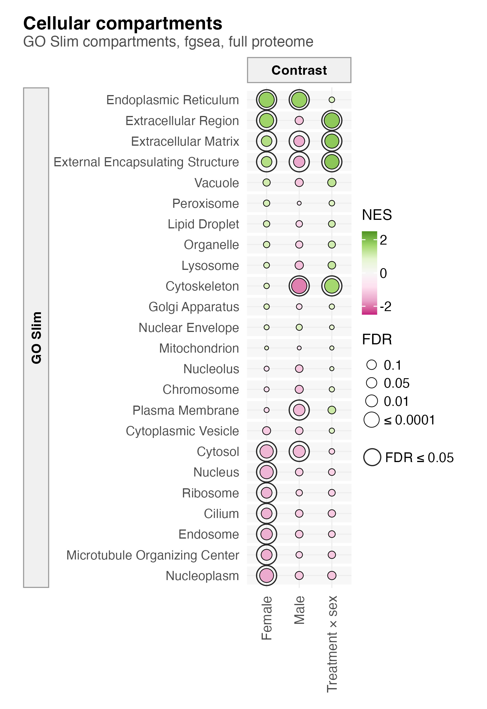
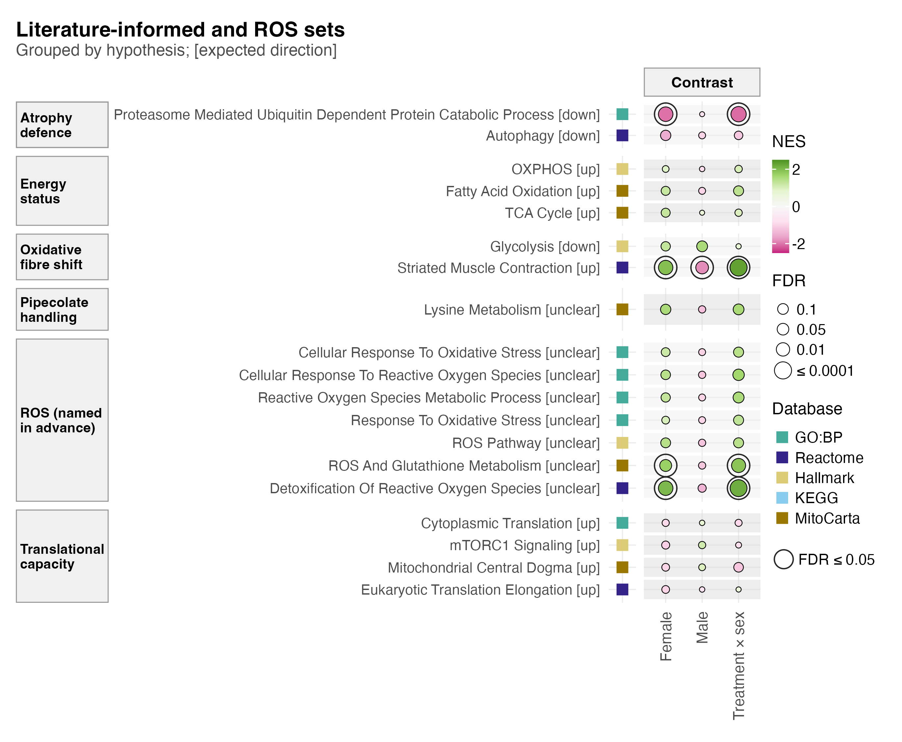

# S3_Pathway_sets

Supplementary Figure 3: the GO Slim compartments and the literature-informed and ROS sets.

| | |
|---|---|
| Reads | `02_Statistics/02_Enrichment/c_data/enrichment.rds` |
| Writes | `b_reports/panels/<panel>.pdf/.png`, `b_reports/S3_composite.pdf/.png` (180 × 102 mm; panels a 70 × 102 mm and b 116 × 95.5 mm on their own), `c_data/S3.xlsx` |
| Run | `Rscript 04_Figures/S3_Pathway_sets/a_script/S3_composite.R` (each panel script also runs alone) |

Each panel is its own script in `a_script/panels/`; the composite runs them, adds the letters, stitches them under one shared key and writes one workbook. The grids have fixed row heights, so the shorter panel b sits vertically centred beside a. Both panels use F03's `pathway_grid()`: a boxed Contrast block of three columns (Female, Male, Treatment × sex), row blocks in boxed strips on the left, a light band behind each row, dot fill NES and dot area −log10 FDR. Panels read saved outputs and compute nothing beyond counts, filtering and scaling.

## Panels

### a. Cellular compartments

Each dot is one of 24 GO Slim cellular compartments (27 to 1,703 proteins) in one contrast: female PAS against vehicle, male PAS against vehicle, and the female minus male difference. Fill is the fgsea normalised enrichment score on the full-proteome moderated t, green when the compartment's proteins sit towards the up end of the ranking and magenta towards the down end. Dot area grows with −log10 FDR (BH across the 24 within each contrast) from a small minimum and stops growing at FDR 0.0001, with the key in FDR (0.1, 0.05, 0.01, ≤ 0.0001), and a ring around the dot marks FDR ≤ 0.05. All 24 rows sit in one GO Slim block, ordered by the female NES, highest at the top. There is one database, so no database squares.

In females, 11 compartments pass: endoplasmic reticulum (NES 1.75), extracellular region, extracellular matrix and external encapsulating structure lean up, and seven, among them nucleus, nucleoplasm and cytosol, lean down. In males the endoplasmic reticulum also leans up (1.74), but cytoskeleton (−1.93), extracellular matrix, external encapsulating structure, plasma membrane and cytosol lean down. All four interaction hits (cytoskeleton and the three extracellular terms) are positive: the female shift is above the male. Mitochondrion shows no detectable shift in any contrast (FDR ≥ 0.99). The compartments overlap heavily, and fgsea permutes genes, so these FDRs run optimistic.

### b. Literature and ROS sets

Each dot is one of 19 sets (12 to 145 proteins) in one contrast, drawn as in panel a, with the rows in one block per hypothesis that named them and each label ending in the direction that hypothesis expected under PAS, in brackets. The one-set Pipecolate handling block is drawn 5.5 mm tall rather than 3 mm, so its two-line strip fits. A square before the first column gives the set's database, read from the prefix of its name (GOBP, HALLMARK, MITOCARTA, REACTOME). FDR here is BH across the 19 sets within each contrast. Only the 7 ROS sets were named before the results; the 12 literature-informed sets were named on 2026-10-05, after the first contrast results had been seen (`01_Processing/04_Gene_Sets`).

In females, the proteasome set falls as its hypothesis expected (NES −2.03, FDR 0.0028) and striated muscle contraction rises as expected (1.95, 0.0033). Two ROS sets, detoxification of reactive oxygen species (2.03, 0.0028) and MitoCarta ROS and glutathione metabolism (1.74, 0.040), rise too. In males only striated muscle contraction passes, and it falls (−1.83, 0.020), against its expected rise. The interaction carries the same four sets as the females, with the same signs. No energy-status or translational-capacity set passes in any contrast. Glycolysis, expected to fall, has a positive NES in both sexes without reaching FDR ≤ 0.05.

Both lists call `fgsea::fgsea(nPermSimple = 10000)` directly on the ranking the main tests use (`enrichment.rds`: `compartments`, `literature`), because at fgsea's default a set with unbalanced gene-level statistics loses its p-value.

There are no trait columns, unlike F03. `association_fgsea` has no GO Slim compartments. It does hold 18 of the 19 sets in panel b, but from a different test: fgsea at its default permutations, the five MitoCarta sets on the mitochondrial ranking rather than the full one, and BH across the whole collection rather than the 19. Detoxification of reactive oxygen species is missing from it. Those columns would not be comparable with the contrast columns beside them.

## Workbook

`c_data/S3.xlsx` holds one sheet per panel with the numbers it draws (per set and contrast: label, NES, fgsea p, BH FDR and size; panel b adds hypothesis, expected direction and database), plus `read_me`, `input_manifest` and `package_versions`.
