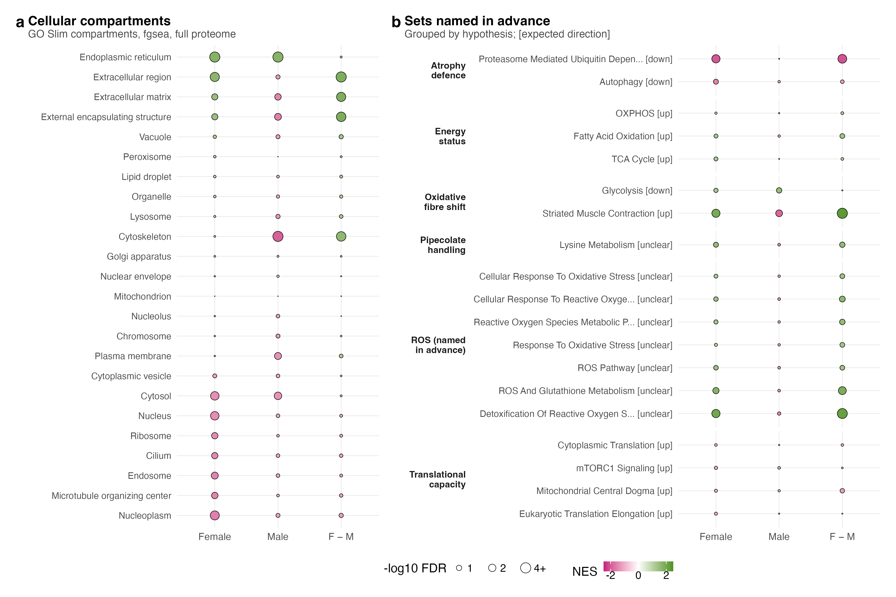

# S3_Pathway_sets

Supplementary Figure 3: the GO Slim compartments and the sets named in advance.

| | |
|---|---|
| Reads | `02_Statistics/02_Enrichment/c_data/enrichment.rds` |
| Writes | `b_reports/panels/<panel>.pdf/.png`, `b_reports/S3_composite.pdf/.png` (180 × 120 mm), `c_data/S3.xlsx` |
| Run | `Rscript 04_Figures/S3_Pathway_sets/a_script/S3_composite.R` (each panel script also runs alone) |

Each panel is its own script in `a_script/panels/`; the composite runs them, adds the letters, stitches them and checks the row counts against `02_enrichment.xlsx`. Panels read saved outputs and compute nothing beyond counts, filtering and scaling.

## Panels

| Panel | Shows | Source |
|---|---|---|
| a | GO Slim cellular compartments, fgsea per contrast in the full proteome. | `enrichment.rds`: `compartments` |
| b | Literature-informed and ROS sets, grouped by hypothesis, with the direction each expected; BH across the list. | `enrichment.rds`: `literature` |

## Workbook

`c_data/S3.xlsx` holds one sheet per panel with the numbers it draws, plus `read_me`, `input_manifest` and `package_versions`.
