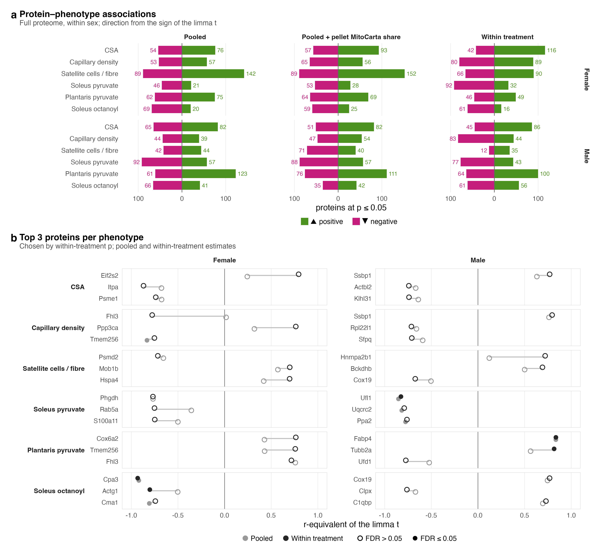
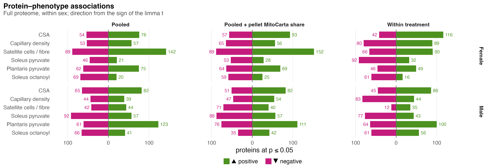
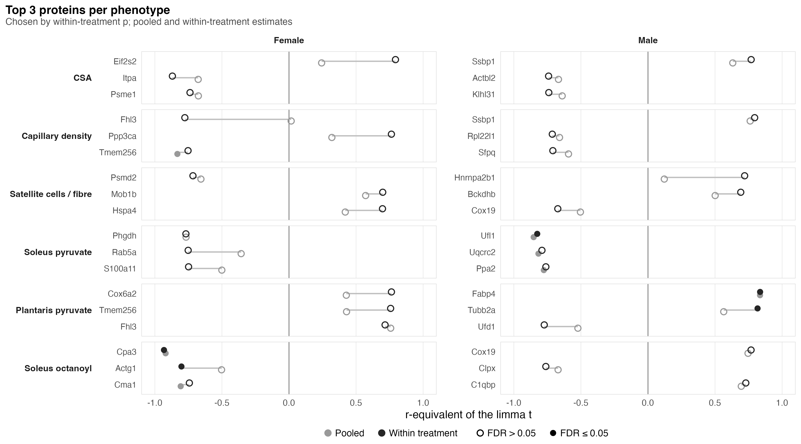

# S4_Protein_associations

Supplementary Figure 4: how many proteins track each phenotype and in which direction, and the strongest three.

| | |
|---|---|
| Reads | `02_Statistics/01_Fit/c_data/fit.rds` |
| Writes | `b_reports/panels/<panel>.pdf/.png`, `b_reports/S4_composite.pdf/.png` (180 × 165 mm), `c_data/S4.xlsx` |
| Run | `Rscript 04_Figures/S4_Protein_associations/a_script/S4_composite.R` (each panel script also runs alone) |

Each panel is its own script in `a_script/panels/`; the composite runs them, adds the letters, stitches them and writes one workbook. Panels read saved outputs and compute nothing beyond counts, filtering and scaling.

## Panels

### a. Association counts

Each pair of bars counts the full-proteome proteins whose association with one phenotype, within one sex, reaches p ≤ 0.05 under one model, split by the sign of the limma t: positive (▲, green) to the right of zero and negative (▼, magenta) to the left. Columns are the three models: pooled across PAS and vehicle mice, pooled with the pellet's MitoCarta share added, and within treatment; rows are the sexes. The counts come from `fit.rds`: `protein_associations` (filtered and counted; their totals match `association_summary`). The within-treatment model removes the group means and asks whether a protein tracks the trait among mice given the same treatment.

Female satellite cells per fibre give the largest counts under the pooled models (142 up and 89 down; 152 and 89 with the MitoCarta share) and fall to 90 and 66 within treatment. Within treatment, female CSA leans positive (116 up, 42 down) and female soleus pyruvate negative (32 up, 92 down). Female soleus octanoyl leans negative under all three models (20, 25 and 16 up against 69, 59 and 61 down). In males, plantaris pyruvate leans positive (123, 111 and 100 up against 61, 76 and 64 down) and soleus pyruvate negative (57, 57 and 43 up against 92, 88 and 77 down); male satellite cells drop to 35 up and 12 down within treatment, and male capillary density turns negative there (44 up, 83 down). Summed over the six phenotypes, up and down counts are close in every sex and model (within treatment: females 392 up and 387 down, males 364 and 342). FDR ≤ 0.05 is rare: at most 5 proteins in any bar (male soleus pyruvate, negative, pooled + MitoCarta share), and within treatment 2 negative in females and 2 positive and 1 negative in males. Proteins co-vary and each sex has ten mice, so a count is not itself a test.

### b. Top three proteins per phenotype

For each phenotype (rows, grouped) and sex (columns), the three proteins with the smallest within-treatment p, smallest at the top (`fit.rds`: `protein_associations`). Each protein's two points are the r-equivalent of the limma t, t / sqrt(t² + df), under the pooled (light grey) and within-treatment (near-black) models, joined by a line and offset slightly so neither hides the other. Filled points pass FDR ≤ 0.05 and open points do not.

Within-treatment r-equivalents of the 36 proteins run from 0.67 to 0.93 in size. Five reach FDR ≤ 0.05 within treatment: Cpa3 with female soleus octanoyl (−0.93, FDR 0.012), Actg1 with female soleus octanoyl (−0.80, 0.047), Fabp4 with male plantaris pyruvate (0.84, 0.024), Tubb2a with male plantaris pyruvate (0.82, 0.027) and Ufl1 with male soleus pyruvate (−0.83, 0.039). Seven pass pooled: Cpa3, Fabp4 and Ufl1 again, plus Tmem256 with female capillary density (−0.83), Uqcrc2 and Ppa2 with male soleus pyruvate (−0.82, −0.78) and Cma1 with female soleus octanoyl (−0.81). Some proteins differ sharply between models: Fhl3 with female capillary density is −0.78 within treatment and 0.02 pooled, Hnrnpa2b1 with male satellite cells 0.72 against 0.12, and Eif2s2 with female CSA 0.79 against 0.24. A few proteins recur: Ssbp1 is the top male protein for both CSA and capillary density; Tmem256 and Fhl3 fall with female capillary density and rise with female plantaris pyruvate; Cox19 falls with male satellite cells and rises with male soleus octanoyl. Each protein was picked from 1,962, so its within-treatment estimate runs optimistic.

The models come from `02_Statistics/01_Fit`: all three regress each protein on one z-scored phenotype within one sex with the surrogate variable fitted within sex; the MitoCarta share in the check model is centred within group. All three measure co-movement, not a PAS effect.

## Workbook

`c_data/S4.xlsx` holds one sheet per panel with the numbers it draws, plus `read_me`, `input_manifest` and `package_versions`.
