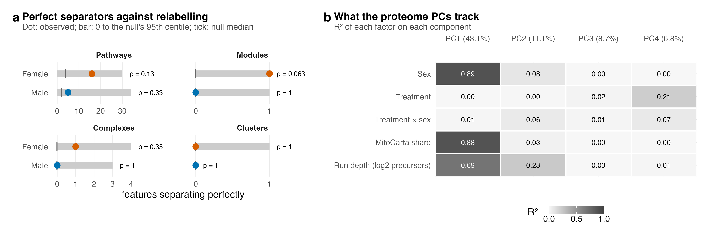
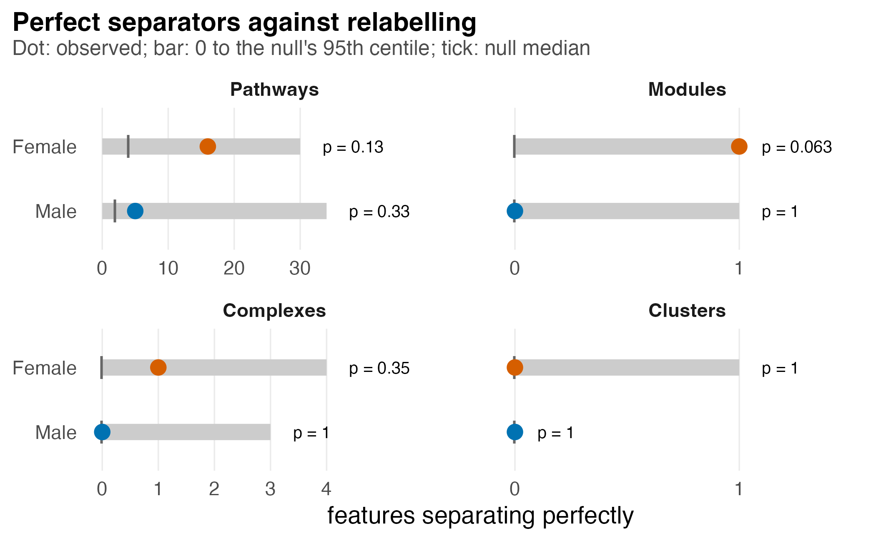
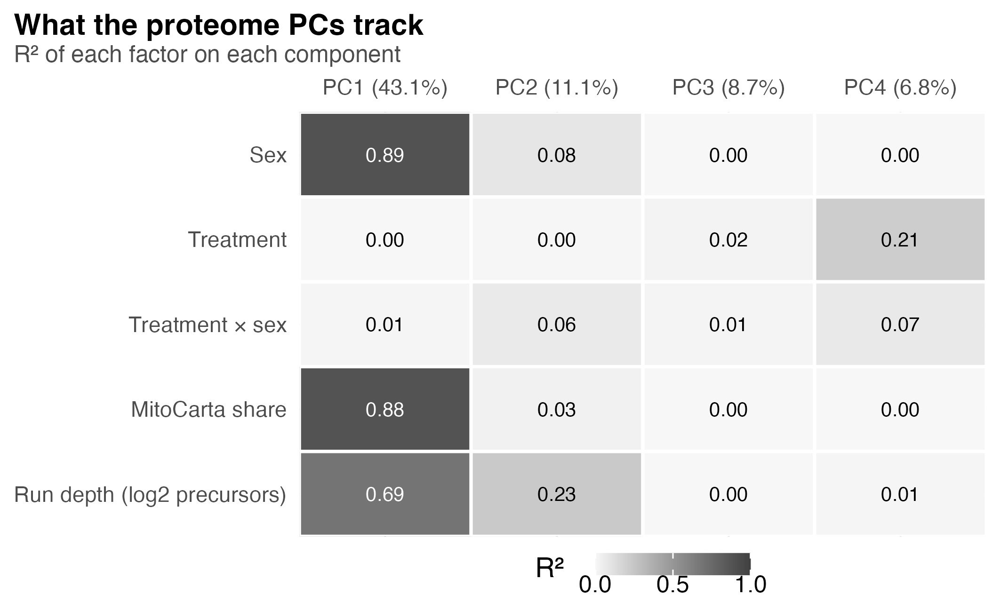

# S5_Structure

Supplementary Figure 5: whether perfect separation exceeds the relabelling null, and what the proteome components track.

| | |
|---|---|
| Reads | `02_Statistics/03_Classification/c_data/classification.rds`, `02_Statistics/04_PCA/c_data/pca.rds` |
| Writes | `b_reports/panels/<panel>.pdf/.png`, `b_reports/S5_composite.pdf/.png` (180 × 60 mm), `c_data/S5.xlsx` |
| Run | `Rscript 04_Figures/S5_Structure/a_script/S5_composite.R` (each panel script also runs alone) |

Each panel is its own script in `a_script/panels/`; the composite runs them, adds the letters, stitches them and writes one workbook. Panels read saved outputs and compute nothing beyond counts, filtering and scaling.

## Panels

### a. Perfect separators against relabelling

Each facet is one feature level, on its own x scale shared by both sexes, with one row per sex: 1,005 pathway scores, 8 module eigengenes, 98 complex scores and 7 cluster scores (`classification.rds`: `perfect`). The coloured dot counts the features that put all five PAS mice above, or all five below, all five vehicle mice. The grey bar runs from 0 to the 95th centile of the same count over all 252 ways of relabelling that sex's ten mice, a tick marks the null median, and the text gives the exact p, the share of relabellings with a count at least as large.

No level exceeds the relabelling null at p ≤ 0.05. Female pathways give the largest count, 16 against a null median of 4 (95th centile 30, p 0.13), and one female module separates perfectly against a null median of 0 (p 0.063). One female complex separates perfectly (p 0.35); male pathways give 5 against 2 (p 0.33), and no male module, complex or cluster separates. With five mice a side, some features will separate perfectly by chance alone, as the null shows.

### b. What the proteome components track

Each tile is the R² between one of the first four principal components of the normalised full proteome (columns, with the share of variance each explains) and one factor (rows). R² is the squared correlation of the component scores with sex and treatment coded ±1, their product, the pellet's MitoCarta share and run depth, the log2 precursors identified per run (`pca.rds`: `component_r2`). Darker grey is higher R², with white text above 0.5. PC1, 43.1% of the variance, tracks sex (0.89), MitoCarta share (0.88) and run depth (0.69), and not treatment (0.00). PC2 (11.1%) tracks run depth most (0.23), and PC3 (8.7%) tracks nothing above 0.02. Treatment reaches 0.21 only on PC4, 6.8% of the variance, with the interaction at 0.07. Sex, MitoCarta share and run depth coincide on PC1, so this panel cannot separate them, and treatment has no detectable association with the first three components.

The PCA is descriptive and does not carry the surrogate variable; `02_Statistics/04_PCA` tests the same factors by PERMANOVA (sex R² 0.39, p 0.001; treatment 0.04, p 0.29).

## Workbook

`c_data/S5.xlsx` holds one sheet per panel with the numbers it draws, plus `read_me`, `input_manifest` and `package_versions`.
