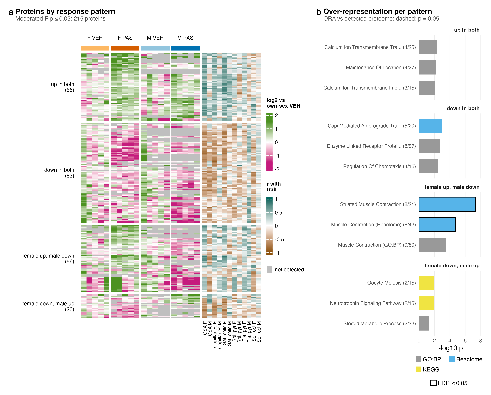
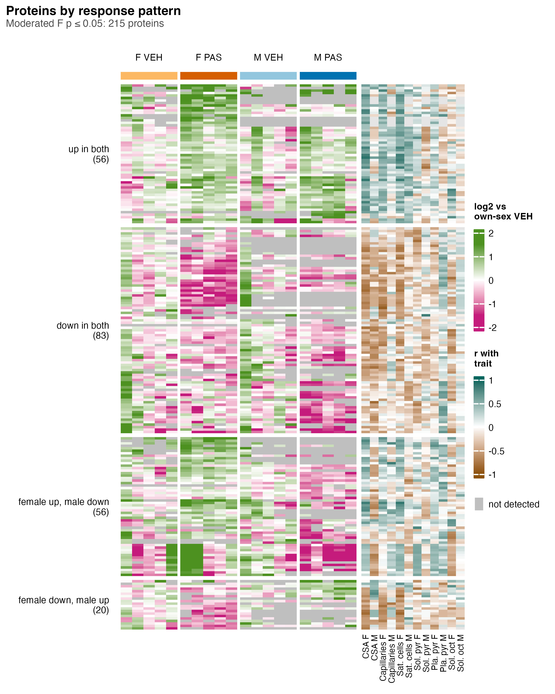
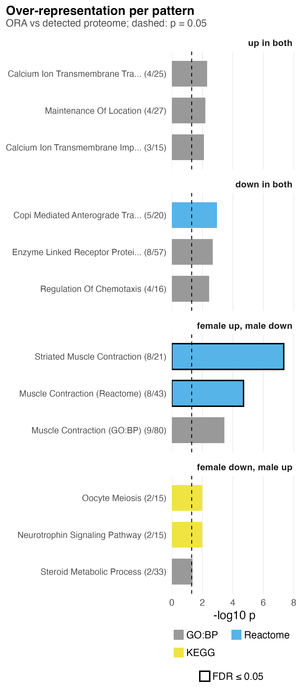

# S6_Protein_patterns

Supplementary Figure 6: which proteins PAS changes in either sex, and how the two sexes' responses line up.

| | |
|---|---|
| Reads | `02_Statistics/01_Fit/c_data/fit.rds`, `01_Processing/02_Quantification/c_data/proteins.rds`, `02_Statistics/02_Enrichment/c_data/enrichment.rds` |
| Writes | `b_reports/panels/<panel>.pdf/.png`, `b_reports/S6_composite.pdf/.png` (180 × 145 mm), `c_data/S6.xlsx` |
| Run | `Rscript 04_Figures/S6_Protein_patterns/a_script/S6_composite.R` (each panel script also runs alone) |

Each panel is its own script in `a_script/panels/`; the composite runs them, adds the letters, stitches them and writes one workbook. Panels read saved outputs and compute nothing beyond counts, filtering and scaling.

## Panels

### a. Proteins by response pattern

Each row is one of the 215 full-proteome proteins with a moderated F p ≤ 0.05 over the two within-sex PAS contrasts (`protein_ftest`). Each column is one of the 20 mice, grouped as female vehicle, female PAS, male vehicle and male PAS. A cell is that mouse's log2 abundance (`E_norm`) minus its own sex's vehicle mean, so green is higher, magenta lower, and colour stops changing beyond ±1.5; a grey cell marks a mouse in which the protein was not detected. Rows are split by the signs of the two fold changes (56 up in both sexes, 83 down in both, 56 up in females and down in males, 20 down in females and up in males) and clustered within each split. The twelve narrow columns give each protein's Pearson r with each phenotype within one sex across its ten mice (`protein_associations`, pooled model): teal positive, brown negative, grey where no r exists (17 proteins in males, 2 in females).

The F p-values run from 8.5e-05 to 0.0498 and the FDRs from 0.097 to 0.45. The r columns follow the treatment direction: female CSA has median r 0.55 in the up-in-both rows and −0.46 in the down-in-both rows.

### b. Over-representation per pattern

Each bar is one gene set within one response pattern from panel a. Bar length is −log10 p of over-representation (`fgsea::fora`, `pattern_ora`) of the pattern's genes against every detected gene, full collections. Fill gives the collection, a black outline marks BH FDR ≤ 0.05 within pattern and collection, the dashed line is p = 0.05, and the label gives overlap over set size. Only the three smallest-p sets per pattern are drawn. Genes are counted once, so the down-in-both list holds 81 genes for 83 proteins (Cav1 and Mbp appear twice).

Only the female up, male down pattern has sets at FDR ≤ 0.05: Reactome striated muscle contraction (8 of 21, p 4.6e-08, FDR 6.4e-06) and Reactome muscle contraction (8 of 43, FDR 0.0014), both carried by Acta1, Myl1, Tnnc2, Tnni2, Tnnt3, Tpm1, Tpm2 and Vim. GO:BP muscle contraction follows at 9 of 80 (FDR 0.27), and the smallest FDR in any other pattern is 0.15 (COPI-mediated anterograde transport, down in both).

The F test covers the interaction as well, since it asks whether either sex moves, but no protein in panel a reaches FDR ≤ 0.05. With 1,962 proteins tested, chance alone puts about 98 at p ≤ 0.05, so close to half of the 215 rows may be noise. The rows were selected because they differ, so the clustering describes them and tests nothing, and the ORA in panel b is descriptive for the same reason. Because each r pools PAS and vehicle mice, part of it comes from the PAS effect itself; r records co-movement, not an association separate from treatment.

The muscle contraction result sits beside a composition difference: male PAS pellets carry less myofibril material (S1 panel f, p 0.025), so the male-down half of the female up, male down pattern can partly reflect what went into the tube. `02_Statistics/02_Enrichment` also reports Hallmark myogenesis at FDR 0.03 for the same pattern, outside the three sets drawn here.

## Workbook

`c_data/S6.xlsx` holds one sheet per panel with the numbers it draws, plus `read_me`, `input_manifest` and `package_versions`.
