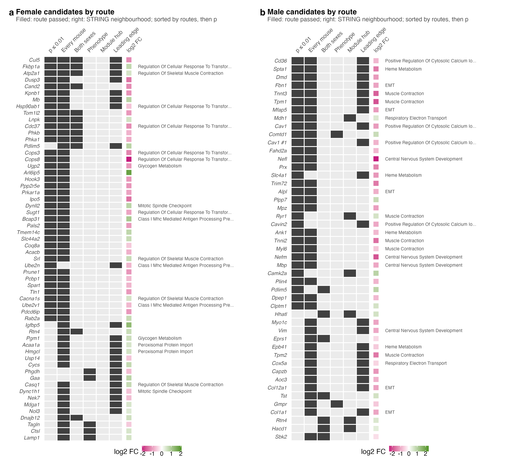

# S7_Candidates

Supplementary Figure 7: which of the six candidate routes each protein passed.

| | |
|---|---|
| Reads | `02_Statistics/06_Candidates/c_data/candidates.rds`, `06_candidates.xlsx` |
| Writes | `b_reports/panels/<panel>.pdf/.png`, `b_reports/S7_composite.pdf/.png` (180 × 165 mm), `c_data/S7.xlsx` |
| Run | `Rscript 04_Figures/S7_Candidates/a_script/S7_composite.R` (each panel script also runs alone) |

The routes are defined in `02_Statistics/06_Candidates/README.md`: p ≤ 0.01; every mouse separated (AUC ≥ 0.92 or ≤ 0.08); same direction in both sexes at p ≤ 0.10; within-treatment phenotype association at p ≤ 0.01; hub (kME ≥ 0.8) of a module that responds at p ≤ 0.05; leading edge of a kept FDR set at p ≤ 0.05. A protein must be detected in at least 4 of 5 mice per group of its sex to enter.

## Panels

| Panel | Shows | Source |
|---|---|---|
| a | 58 female proteins passing two or more routes. No female protein passes the hub route: no rebuilt module responds to PAS in females. | `candidates` |
| b | 47 male proteins passing two or more routes. Two Cav1 isoforms both pass; the second is labelled `Cav1 #1`. | `candidates` |

## Workbook

`c_data/S7.xlsx`: one sheet per panel, then `all_candidates`, every candidate passing one route or more in either sex (463 rows), ranked by routes and then p.
