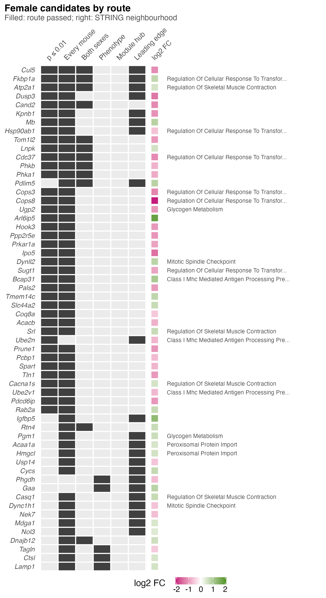
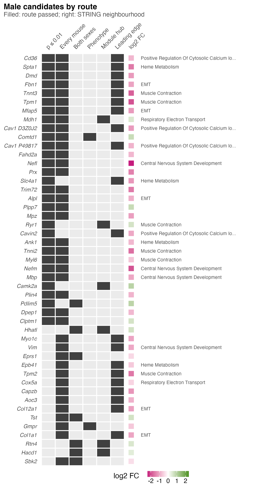

# S7_Candidates

Supplementary Figure 7: which of the six candidate routes each protein passed.

| | |
|---|---|
| Reads | `02_Statistics/06_Candidates/c_data/candidates.rds` |
| Writes | `b_reports/panels/<panel>.pdf/.png`, `b_reports/S7_composite.pdf/.png` (180 × 165 mm), `c_data/S7.xlsx` |
| Run | `Rscript 04_Figures/S7_Candidates/a_script/S7_composite.R` (each panel script also runs alone) |

The routes are defined in `02_Statistics/06_Candidates/README.md`: p ≤ 0.01; every mouse separated (AUC ≥ 0.92 or ≤ 0.08); same direction in both sexes at p ≤ 0.10; within-treatment phenotype association at p ≤ 0.01; hub (kME ≥ 0.8) of a module that responds at p ≤ 0.05; leading edge of a kept FDR set at p ≤ 0.05. A protein must be detected in at least 4 of 5 mice per group of its sex to enter.

Each panel is its own script in `a_script/panels/`, and both call the shared `candidate_routes()`; the composite runs them, stitches them side by side and writes one workbook.

## Panels

### a. Female candidates by route

Each row is one of the 58 female proteins passing two or more routes, sorted by the number of routes and then by PAS against vehicle p within females. A dark tile marks a route passed and a pale one a route missed. The square in the log2 FC column is the female PAS fold change, magenta for lower and green for higher, on a scale symmetric about zero up to the largest female |log2 FC| (2.08). Text on the right names the protein's STRING neighbourhood: candidates linked at combined score ≥ 700, split into walktrap communities and each named by its smallest-p Hallmark, Reactome or GO:BP term; 19 rows carry a name.

Three proteins pass four routes (Cul5, Fkbp1a, Atp2a1), 11 pass three and 44 pass two. The every-mouse route is passed by 55 rows and p ≤ 0.01 by 39, with 38 passing both, so these two routes largely count the same strength twice. The leading edge is passed by 22 rows, both sexes by 12 and the phenotype route by 5. No female protein passes the hub route, because no rebuilt module responds to PAS in females. The largest neighbourhoods are TGF-beta response regulation (6, including Cops3 and Cops8) and skeletal muscle contraction (Atp2a1, Srl, Cacna1s, Casq1, all higher with PAS). Those four are sarcoplasmic reticulum markers, the one class whose score rises in female PAS pellets (S1 panel f), so they should be read with the composition result beside them.

### b. Male candidates by route

The same layout for the 47 male proteins passing two or more routes, with the log2 FC scale running to the largest male |log2 FC| (2.38), so the colours of the two panels are close but not identical.

No male protein passes four routes; 11 pass three and 36 pass two. The every-mouse route is passed by 39 rows, p ≤ 0.01 by 31 (26 both), the leading edge by 20, both sexes by 7, the hub by 6 (Mdh1, Ryr1, Camk2a, Hhatl, Rtn4, Hacd1) and the phenotype route by 2 (Comtd1, Gmpr). Thirty-six of the 47 are lower with PAS. Two Cav1 protein groups both pass, labelled `Cav1 D3Z0J2` and `Cav1 P49817`. Fifteen rows are marker proteins of the classes whose score falls in male PAS pellets (S1 panel f): red cell (Spta1, Slc4a1, Epb41), nerve (Nefl, Nefm, Mbp, Mpz, Prx), vessel (both Cav1 isoforms, Aoc3) and myofibril (Tnnt3, Tpm1, Tnni2, Tpm2). All 15 are lower with PAS. Because the class scores are built from these same proteins, the two observations are not independent, and these 15 candidates may report what went into the tube rather than a change within the muscle.

Across both sexes, 255 female and 208 male proteins pass at least one route. The route thresholds are deliberately loose and the routes are not independent, and the phenotype route crosses tissues (respiration comes from soleus and plantaris). The 463 candidates are discovery-stage leads for a western blot or targeted assay in new mice, not validated biomarkers.

## Workbook

`c_data/S7.xlsx`: one sheet per panel, then `all_candidates`, every candidate passing one route or more in either sex (463 rows), ranked by routes and then p, plus `read_me`, `input_manifest` and `package_versions`.
