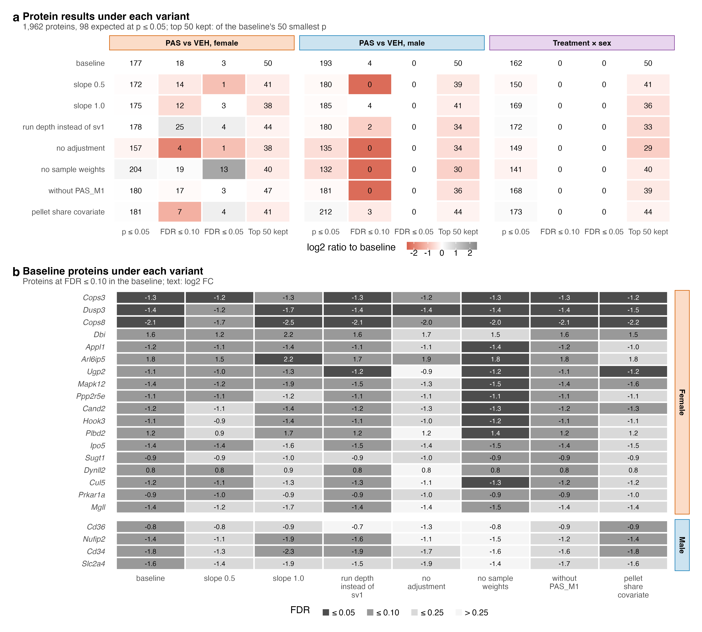
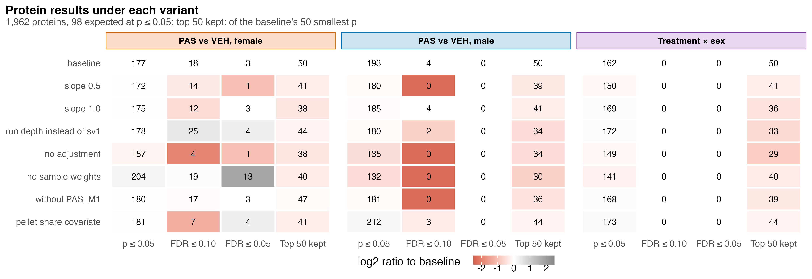
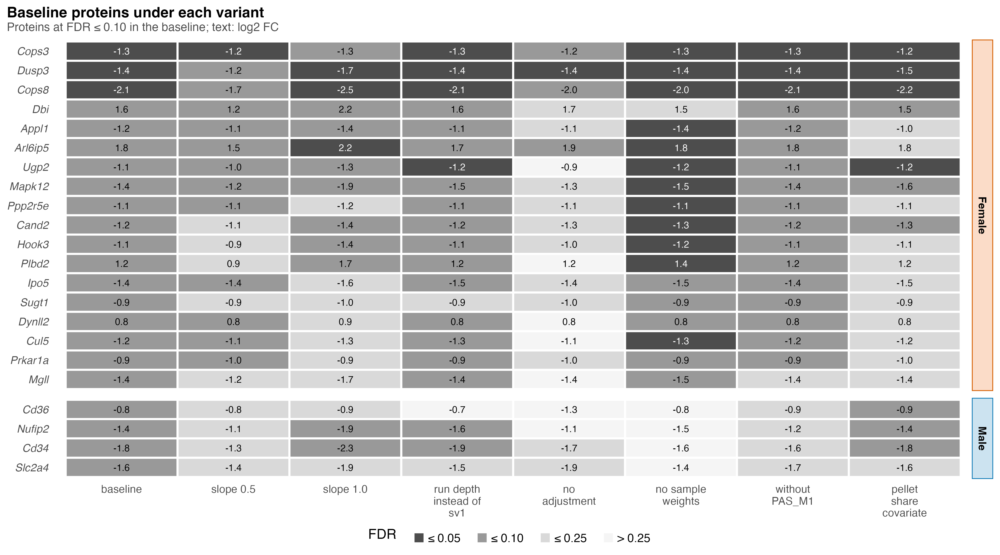

# S8_Sensitivity

Supplementary Figure 8: how the protein results move when one processing or model choice changes.

| | |
|---|---|
| Reads | `02_Statistics/07_Sensitivity/c_data/sensitivity.rds` |
| Writes | `b_reports/panels/<panel>.pdf/.png`, `b_reports/S8_composite.pdf/.png` (180 × 162 mm), `c_data/S8.xlsx` |
| Run | `Rscript 04_Figures/S8_Sensitivity/a_script/S8_composite.R` (each panel script also runs alone) |

Each variant changes one choice and refits the three comparison contrasts in the full proteome (see `02_Statistics/07_Sensitivity/README.md`). Each panel is its own script in `a_script/panels/`; the composite runs them, stacks them and writes one workbook.

## Panels

### a. Protein results under each variant

Each cell is one variant (row) in one contrast (facet: female PAS against vehicle, male PAS against vehicle, treatment × sex) and one measure (column). The measures are the number of the 1,962 proteins at p ≤ 0.05, at FDR ≤ 0.10 and at FDR ≤ 0.05, and how many of the baseline's 50 smallest p-values stay among the variant's 50 smallest. The number in each cell is the count; the fill is the count's log2 ratio to the baseline with one added to both, red for fewer and grey for more, capped at ±2.5, so the baseline row is white.

Every variant finds 132 to 212 proteins at p ≤ 0.05, where chance alone gives 98. Males drop most without adjustment (135) or without sample weights (132), from 193 at baseline. The female FDR ≤ 0.10 count runs from 4 (no adjustment) to 25 (run depth instead of sv1), and the female FDR ≤ 0.05 count from 1 to 13 (no sample weights). The male FDR ≤ 0.10 count is 4 at baseline and 0 under four variants, and no variant finds a male protein at FDR ≤ 0.05 or an interaction protein at FDR ≤ 0.10. The top 50 keeps 38 to 47 in females, 30 to 44 in males and 29 to 44 for the interaction. So the excess over chance holds under every choice, while the short list that clears an FDR line depends on the choice.

### b. Baseline proteins under each variant

Each row is one of the 22 proteins at FDR ≤ 0.10 in the baseline (18 female, 4 male, none for the interaction), sorted by baseline FDR within each sex, and each column a variant. Tile shade bins the protein's FDR under that variant, from dark grey (≤ 0.05) through mid grey (≤ 0.10) and light grey (≤ 0.25) to near white (> 0.25); the text is the log2 FC, white on the darkest tiles.

No protein changes sign under any variant. Cops3, Dusp3 and Cops8 stay at FDR ≤ 0.10 under all seven variants and at FDR ≤ 0.05 under five, six and five of them; Dusp3's worst is 0.051, under slope 0.5. Arl6ip5, Mapk12 and Ugp2 hold under six, and Mgll and Sugt1 under only two. The four male proteins start just under the line (baseline FDR 0.094 to 0.096): Nufip2 and Cd34 stay at FDR ≤ 0.10 under slope 1.0, run depth and pellet share (3 of 7), Cd36 under pellet share alone, and Slc2a4 under none (best 0.108). So only two of the four male proteins that slope 1.0 finds in panel a are baseline proteins. The direction of each change is steadier than its FDR: with five mice per group most of these proteins sit near the FDR line, and a small change to the model moves them across it.

The variants are: limpa detection-curve slope 0.5 or 1.0 instead of 0.7 (dpcQuant rerun on the same 1,962 proteins, surrogate variable kept from the baseline); measured log2 run depth as the covariate instead of sv1; no covariate; `dpcDE(sample.weights = FALSE)`; the re-injected male PAS run (PAS_M1) removed; and the pellet's MitoCarta share added to the design. The baseline row is checked against `02_Statistics/01_Fit`.

## Workbook

`c_data/S8.xlsx` holds one sheet per panel with the numbers it draws, plus `read_me`, `input_manifest` and `package_versions`.
