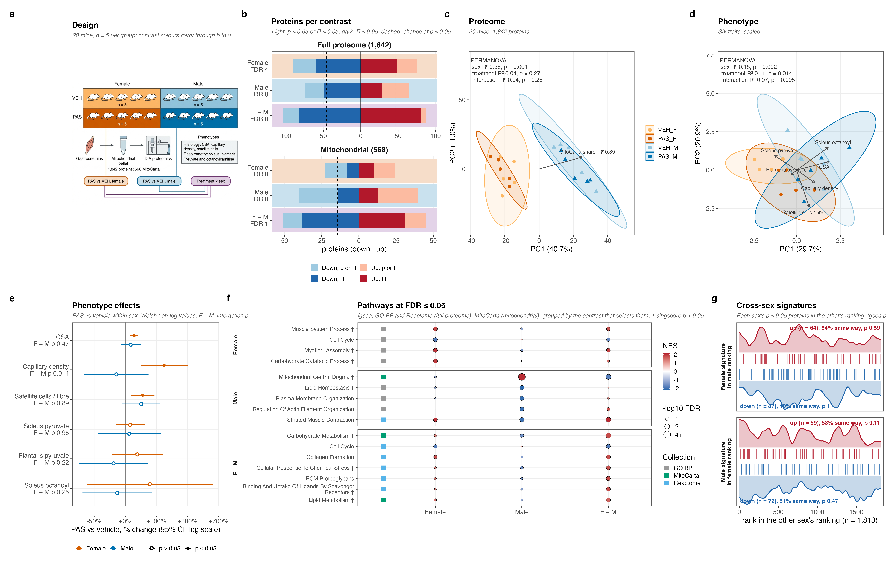

# PAS_2026

Gastrocnemius proteomics of pipecolic acid plus succinate (PAS) against vehicle in mice with a ligated femoral artery. 20 mice, five per sex and treatment, one mitochondria-enriched pellet each, DIA mass spectrometry; 1,842 proteins, 568 in MitoCarta. Six phenotypes per mouse: CSA, capillary density and satellite cells by histology, and respiratory conductance in soleus and plantaris.

The project asks three questions:

1. Does PAS change females? PAS_F − VEH_F.
2. Does PAS change males? PAS_M − VEH_M.
3. Does the PAS response differ by sex? (PAS_F − VEH_F) − (PAS_M − VEH_M).

Differences between females and males at baseline are not a question here. They dominate the proteome (PERMANOVA R² 0.38), so they appear as context in `02_Statistics/04_PCA` and Figure 1.



## Layout

| Folder | Holds |
|---|---|
| [`00_Input/`](00_Input/README.md) | the delivered data, MitoCarta, CORUM 5.3 and STRING v12; nothing is downloaded at run time |
| [`01_Processing/`](01_Processing/README.md) | filtering, quantification, design, gene sets, scores, modules |
| [`02_Statistics/`](02_Statistics/README.md) | the shared fit, pathway tests, classification, PCA |
| [`03_Female/`](03_Female/README.md) | question 1: proteins, pathways, phenotypes, classification |
| [`04_Male/`](04_Male/README.md) | question 2: the same four steps |
| [`05_Sex_Difference/`](05_Sex_Difference/README.md) | question 3: proteins and pathways |
| [`06_Figures/`](06_Figures/README.md) | figures built from saved outputs only |
| `R/` | `helpers.R` (constants, paths, writers, shared rules), `comparisons.R` (the report steps of the three comparisons), `figures.R` (theme, colours and the plots several steps draw) |

Data flows one way: processing feeds statistics, the comparisons slice and report the statistics, and the figures read both. No comparison reads another. Every step reads only saved files from earlier steps, so it reruns alone once those exist. Every step holds `a_script/` (one script), `b_reports/` (one PDF, where there is something to draw), `c_data/` (one workbook, plus any `.rds` a later step reads) and a README naming what it reads and writes.

## Reading the results by hand

| Question | Proteins | Pathways | Phenotypes | Classification |
|---|---|---|---|---|
| 1. Female | `03_Female/01_Proteins` | `03_Female/02_Pathways` | `03_Female/03_Phenotypes` | `03_Female/04_Classification` |
| 2. Male | `04_Male/01_Proteins` | `04_Male/02_Pathways` | `04_Male/03_Phenotypes` | `04_Male/04_Classification` |
| 3. Sex difference | `05_Sex_Difference/01_Proteins` | `05_Sex_Difference/02_Pathways` | `02_Statistics/01_Fit`, sheet `phenotype_interaction` | none |

In each folder, the PDF in `b_reports/` opens on overview pages and ends with a grid of every feature at p ≤ 0.05. The workbook in `c_data/` opens on `read_me`, which says what each sheet holds; it ends with `input_manifest` (files read, with md5) and `package_versions`. Which protein belongs to which pathway, complex or cluster is in `01_Processing/04_Gene_Sets/c_data/04_gene_sets.xlsx`, sheet `membership`.

## Conventions

- **Model:** one limpa/limma fit on all 20 mice, four cell means, no covariates (run order was randomised). Proteins use limpa `dpcDE` with precision and sample weights; scores and module eigengenes use plain limma.
- **Multiple testing:** BH within universe (full or mitochondrial) and contrast for proteins; within contrast and collection for pathways. p ≤ 0.05 is reported beside the number expected by chance.
- **Π** = p^|log2 FC| (Xiao et al. 2014). It ranks on p and fold change together, controls no error rate, and is counted on its own.
- **r** sits beside every test: r with group (PAS = 1) for a contrast; r across the sex's ten mice, and within vehicle and PAS, for an association.
- **Phenotype effect** means what PAS did to a phenotype, as % change against the same sex's vehicle. **Phenotype association** means a feature moving with a phenotype across one sex's PAS and vehicle mice; it is co-movement, not a PAS effect.
- **Pathways:** fgsea through enrichVolcano on GO:BP and Reactome (full proteome) and MitoCarta (mitochondrial universe). The same sets are scored per mouse with singscore, and that mouse-level test sits beside every fgsea row. fgsea permutes genes, so where the two disagree the singscore result is the conservative one.
- **Seed:** 20260910 for every stochastic step.

## Run

```sh
Rscript -e 'renv::restore()'
Rscript run_all.R
```

About 5 minutes on a laptop. R 4.6.0. `renv.lock` pins every package; enrichVolcano installs from github.com/Dustyn-T-Lewis/enrichVolcano. It needs no network: CORUM and STRING are read from `00_Input/`. limpa's quantification is checkpointed; `01_Processing/02_Quantification/README.md` says how to refit it.

## Open with Dr. Ismaeel

Whether the measured limb is the ligated one; the muscle, marker and units of the histology; the capillary density definition; and the respiratory conductance units (`00_Input/phenotypes.xlsx`, sheet `notes`). The proteome comes from gastrocnemius, while respirometry comes from soleus and plantaris.

## Version 1

The exploratory first version is on branch `Dustyn/v1-exploratory-analyses`. Its protein contrasts are identical to these.

## Reference

Burke BI, Valentino TR, Ismaeel A, et al. Exercise-associated microbial metabolites prevent skeletal muscle atrophy in adult female mice. Nat Commun 2026. PMID 42431880.
