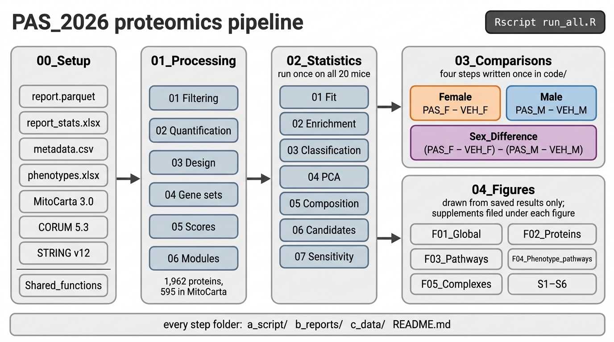

# PAS_2026

Gastrocnemius proteomics of pipecolic acid plus succinate (PAS) against vehicle in mice with a ligated femoral artery. 20 mice, five per sex and treatment, one mitochondria-enriched pellet each, DIA mass spectrometry; 1,842 proteins, 568 in MitoCarta. Six phenotypes per mouse: CSA, capillary density and satellite cells by histology, and respiratory conductance in soleus and plantaris.

The project asks three questions:

1. Does PAS change females? PAS_F − VEH_F.
2. Does PAS change males? PAS_M − VEH_M.
3. Does the PAS response differ by sex? (PAS_F − VEH_F) − (PAS_M − VEH_M).

Differences between females and males at baseline are not a question here. They dominate the proteome (PERMANOVA R² 0.38), so they appear as context in `02_Statistics/04_PCA` and [Figure 1](04_Figures/F01_Overview/README.md).



## Folders, in run order

| Folder | Holds |
|---|---|
| [`00_Setup`](00_Setup/README.md) | the study data and reference files (`Input/`) and the helpers several scripts source (`Shared_functions/`) |
| [`01_Processing`](01_Processing/README.md) | filtering, quantification, design, gene sets, set scores, modules |
| [`02_Statistics`](02_Statistics/README.md) | every model and test, run once on all 20 mice: the fit, pathway tests, classification, PCA |
| [`03_Comparisons`](03_Comparisons/README.md) | the three questions: four steps written once in `code/`, run for `Female`, `Male` and `Sex_Difference` |
| [`04_Figures`](04_Figures/README.md) | figures drawn from saved results only |

Data flows one way: processing feeds statistics, each comparison slices the statistics for its contrast, and the figures read the statistics. No comparison reads another. Every step reads only files earlier steps saved, so it reruns alone once those exist.

## Every step

```
01_Processing/NN_Step/, 02_Statistics/NN_Step/, 04_Figures/F0N_Name/
├── a_script/   one R script
├── b_reports/  one PDF, where there is something to draw
├── c_data/     one workbook, plus any .rds a later step reads
└── README.md   what the step reads, writes and finds

03_Comparisons/
├── code/       01_proteins.R … 04_classification.R, each step written once
└── <comparison>/
    ├── a_script/  run_comparison.R: runs the steps for this contrast
    ├── b_reports/ one PDF per step
    ├── c_data/    one workbook and one .rds per step, named by step
    └── README.md  the comparison's results
```

Every workbook opens on `read_me`, which says what each sheet holds, and ends with `input_manifest` (files read, with md5) and `package_versions`. Every PDF opens on overview pages and ends with a grid of every feature at p ≤ 0.05. Which protein belongs to which pathway, complex or cluster is in `01_Processing/04_Gene_Sets/c_data/04_gene_sets.xlsx`, sheet `membership`.

## Conventions

- **Model:** one limpa/limma fit on all 20 mice, four cell means, no covariates (run order was randomised). Proteins use limpa `dpcDE` with precision and sample weights; scores and module eigengenes use plain limma.
- **Multiple testing:** BH within universe (full or mitochondrial) and contrast for proteins; within contrast and collection for pathways. p ≤ 0.05 is reported beside the number expected by chance.
- **Π** = p^|log2 FC| (Xiao et al. 2014). It ranks on p and fold change together, controls no error rate, and is counted on its own.
- **r** sits beside every test: r with group (PAS = 1) for a contrast; r across the sex's ten mice, and within vehicle and PAS, for an association.
- **Phenotype effect** means what PAS did to a phenotype, as % change against the same sex's vehicle. **Phenotype association** means a feature moving with a phenotype across one sex's PAS and vehicle mice; it is co-movement, not a PAS effect.
- **Pathways:** fgsea through enrichVolcano on GO:BP and Reactome (full proteome) and MitoCarta (mitochondrial universe). The same sets are scored per mouse with singscore, and that mouse-level test sits beside every fgsea row. fgsea permutes genes, so where the two disagree the singscore result is the conservative one.
- **Seed:** 20260910 for every stochastic step.

## Run

```sh
Rscript -e 'renv::restore()'
Rscript run_all.R
```

About 5 minutes on a laptop. R 4.6.0. `renv.lock` pins every package; enrichVolcano installs from github.com/Dustyn-T-Lewis/enrichVolcano. It needs no network: CORUM and STRING are read from `00_Setup/Input/`. limpa's quantification is checkpointed; `01_Processing/02_Quantification/README.md` says how to refit it.

## Open with Dr. Ismaeel

Whether the measured limb is the ligated one; the muscle, marker and units of the histology; the capillary density definition; and the respiratory conductance units (`00_Setup/Input/phenotypes.xlsx`, sheet `notes`). The proteome comes from gastrocnemius, while respirometry comes from soleus and plantaris.

## Version 1

The exploratory first version is on branch `Dustyn/v1-exploratory-analyses`. Its protein contrasts are identical to these.

## Reference

Burke BI, Valentino TR, Ismaeel A, et al. Exercise-associated microbial metabolites prevent skeletal muscle atrophy in adult female mice. Nat Commun 2026. PMID 42431880.
